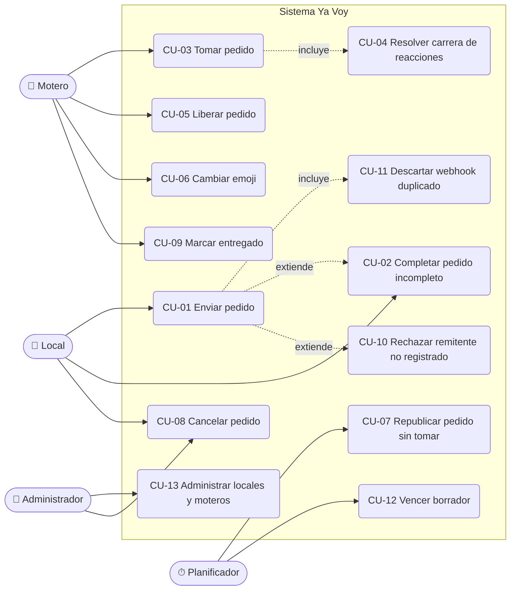

# 02 — Casos de uso

## Diagrama general



Todos los casos que parten de un evento de WhatsApp incluyen implícitamente CU-11 (deduplicación).
Las referencias a plantillas de mensaje (`store_order_published`, etc.) apuntan al
[catálogo de mensajes](07-catalogo-mensajes.md).

---

## CU-01 Enviar pedido

- **Actor:** Local. **Requisitos:** RF-01 a RF-08.
- **Precondición:** el remitente es un local registrado y activo.
- **Disparador:** el local envía un mensaje de texto al número del bot.

**Flujo principal**

1. Evolution envía el evento `messages.upsert` al webhook.
2. La API valida el secreto, inserta el evento en `inbound_events` (único por `wa_message_id`), encola el procesamiento y responde `200`.
3. El worker identifica al remitente como local registrado y toma el lock del local.
4. Como no hay borrador abierto, crea un pedido en estado `draft` y guarda el mensaje en `messages`.
5. Llama al LLM para extraer los datos al esquema `OrderExtraction` y los combina con el borrador.
6. Programa la evaluación del borrador dentro de `DRAFT_DEBOUNCE_SECONDS`.
7. Al evaluar, si no llegó otro mensaje del local en ese intervalo, valida los campos obligatorios: están completos.
8. Asigna código (`YV-0042`), cambia el estado a `published`, publica el pedido en el grupo (`group_order_post`) y guarda el id del mensaje publicado en `group_posts`.
9. Confirma al local (`store_order_published`).

**Flujos alternativos**

- **5a. El LLM falla o no responde:** se reintenta con backoff (`LLM_MAX_RETRIES`). Si se agotan los reintentos, se responde `store_processing_error` y se alerta al administrador; el borrador se conserva.
- **5b. El mensaje no parece un pedido** (por ejemplo, "hola", "gracias"): la extracción no devuelve datos. Si no hay borrador con datos, se responde `store_help` como máximo una vez cada `HELP_REPLY_COOLDOWN_MINUTES`.
- **5c. El mensaje es un comando** (`cancelar`, `ayuda`): se resuelve por código determinístico sin llamar al LLM (ver CU-08).
- **6a. Llega otro mensaje dentro del intervalo:** se combina y se reprograma la evaluación; solo la última evaluación responde.
- **7a. Faltan datos:** continúa en CU-02.
- **8a. Falla la publicación en el grupo:** el envío se reintenta desde la bandeja de salida; el pedido queda `published` y el plazo de toma comienza cuando la publicación se confirma.
- **Mensaje no textual** (audio, imagen sin texto, sticker): se responde `store_unsupported_media`.

**Postcondición:** el pedido queda `published` con al menos una fila en `group_posts`.

---

## CU-02 Completar pedido incompleto

- **Actor:** Local. **Requisitos:** RF-05, RF-07, RF-09.
- **Precondición:** el local tiene un borrador abierto con campos faltantes o inválidos.

**Flujo principal**

1. La evaluación del borrador detecta campos faltantes o inválidos.
2. El sistema responde `store_order_missing_fields` listando cada campo faltante en lenguaje natural y, si hay inválidos, el motivo (por ejemplo, "el teléfono no parece válido").
3. El local envía uno o más mensajes con los datos faltantes.
4. Cada mensaje se extrae y se combina con el borrador; se renueva `draft_expires_at`.
5. Al completarse, continúa en el paso 8 de CU-01.

**Flujos alternativos**

- **3a. El local no responde en `DRAFT_TTL_MINUTES`:** se ejecuta CU-12.
- **3b. El local corrige un dato ya cargado** ("no, la dirección es Mitre 1200"): el valor nuevo no vacío reemplaza al anterior.
- **3c. El local manda `cancelar`:** se descarta el borrador (CU-08).
- **4a. El mismo campo sigue faltando tras `MAX_MISSING_FIELDS_PROMPTS` respuestas:** se agrega a la respuesta un ejemplo de formato completo (`store_order_format_example`).

---

## CU-03 Tomar pedido

- **Actor:** Motero. **Requisitos:** RF-11 a RF-15.
- **Precondición:** el pedido está `published` o `unclaimed`; el motero está registrado y activo.
- **Disparador:** el motero reacciona con cualquier emoji a una publicación del pedido en el grupo.

**Flujo principal**

1. Llega un evento `messages.upsert` con `reactionMessage` (emoji no vacío) cuyo `key.id` apunta a una publicación del bot.
2. El worker resuelve el pedido a partir de `group_posts.wa_message_id`.
3. Resuelve al motero por `participant` (número o `@lid`) contra `couriers.phone_jid` / `couriers.lid`.
4. Ejecuta la asignación atómica:
   ```sql
   UPDATE orders
      SET courier_id = :courier_id, status = 'assigned', assigned_at = now(), updated_at = now()
    WHERE id = :order_id AND courier_id IS NULL AND status IN ('published', 'unclaimed')
   RETURNING id;
   ```
5. Devuelve una fila: el motero ganó. En la misma transacción se registra `order_events (claimed)` y se encolan en `outbound_messages`:
   - `courier_order_assigned` al motero por privado, con el detalle completo.
   - `store_order_assigned` al local.
   - `group_order_assigned` en el grupo, citando la publicación.

**Flujos alternativos**

- **3a. El participante es un `@lid` desconocido:** se intenta resolver el número consultando los metadatos del grupo en Evolution y, si se resuelve, se guarda el `lid` en `couriers`. Si no se resuelve, se ignora la reacción, se registra y se alerta al administrador (`admin_unknown_reactor`).
- **3b. El participante no es un motero registrado o está inactivo:** se ignora y se registra (RF-20).
- **4a. No devuelve filas:** carrera perdida o pedido ya no disponible; continúa en CU-04.
- **1a. La reacción es sobre un mensaje que no es una publicación de pedido:** se ignora (RN-11).

---

## CU-04 Resolver carrera de reacciones (doble reacción)

- **Actor:** Motero (dos o más). **Requisitos:** RF-12, RF-16. **Reglas:** RN-01, RN-02.

**Flujo principal**

1. Los moteros A y B reaccionan casi al mismo tiempo; llegan dos eventos y se encolan dos trabajos.
2. Los dos trabajos ejecutan el `UPDATE` condicional en paralelo. Postgres serializa la escritura sobre la fila: el primero en confirmar obtiene la fila; el segundo, al reevaluar `courier_id IS NULL`, no obtiene ninguna.
3. El ganador sigue el paso 5 de CU-03. Solo el ganador recibe el privado de asignación.
4. Para el perdedor: si `NOTIFY_LOSER_ON_RACE=true`, se le envía `courier_order_already_taken`; si no, no se hace nada. Se registra `order_events (claim_rejected)`.

**Notas**

- La garantía de unicidad la da la base de datos, no el orden de los webhooks ni el mensaje privado.
- La reacción del perdedor queda visible en el grupo; el mensaje "Asignado a {motero}" deja claro quién lo tiene.
- Si el perdedor después quita su reacción, aplica CU-05 flujo 2a (sin efecto).

---

## CU-05 Liberar pedido (quitar reacción)

- **Actor:** Motero asignado. **Requisitos:** RF-17, RF-18. **Reglas:** RN-04, RN-06.
- **Disparador:** llega un evento de reacción con `text` vacío sobre una publicación del pedido.

**Flujo principal**

1. Se resuelven pedido y motero como en CU-03.
2. Se ejecuta la liberación condicional:
   ```sql
   UPDATE orders
      SET courier_id = NULL, status = 'published', assigned_at = NULL,
          claim_deadline_at = now() + make_interval(mins => :claim_timeout), updated_at = now()
    WHERE id = :order_id AND courier_id = :courier_id AND status = 'assigned'
   RETURNING id;
   ```
3. Devuelve una fila: se registra `order_events (unclaimed_by_courier)` y se encolan `store_order_unassigned`, `group_order_unassigned` (citando la publicación) y `courier_order_released` al motero.

**Flujos alternativos**

- **2a. No devuelve filas** (quien quita no es el asignado, o el pedido ya está entregado/cancelado): no hay efecto; se registra como evento ignorado en `inbound_events.status = 'ignored'`.
- **3a. Después de liberar, otro motero que ya había reaccionado antes no se asigna automáticamente:** su reacción ya fue procesada. Para tomarlo debe volver a reaccionar (o cambiar el emoji, que llega como reacción nueva). El mensaje `group_order_unassigned` lo indica.

---

## CU-06 Cambiar emoji

- **Actor:** Motero. **Requisitos:** RF-19. **Reglas:** RN-05.

WhatsApp envía el cambio de emoji como un evento de reacción nuevo con el emoji nuevo (no envía primero una reacción vacía).

**Flujo principal**

1. Llega una reacción con emoji no vacío de un motero sobre una publicación.
2. Se intenta la asignación atómica (CU-03 paso 4).
3. Si el pedido ya está asignado a ese mismo motero, no devuelve filas y no se hace nada (no se notifica, no se considera liberación ni reasignación).

**Flujos alternativos**

- **3a. El pedido está asignado a otro motero:** se comporta como un perdedor de carrera (CU-04 paso 4), aunque no se repite el aviso "ya lo tomó otro" si ya se le envió para ese pedido (clave de idempotencia).
- **3b. El pedido estaba `published`** (por ejemplo, porque se liberó): el cambio de emoji funciona como una toma normal.

---

## CU-07 Republicar pedido sin tomar

- **Actor:** Planificador (tarea periódica del worker). **Requisitos:** RF-21, RF-22.
- **Disparador:** tarea periódica cada `SCHEDULER_INTERVAL_SECONDS` que busca pedidos `published` con `claim_deadline_at < now()`.

**Flujo principal**

1. Para cada pedido vencido, si `repost_count < MAX_REPOSTS`: incrementa `repost_count`, renueva `claim_deadline_at`, publica `group_order_repost` (nuevo mensaje en el grupo, guardado en `group_posts`) y avisa al local `store_order_reposted`.
2. Si `repost_count >= MAX_REPOSTS`: el pedido pasa a `unclaimed`; se envían `store_order_unclaimed` y `admin_order_unclaimed`.

**Flujos alternativos**

- **1a. Un motero reacciona a una publicación anterior:** es válido; todas las publicaciones del pedido sirven para tomarlo.
- **2a. Pedido `unclaimed` tomado luego:** sigue CU-03 normalmente.
- **Concurrencia:** el planificador actualiza con `WHERE status = 'published' AND claim_deadline_at < now()` y `FOR UPDATE SKIP LOCKED`, de modo que una toma simultánea gana o pierde limpiamente.

---

## CU-08 Cancelar pedido

- **Actor:** Local (o Administrador). **Requisitos:** RF-10, RF-23, RF-24. **Reglas:** RN-08.
- **Disparador:** el local envía `cancelar` (con borrador abierto), `cancelar YV-0042`, o `cancelar` citando la confirmación del pedido.

**Flujo principal**

1. El comando se detecta por código (expresión regular sobre texto normalizado, sin LLM).
2. Se resuelve el pedido: por código, por mensaje citado (`outbound_messages.wa_message_id`) o, si solo dice `cancelar`, el borrador abierto.
3. Se valida que pertenezca al local y que no esté `delivered`, `cancelled` ni `expired`.
4. Se bloquea la fila (`SELECT ... FOR UPDATE`) para conocer el estado previo y se ejecuta `UPDATE orders SET status = 'cancelled', cancelled_at = now() WHERE id = :order_id AND store_id = :store_id AND status IN ('draft', 'published', 'assigned', 'unclaimed') RETURNING courier_id`.
5. Se confirma al local (`store_order_cancelled`).
6. Si estaba publicado o asignado, se avisa en el grupo (`group_order_cancelled`). Si estaba asignado, además se avisa al motero (`courier_order_cancelled`).

**Flujos alternativos**

- **2a. `cancelar` sin código, sin borrador y con varios pedidos activos:** se responde `store_cancel_ambiguous` listando los códigos activos.
- **2b. Código inexistente o de otro local:** `store_order_not_found`.
- **3a. Pedido ya entregado o cancelado:** `store_cancel_not_allowed`.
- **Cancelación por administrador:** vía API de administración; mismas notificaciones, `actor_type = 'admin'`.

---

## CU-09 Marcar entregado

- **Actor:** Motero asignado. **Requisitos:** RF-25, RF-26. **Reglas:** RN-07.
- **Disparador:** el motero escribe por privado al bot `entregado YV-0042`, o `entregado` citando el mensaje de asignación, o solo `entregado`.

**Flujo principal**

1. Se identifica al remitente como motero registrado (por número en chat privado).
2. Se resuelve el pedido (código, mensaje citado o, si tiene uno solo asignado, ese).
3. `UPDATE orders SET status = 'delivered', delivered_at = now() WHERE id = :id AND courier_id = :courier AND status = 'assigned' RETURNING id`.
4. Se envían `courier_order_delivered_ack` y `store_order_delivered`; en el grupo, `group_order_delivered` (configurable con `ANNOUNCE_DELIVERED_IN_GROUP`).

**Flujos alternativos**

- **2a. Sin código y con varios pedidos asignados:** `courier_delivered_ambiguous` con la lista de códigos.
- **2b. Sin pedidos asignados o código de un pedido no asignado a él:** `courier_order_not_found`.
- **Otro texto por privado de un motero:** se responde `courier_help` (con límite de frecuencia).

---

## CU-10 Rechazar remitente no registrado

- **Actor:** Número desconocido. **Requisitos:** RF-02. **Reglas:** RN-10.

**Flujo principal**

1. Llega un mensaje privado de un número que no es local ni motero registrado.
2. Se guarda en `inbound_events` y `messages` (para que el administrador pueda verlo).
3. Si no se le respondió en las últimas `UNKNOWN_SENDER_REPLY_COOLDOWN_HOURS`, se envía `unknown_sender`. Si sí, no se responde.
4. Se alerta al administrador (`admin_unknown_sender`), también con límite de frecuencia por número.

**Flujos alternativos**

- **Mensajes de grupos que no son el grupo de moteros, estados (`status@broadcast`), mensajes propios (`fromMe`):** se descartan sin responder.

---

## CU-11 Descartar webhook duplicado

- **Actor:** Sistema. **Requisitos:** RF-31. **RNF:** RNF-01, RNF-03.

**Flujo principal**

1. La API recibe un evento y ejecuta:
   ```sql
   INSERT INTO inbound_events (wa_message_id, event_type, ...) VALUES (...)
   ON CONFLICT (wa_message_id) DO NOTHING
   RETURNING id;
   ```
2. Si devuelve una fila, encola el trabajo `process_inbound_event(id)`.
3. Si no devuelve filas, el evento ya se recibió: responde `200` sin encolar.

**Flujos alternativos**

- **Redis no disponible al encolar:** el evento queda en `inbound_events` con `status = 'received'`; una tarea de barrido reencola los eventos `received` con más de `INBOUND_RECOVERY_SECONDS` de antigüedad.
- **El trabajo se ejecuta dos veces** (reintento del worker): el procesamiento verifica `status = 'received'` con `SELECT ... FOR UPDATE` antes de actuar, y las transiciones de estado son condicionales, así que no hay doble efecto. Los mensajes salientes tienen `idempotency_key` única.

---

## CU-12 Vencer borrador

- **Actor:** Planificador. **Requisitos:** RF-09.

1. La tarea periódica busca pedidos `draft` con `draft_expires_at < now()`.
2. Los pasa a `expired` y envía `store_draft_expired` al local, incluyendo un resumen de lo que había cargado.
3. Un mensaje posterior del local abre un borrador nuevo.

---

## CU-13 Administrar locales y moteros

- **Actor:** Administrador. **Requisitos:** RF-27, RF-28.

1. El administrador da de alta un local (nombre, teléfono, dirección de retiro) o un motero (nombre, teléfono; el `lid` se completa automáticamente al resolverse).
2. Puede desactivar (`is_active = false`) sin borrar, para conservar el historial.
3. Puede consultar pedidos y su `order_events`, y forzar cancelación, liberación o asignación; cada acción genera los mismos mensajes que la acción equivalente del local o motero, con `actor_type = 'admin'`.

En v1 se implementa como endpoints `/admin/*` protegidos con `ADMIN_API_KEY` y un script de carga inicial (ver PA-09).
