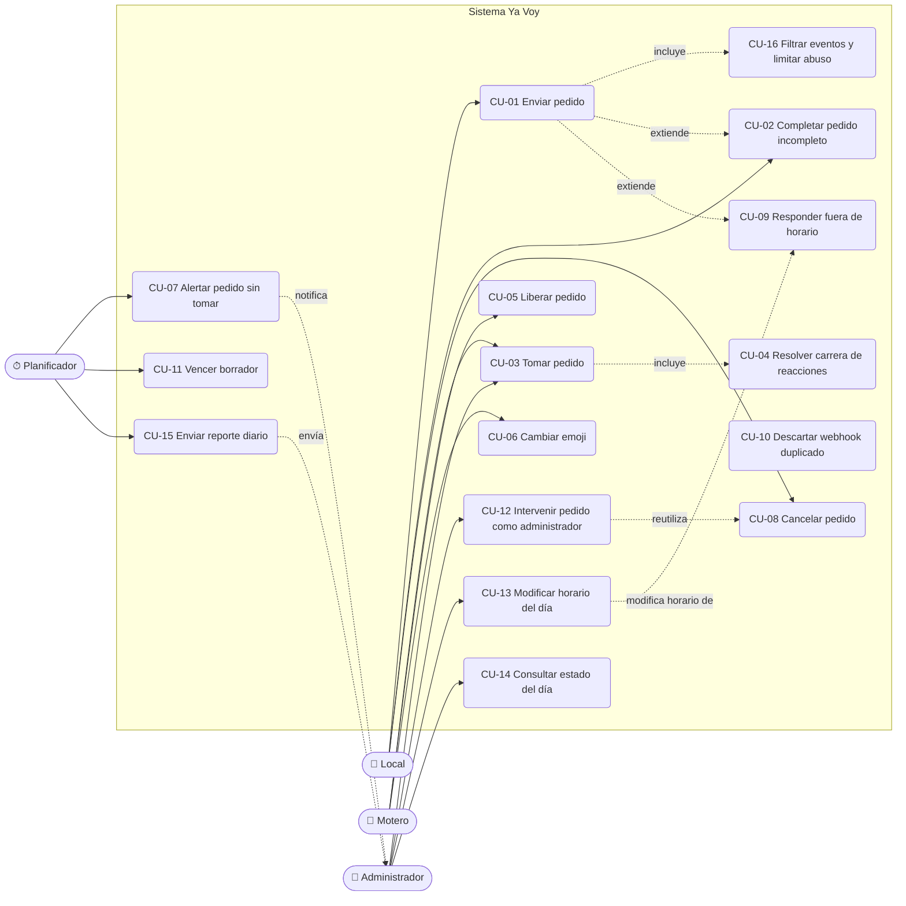

# 02 — Casos de uso

## Diagrama general



Todos los casos que parten de un evento de WhatsApp incluyen CU-10 (deduplicación) y CU-16 (filtrado).
Las referencias a plantillas de mensaje (`store_order_published`, etc.) apuntan al
[catálogo de mensajes](07-catalogo-mensajes.md).

---

## CU-01 Enviar pedido

- **Actor:** Local. **Requisitos:** RF-01 a RF-16.
- **Precondición:** el mensaje es privado, dentro del horario efectivo, y el remitente no es administrador ni motero conocido.
- **Disparador:** el local envía un mensaje de texto al número del bot.

**Flujo principal** (con el ejemplo canónico)

1. El local envía:
   ```
   📍 Dirección de retiro: casa nogal almendros
   📍 Dirección de entrega: el ceibo 2871
   🥪 Producto/: almacen
   💳Abona: transferencia
   ```
2. Evolution envía el evento `messages.upsert` al webhook. La API valida el secreto, inserta el evento en `inbound_events` (único por `wa_message_id`), encola el procesamiento y responde `200`.
3. El worker aplica el filtrado (CU-16) y clasifica al remitente como local. Si no existe en `stores`, lo crea con su JID, su número (si se puede resolver) y su `pushName`; si existe y el `pushName` cambió, lo actualiza.
4. Verifica el horario efectivo (horario base menos cierres activos).
5. Toma el lock del local. Como no hay borrador abierto, crea un pedido en estado `draft` y guarda el mensaje en `messages`.
6. Llama al LLM para extraer los datos a `OrderExtraction` y los combina con el borrador.
7. Programa la evaluación del borrador dentro de `DRAFT_DEBOUNCE_SECONDS`.
8. Al evaluar, si no llegó otro mensaje del local en ese intervalo, valida los campos obligatorios: están completos.
9. Asigna código (`YV-0042`), cambia el estado a `published`, fija `unclaimed_alert_at`, publica el pedido en el grupo (`group_order_post`) y guarda el id del mensaje publicado en `orders.group_message_id`.
10. Confirma al local (`store_order_published`).

**Flujos alternativos**

- **3a. El remitente es el administrador:** se procesa como mensaje de administrador (CU-12, CU-13 o CU-14).
- **3b. El remitente es un motero conocido:** nunca es un pedido; se responde `courier_help` (con límite de frecuencia).
- **4a. Fuera del horario efectivo:** continúa en CU-09.
- **5a. El mensaje es un comando** (`cancelar`, `ayuda`): se resuelve por código determinístico sin llamar al LLM (CU-08).
- **6a. El LLM falla o no responde:** se reintenta con backoff (`LLM_MAX_RETRIES`). Si se agotan los reintentos, se responde `store_processing_error` y se alerta al administrador (`admin_llm_failure`); el borrador se conserva.
- **6b. El mensaje no parece un pedido** ("hola", "gracias"): la extracción no devuelve datos. Si el borrador no tiene datos, se responde `store_help` como máximo una vez cada `HELP_REPLY_COOLDOWN_MINUTES` y el borrador vacío se descarta.
- **7a. Llega otro mensaje dentro del intervalo:** se combina y se reprograma la evaluación; solo la última evaluación responde.
- **8a. Faltan datos:** continúa en CU-02.
- **8b. El horario efectivo terminó entre el último mensaje y la evaluación:** se publica igual, porque el último mensaje llegó dentro de horario (RN-17).
- **9a. Falla la publicación en el grupo:** el envío se reintenta desde la bandeja de salida; el plazo de alerta se cuenta desde que la publicación se confirma.
- **Mensaje no textual** (audio, imagen sin texto, sticker): se responde `store_unsupported_media`.

**Postcondición:** el pedido queda `published` con `group_message_id` no nulo.

---

## CU-02 Completar pedido incompleto

- **Actor:** Local. **Requisitos:** RF-13, RF-15, RF-17.
- **Precondición:** el local tiene un borrador abierto con campos faltantes.

**Flujo principal**

1. Por ejemplo, el local envía las tres primeras líneas del ejemplo canónico, sin `Abona`.
2. La evaluación del borrador detecta que falta `payment_method`.
3. El sistema responde `store_order_missing_fields` ("Me falta: cómo abona (efectivo, transferencia, ya pagado u otro)").
4. El local envía "transferencia".
5. El mensaje se extrae y se combina con el borrador; se renueva `draft_expires_at`.
6. Al completarse, continúa en el paso 9 de CU-01.

**Flujos alternativos**

- **4a. El local no responde en `DRAFT_TTL_MINUTES`:** se ejecuta CU-11.
- **4b. El local corrige un dato ya cargado** ("no, la entrega es el ceibo 2900"): el valor nuevo no vacío reemplaza al anterior.
- **4c. El local manda `cancelar`:** se descarta el borrador (CU-08).
- **4d. El dato faltante llega fuera del horario efectivo** (después de las 23:00 o durante un cierre): recibe la respuesta de CU-09, no se combina y el borrador vence solo (RN-17).
- **5a. El mismo campo sigue faltando tras `MAX_MISSING_FIELDS_PROMPTS` respuestas:** se agrega `store_order_format_example` con el ejemplo canónico.

---

## CU-03 Tomar pedido

- **Actor:** Motero (incluido el administrador cuando reacciona en el grupo). **Requisitos:** RF-19 a RF-23, RF-28.
- **Precondición:** el pedido está `published`.
- **Disparador:** un participante del grupo de moteros reacciona con cualquier emoji a la publicación del pedido.

**Flujo principal**

1. Llega un evento `messages.upsert` con `reactionMessage` (emoji no vacío) cuyo `reactionMessage.key.id` apunta a una publicación del bot.
2. El worker resuelve el pedido por `orders.group_message_id`.
3. Resuelve al motero por el id del participante (`key.participant`) y sus campos alternativos: busca por `couriers.lid` o `couriers.phone_jid`. Si no existe, lo crea (alta automática) con los identificadores disponibles y su `pushName`. Si existe, completa los identificadores que falten y actualiza el nombre si cambió.
4. Ejecuta la asignación atómica:
   ```sql
   UPDATE orders
      SET courier_id = :courier_id, last_courier_id = :courier_id,
          status = 'assigned', assigned_at = now(), updated_at = now()
    WHERE id = :order_id AND courier_id IS NULL AND status = 'published'
   RETURNING id;
   ```
5. Devuelve una fila: el motero ganó y el pedido queda resuelto (no hay seguimiento de entrega). En la misma transacción se registra `order_events (claimed)` y se encolan en `outbound_messages`:
   - `courier_order_assigned` al motero por privado, con el detalle del pedido.
   - `store_order_assigned` al local ("Tu motero para este pedido será {courier_name}").
   - `group_order_assigned` en el grupo, citando la publicación.

**Flujos alternativos**

- **1a. La reacción es sobre un mensaje que no es una publicación de pedido:** se ignora (RN-12).
- **3a. El evento no trae `pushName`:** se usa el último nombre conocido o, si no hay, `COURIER_FALLBACK_NAME` ("Motero").
- **3b. El evento trae un `lid` y un número que coinciden con dos filas distintas de `couriers`:** se fusionan en la fila más antigua (se reasignan sus referencias) y se registra el hecho en el log.
- **3c. El motero está bloqueado (`is_blocked`):** se ignora la reacción.
- **4a. No devuelve filas:** carrera perdida o pedido no disponible; continúa en CU-04.

---

## CU-04 Resolver carrera de reacciones (doble reacción)

- **Actor:** Motero (dos o más). **Requisitos:** RF-20, RF-24. **Reglas:** RN-01, RN-02.

**Flujo principal**

1. Los moteros A y B reaccionan casi al mismo tiempo; llegan dos eventos y se encolan dos trabajos.
2. Los dos trabajos ejecutan el `UPDATE` condicional en paralelo. Postgres serializa la escritura sobre la fila: el primero en confirmar obtiene la fila; el segundo, al reevaluar `courier_id IS NULL`, no obtiene ninguna.
3. El ganador sigue el paso 5 de CU-03. Solo el ganador recibe el privado de asignación.
4. Al perdedor se le envía `courier_order_already_taken` (si `NOTIFY_LOSER_ON_RACE=true`, por defecto) y se registra `order_events (claim_rejected)`.

**Notas**

- La garantía de unicidad la da la base de datos, no el orden de los webhooks ni el mensaje privado.
- La reacción del perdedor queda visible en el grupo; el mensaje "Asignado a {motero}" deja claro quién lo tiene.
- Si el perdedor después quita su reacción, aplica CU-05 flujo 2a (sin efecto).

---

## CU-05 Liberar pedido (quitar reacción)

- **Actor:** Motero asignado. **Requisitos:** RF-25, RF-26. **Reglas:** RN-04, RN-06.
- **Disparador:** llega un evento de reacción con `text` vacío sobre la publicación del pedido.

**Flujo principal**

1. Se resuelven pedido y motero como en CU-03.
2. Se ejecuta la liberación condicional:
   ```sql
   UPDATE orders
      SET courier_id = NULL, status = 'published', assigned_at = NULL,
          unclaimed_alert_at = now() + make_interval(mins => :unclaimed_alert_minutes),
          unclaimed_alert_sent_at = NULL, updated_at = now()
    WHERE id = :order_id AND courier_id = :courier_id AND status = 'assigned'
   RETURNING id;
   ```
3. Devuelve una fila: se registra `order_events (released_by_courier)` y se encolan `store_order_unassigned`, `group_order_unassigned` (citando la publicación) y `courier_order_released` al motero.

**Flujos alternativos**

- **2a. No devuelve filas** (quien quita no es el asignado, o el pedido está cancelado): no hay efecto; `inbound_events.status = 'ignored'`.
- **3a. Otro motero que había reaccionado antes no se asigna automáticamente:** su reacción ya fue procesada. Para tomarlo debe volver a reaccionar (o cambiar el emoji, que llega como reacción nueva). `group_order_unassigned` lo indica.
- **Liberación después del cierre del día:** el pedido vuelve a quedar pendiente y demora el reporte diario hasta que se resuelva (CU-15).

---

## CU-06 Cambiar emoji

- **Actor:** Motero. **Requisitos:** RF-27. **Reglas:** RN-05.

WhatsApp envía el cambio de emoji como un evento de reacción nuevo con el emoji nuevo (no envía antes una reacción vacía).

**Flujo principal**

1. Llega una reacción con emoji no vacío de un motero sobre una publicación.
2. Se intenta la asignación atómica (CU-03 paso 4).
3. Si el pedido ya está asignado a ese mismo motero, no devuelve filas y no se hace nada.

**Flujos alternativos**

- **3a. El pedido está asignado a otro motero:** se comporta como un perdedor de carrera (CU-04 paso 4); el aviso "ya lo tomó otro" no se repite si ya se le envió para ese pedido (clave de idempotencia).
- **3b. El pedido estaba `published`** (por ejemplo, porque se liberó): funciona como una toma normal.

---

## CU-07 Alertar pedido sin tomar

- **Actor:** Planificador. **Requisitos:** RF-29. **Reglas:** RN-18.
- **Disparador:** tarea periódica cada `SCHEDULER_INTERVAL_SECONDS` que busca pedidos `published` con `unclaimed_alert_at < now()` y `unclaimed_alert_sent_at IS NULL`.

**Flujo principal**

1. Para cada pedido encontrado (`FOR UPDATE SKIP LOCKED`), fija `unclaimed_alert_sent_at = now()`, registra `order_events (unclaimed_alert_sent)` y encola `admin_order_unclaimed`.
2. El pedido sigue `published` y se puede tomar normalmente. No se republica ni se avisa al local.
3. El administrador decide: esperar, avisar a los moteros por su cuenta, tomarlo él mismo reaccionando o cancelarlo (CU-12).

**Flujos alternativos**

- **1a. Un motero toma el pedido justo en ese momento:** la condición `status = 'published'` en el `UPDATE` de la alerta y el bloqueo de la fila hacen que gane una sola de las dos operaciones; si ganó la toma, no se alerta.
- **Pedido liberado después de la alerta:** el plazo se reinicia (CU-05) y puede generar una nueva alerta.

---

## CU-08 Cancelar pedido

- **Actor:** Local. **Requisitos:** RF-18, RF-30, RF-31. **Reglas:** RN-08.
- **Disparador:** el local envía `cancelar` (con borrador abierto), `cancelar YV-0042`, o `cancelar` citando la confirmación del pedido. Funciona a cualquier hora.

**Flujo principal**

1. El comando se detecta por código (expresión regular sobre texto normalizado, sin LLM).
2. Se resuelve el pedido: por código, por mensaje citado (`outbound_messages.wa_message_id`) o, si solo dice `cancelar`, el borrador abierto.
3. Se valida que pertenezca al local y que no esté `cancelled` ni `expired`.
4. Se bloquea la fila (`SELECT ... FOR UPDATE`) para conocer el estado previo y se ejecuta `UPDATE orders SET status = 'cancelled', cancelled_at = now(), cancelled_by = 'store', courier_id = NULL WHERE id = :order_id AND store_id = :store_id AND status IN ('draft', 'published', 'assigned') RETURNING id`.
5. Se confirma al local (`store_order_cancelled` o `store_draft_cancelled`).
6. Si estaba publicado o asignado, se avisa en el grupo (`group_order_cancelled`). Si estaba asignado, además se avisa al motero (`courier_order_cancelled`).

**Flujos alternativos**

- **2a. `cancelar` sin código, sin borrador y con varios pedidos activos:** `store_cancel_ambiguous` con los códigos activos. Con uno solo activo, se cancela ese.
- **2b. Código inexistente o de otro local:** `store_order_not_found`.
- **3a. Pedido ya cancelado o vencido:** `store_cancel_not_allowed`.

---

## CU-09 Responder fuera de horario

- **Actor:** Local. **Requisitos:** RF-07 a RF-10. **Reglas:** RN-17, RN-22, RN-23.

**Flujo principal**

1. Llega un mensaje de un local (no comando) y `is_accepting_orders(now)` es falso: está fuera del horario base o hay un cierre activo.
2. Se guarda en `messages`, sin llamar al LLM ni crear o modificar borradores.
3. Si no se le respondió en los últimos `OUT_OF_HOURS_REPLY_COOLDOWN_MINUTES`, se envía la plantilla que corresponde al motivo:
   - fuera del horario base → `store_out_of_hours`;
   - cierre `closed_today` → `store_closed_today` ("🚫 Hoy no tomamos pedidos por lluvia.");
   - cierre `closed_until_further_notice` → `store_closed_until_further_notice`;
   - cierre `closed_window` → `store_closed_window` (con el horario de reapertura).
   Si el cierre tiene motivo, se incluye.

**Flujos alternativos**

- **1a. El mensaje es `cancelar ...`:** se procesa normalmente (CU-08).
- **3a. Hay varios cierres superpuestos:** se usa el de mayor alcance (`closed_until_further_notice` > `closed_today` > `closed_window`).
- El alta automática del local (CU-01 paso 3) sí ocurre fuera de horario, para conservar su nombre e historial.

---

## CU-10 Descartar webhook duplicado

- **Actor:** Sistema. **Requisitos:** RF-48. **RNF:** RNF-01, RNF-03.

**Flujo principal**

1. La API recibe un evento y ejecuta:
   ```sql
   INSERT INTO inbound_events (wa_message_id, event_type, ...) VALUES (...)
   ON CONFLICT (wa_message_id) DO NOTHING
   RETURNING id;
   ```
2. Si devuelve una fila, encola `process_inbound_event(id)`.
3. Si no devuelve filas, el evento ya se recibió: responde `200` sin encolar.

**Flujos alternativos**

- **Redis no disponible al encolar:** el evento queda con `status = 'received'`; una tarea de barrido reencola los eventos `received` con más de `INBOUND_RECOVERY_SECONDS`.
- **El trabajo se ejecuta dos veces** (reintento del worker): el procesamiento toma el evento con `SELECT ... FOR UPDATE` y verifica `status = 'received'`; las transiciones son condicionales y los mensajes salientes tienen `idempotency_key` única, así que no hay doble efecto.

---

## CU-11 Vencer borrador

- **Actor:** Planificador. **Requisitos:** RF-17.

1. La tarea periódica busca pedidos `draft` con `draft_expires_at < now()`.
2. Los pasa a `expired` y envía `store_draft_expired` al local.
3. Un mensaje posterior del local (dentro del horario efectivo) abre un borrador nuevo.

---

## CU-12 Intervenir pedido como administrador

- **Actor:** Administrador. **Requisitos:** RF-32.
- **Precondición:** el remitente privado es un número de `ADMIN_PHONES`.

**Flujo principal**

1. El administrador escribe `cancelar YV-0042` o `liberar YV-0042`.
2. Se resuelve el pedido por código (cualquier local).
3. Se ejecuta la transición equivalente con `actor_type = 'admin'`:
   - `cancelar`: como CU-08 pasos 4 y 6, con `cancelled_by = 'admin'`; el local recibe `store_order_cancelled_by_admin`.
   - `liberar`: como CU-05 paso 2 sin la condición de motero (`WHERE status = 'assigned'`); el local y el grupo reciben las mismas notificaciones y el motero recibe `courier_order_released_by_admin`.
4. Se confirma al administrador con `admin_command_ok`.

**Flujos alternativos**

- **2a. Código inexistente o estado que no admite la acción:** `admin_command_error` con el motivo.
- **Texto que no es comando:** se intenta interpretar como cambio de horario (CU-13).

---

## CU-13 Modificar horario del día

- **Actor:** Administrador. **Requisitos:** RF-34 a RF-37, RF-46. **Reglas:** RN-21 a RN-24.
- **Precondición:** el remitente privado es un número de `ADMIN_PHONES` y el texto no es un comando (`cancelar`, `liberar`, `estado`, `horario`, `ayuda`) ni una respuesta de confirmación.

**Flujo principal** (ejemplo: "hoy no tomamos pedidos por lluvia")

1. El worker llama al LLM con el texto, la fecha y hora actual en `TZ` y el horario base, y obtiene un `ScheduleOverrideIntent`: `kind = closed_today`, `reason = "lluvia"`.
2. Valida el resultado con código (ver [modelo de datos](05-modelo-datos.md)) y calcula el período concreto: desde ahora hasta el fin del día local.
3. Si el administrador tenía otra solicitud pendiente, la marca `superseded`.
4. Inserta en `schedule_overrides` con `status = 'pending_confirmation'` y `confirmation_expires_at = now() + SCHEDULE_CONFIRMATION_TTL_MINUTES`.
5. Responde `admin_schedule_confirm`: "Entendí esto: hoy 09/10 no se toman pedidos (motivo: lluvia). ¿Lo aplico? Respondé *sí* o *no*."
6. El administrador responde "sí" dentro del plazo.
7. `UPDATE schedule_overrides SET status = 'active', confirmed_at = now() WHERE id = :id AND status = 'pending_confirmation' AND confirmation_expires_at > now() RETURNING id`.
8. Responde `admin_schedule_applied` con el estado resultante. Desde ese momento, los locales que escriben reciben `store_closed_today` (CU-09).

**Variantes por tipo**

| Mensaje del administrador | `kind` | Período aplicado |
|---------------------------|--------|------------------|
| "hoy no tomamos pedidos por lluvia" | `closed_today` | Desde la confirmación hasta las 24:00 de hoy; motivo "lluvia". |
| "hoy no tomamos pedidos hasta nuevo aviso" | `closed_until_further_notice` | Desde la confirmación, sin fin (`ends_at` nulo). |
| "de 15 a 18 no tomaremos pedidos hoy" | `closed_window` | Hoy de 15:00 a 18:00. |
| "ya tomamos pedidos de nuevo" | `reopen` | Al confirmar, se levantan (`cancelled_at`) los cierres en vigor en ese momento; los cierres futuros se mantienen y se listan en el resumen. |

**Flujos alternativos**

- **1a. El LLM indica que no es una instrucción de horario** (`kind` nulo): se responde `admin_help`.
- **1b. El LLM falla:** `admin_schedule_parse_error`; no se cambia nada.
- **2a. Validación fallida** (ventana en el pasado, inicio posterior al fin, fecha pasada, ventana totalmente fuera del horario base): `admin_schedule_invalid` con el motivo; no se crea solicitud.
- **2b. `reopen` sin cierres en vigor:** `admin_schedule_nothing_to_reopen`, sin pedir confirmación.
- **6a. El administrador responde "no":** `status = 'rejected'`, `admin_schedule_rejected`.
- **6b. Responde "sí" con la solicitud vencida:** `admin_schedule_confirmation_expired`; no se aplica.
- **6c. Escribe otra instrucción en lugar de confirmar:** la solicitud anterior pasa a `superseded` y se procesa la nueva desde el paso 1.
- **6d. No responde:** una tarea periódica marca `expired` las solicitudes con `confirmation_expires_at < now()`; no se envía mensaje.
- **8a. Cierre "hasta nuevo aviso" vigente al comenzar un nuevo día:** al llegar `BUSINESS_HOURS_START` se envía `admin_schedule_still_closed` (una vez por día).

**Postcondición:** el cierre queda `active` (o el `reopen` queda `applied` con los cierres levantados), con el texto original y la interpretación guardados.

---

## CU-14 Consultar estado del día

- **Actor:** Administrador. **Requisitos:** RF-33.

1. El administrador escribe `estado` u `horario`.
2. El sistema responde `admin_schedule_status` con: fecha, horario base, cierres activos y futuros (con motivo), si ahora se están tomando pedidos, solicitud pendiente de confirmación (si hay), pedidos sin tomar (códigos) y conteos del día (publicados, tomados, cancelados).

---

## CU-15 Enviar reporte diario

- **Actor:** Planificador. **Requisitos:** RF-39 a RF-44. **Reglas:** RN-19, RN-20.
- **Disparador:** tarea periódica (cada `SCHEDULER_INTERVAL_SECONDS`).

**Flujo principal**

1. Determina las fechas a procesar: la fecha de hoy si ya pasó `DAILY_REPORT_TIME` en `TZ`, más cualquier fecha anterior con reporte en `waiting` o `failed`.
2. Para la fecha D, inserta `daily_reports (report_date = D, status = 'waiting')` con `ON CONFLICT (report_date) DO NOTHING`.
3. Toma la fila con `FOR UPDATE SKIP LOCKED` y cuenta los pedidos pendientes de D (creados en D con `status IN ('draft', 'published')`).
4. No hay pendientes: pasa a `generating`, consulta los datos de D (hoja `Resumen` desde `order_events` y hoja `Pedidos` desde `orders`), genera el `.xlsx` con openpyxl, lo guarda en `file_content` y pasa a `generated`.
5. Encola un `outbound_messages` de tipo documento (`admin_daily_report`) por cada número de `ADMIN_PHONES`, con `idempotency_key = 'daily_report:{D}:{phone}'`.
6. Cuando todos los envíos quedan `sent`, el reporte pasa a `status = 'sent'`.

**Flujos alternativos**

- **3a. Hay pedidos pendientes:** el reporte queda en `waiting` (con `pending_orders_count` actualizado) y se vuelve a verificar en la próxima ejecución. Los borradores abiertos vencen solos en `DRAFT_TTL_MINUTES`; los pedidos publicados dependen de que alguien los tome o los cancele.
- **3b. Sigue en `waiting` al llegar `REPORT_PENDING_REMINDER_TIME`** (01:00 del día siguiente a D): se envía una vez `admin_report_pending_reminder` con los códigos pendientes y se fija `pending_reminder_sent_at`.
- **3c. El administrador cancela o alguien toma los pendientes:** en la siguiente verificación no quedan pendientes y continúa en el paso 4.
- **El worker estuvo caído a la hora del reporte:** al volver, la tarea detecta la fecha sin reporte enviado y la procesa.
- **El worker se cae a mitad de la generación:** un reporte en `generating` por más de 10 minutos se trata como `failed` y se reintenta.
- **Falla la generación:** `status = 'failed'`, `attempts + 1`; se reintenta hasta `DAILY_REPORT_MAX_ATTEMPTS` y luego se envía `admin_daily_report_failed`.
- **Día sin pedidos o cerrado por el administrador:** se envía igual el archivo (hojas con encabezados); el pie indica los cierres del día.
- **Motero conocido solo por `@lid`:** la columna teléfono queda vacía (ver riesgos en [arquitectura](06-arquitectura.md)).
- **Un pedido de D se cancela o libera después de enviado el reporte:** queda en la auditoría; el reporte no se reenvía (PA-04).

---

## CU-16 Filtrar eventos y limitar abuso

- **Actor:** Sistema. **Requisitos:** RF-02, RF-05, RF-06.

1. Se descartan sin procesar: mensajes `fromMe`, mensajes de grupos distintos de `COURIERS_GROUP_JID`, estados (`status@broadcast`), mensajes del grupo de moteros que no son reacciones a publicaciones, y eventos que no son `messages.upsert` ni `connection.update`.
2. Se cuenta cada mensaje privado por remitente en Redis (ventana de un minuto). Si supera `SENDER_RATE_LIMIT_PER_MINUTE`, se registra con `inbound_events.status = 'ignored'` y no se procesa ni se responde. La primera vez que un remitente excede el límite en el día se alerta al administrador (`admin_rate_limited_sender`).
3. Los remitentes con `is_blocked = true` se ignoran siempre.
4. Los mensajes privados de moteros conocidos se responden solo con `courier_help` (con límite de frecuencia); nunca abren borradores.
