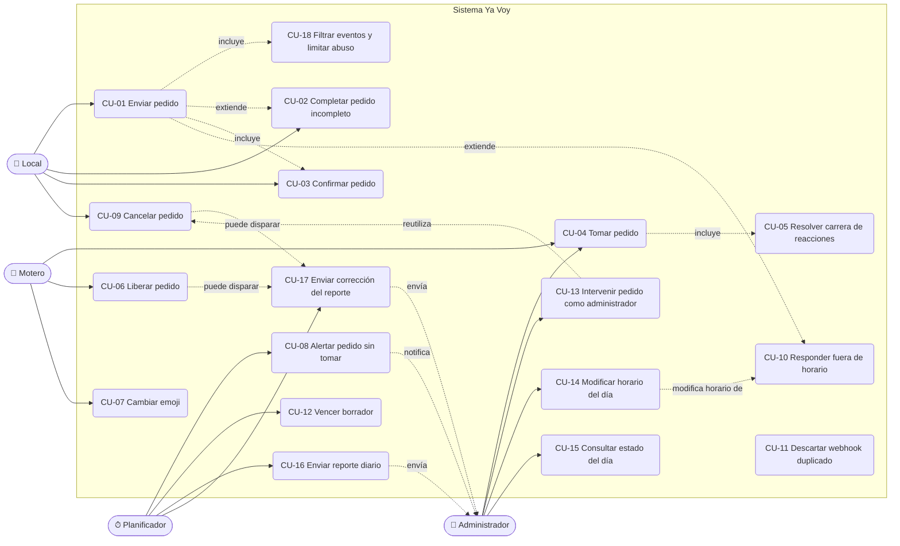

# 02 — Casos de uso

## Diagrama general



Todos los casos que parten de un evento de WhatsApp incluyen CU-11 (deduplicación) y CU-18 (filtrado).
Las referencias a plantillas de mensaje (`store_order_published`, etc.) apuntan al
[catálogo de mensajes](07-catalogo-mensajes.md) y las transiciones (`Txx`) a la
[máquina de estados](03-estados-pedido.md).

---

## CU-01 Enviar pedido

- **Actor:** Local. **Requisitos:** RF-01 a RF-17.
- **Precondición:** el mensaje es privado, dentro del horario efectivo, y el remitente no es administrador ni motero conocido.
- **Disparador:** el local envía un mensaje de texto al número del bot.

**Flujo principal** (con el ejemplo canónico)

1. El local envía:
   ```
   📍 Dirección de retiro: casa nogal almendros
   📍 Dirección de entrega: el ceibo 2871
   🥪 Producto/: almacen
   💳Abona: transferencia
   ```
2. Evolution envía el evento `messages.upsert` al webhook. La API valida el secreto, inserta el evento en `inbound_events` (único por `wa_message_id`), encola el procesamiento y responde `200`.
3. El worker aplica el filtrado (CU-18) y clasifica al remitente como local. Si no existe en `stores`, lo crea con su JID, su número (si se puede resolver) y su `pushName`; si existe y el `pushName` cambió, lo actualiza.
4. Verifica el horario efectivo (`is_accepting_orders(now)`).
5. Toma el lock del local. Como no tiene un pedido en preparación, crea un pedido en estado `draft` con su `business_date` y guarda el mensaje en `messages`.
6. Llama al LLM para extraer los datos a `OrderExtraction` y los combina con el borrador.
7. Programa la evaluación del borrador dentro de `DRAFT_DEBOUNCE_SECONDS`.
8. Al evaluar, si no llegó otro mensaje del local en ese intervalo, valida los campos obligatorios: están completos.
9. El pedido pasa a `awaiting_confirmation` (T04) y se le envía al local `store_order_confirm_request` con el resumen completo. Continúa en CU-03.

**Flujos alternativos**

- **3a. El remitente es el administrador:** se procesa como mensaje de administrador (CU-13, CU-14 o CU-15).
- **3b. El remitente es un motero conocido:** nunca es un pedido; se responde `courier_help` (con límite de frecuencia).
- **4a. Fuera del horario efectivo:** continúa en CU-10.
- **5a. El mensaje es un comando** (`cancelar`, `ayuda`, `sí`, `no`): se resuelve por código determinístico sin llamar al LLM (CU-03, CU-09).
- **6a. El LLM falla o no responde:** se reintenta con backoff (`LLM_MAX_RETRIES`). Si se agotan los reintentos, se responde `store_processing_error` y se alerta al administrador (`admin_llm_failure`); el borrador se conserva.
- **6b. El mensaje no parece un pedido** ("hola", "gracias"): la extracción no devuelve datos. Si el borrador no tiene datos, se responde `store_help` como máximo una vez cada `HELP_REPLY_COOLDOWN_MINUTES` y el borrador vacío se descarta.
- **7a. Llega otro mensaje dentro del intervalo:** se combina y se reprograma la evaluación; solo la última evaluación responde.
- **8a. Faltan datos:** continúa en CU-02.
- **Mensaje no textual** (audio, imagen sin texto, sticker): se responde `store_unsupported_media`.

**Postcondición:** el pedido queda `awaiting_confirmation`.

---

## CU-02 Completar pedido incompleto

- **Actor:** Local. **Requisitos:** RF-14, RF-16, RF-21.
- **Precondición:** el local tiene un borrador abierto con campos faltantes.

**Flujo principal**

1. Por ejemplo, el local envía las tres primeras líneas del ejemplo canónico, sin `Abona`.
2. La evaluación del borrador detecta que falta `payment_method`.
3. El sistema responde `store_order_missing_fields` ("Me falta: cómo abona (efectivo, transferencia, ya pagado u otro)").
4. El local envía "transferencia".
5. El mensaje se extrae y se combina con el borrador; se renueva `draft_expires_at`.
6. Al completarse, continúa en el paso 9 de CU-01 (resumen y pedido de confirmación).

**Flujos alternativos**

- **4a. El local no responde en `DRAFT_TTL_MINUTES`:** se ejecuta CU-12.
- **4b. El local corrige un dato ya cargado** ("no, la entrega es el ceibo 2900"): el valor nuevo no vacío reemplaza al anterior.
- **4c. El local manda `cancelar`:** se descarta el borrador (CU-09).
- **4d. El dato faltante llega fuera del horario efectivo:** recibe la respuesta de CU-10, no se combina y el borrador vence solo (RN-18).
- **5a. El mismo campo sigue faltando tras `MAX_MISSING_FIELDS_PROMPTS` respuestas:** se agrega `store_order_format_example` con el ejemplo canónico.

---

## CU-03 Confirmar pedido

- **Actor:** Local. **Requisitos:** RF-17 a RF-21. **Reglas:** RN-15, RN-18.
- **Precondición:** el pedido del local está `awaiting_confirmation` y el local recibió `store_order_confirm_request`:
  ```
  📝 Revisá tu pedido:

  🏪 Local: Casa Nogal
  📍 Retiro: casa nogal almendros
  📍 Entrega: el ceibo 2871
  🥪 Producto: almacen
  💳 Abona: transferencia

  ¿Confirmás el pedido? Respondé SÍ para enviarlo o corregí lo que haga falta.
  ```

**Flujo principal**

1. El local responde `sí` (o `si`, `dale`, `ok`, `confirmo`, 👍), detectado por código sin LLM.
2. Se verifica el horario efectivo.
3. En una transacción: `UPDATE orders SET status = 'published', code = ..., confirmed_at = now(), published_at = now(), unclaimed_alert_at = ... WHERE id = :order_id AND status = 'awaiting_confirmation' RETURNING id` (T06), `order_events (confirmed, published)` y los mensajes `group_order_post` y `store_order_published` en la bandeja de salida.
4. Se publica en el grupo y se guarda el `key.id` en `orders.group_message_id`.
5. Se le confirma al local con el código (`store_order_published`).

**Flujos alternativos**

- **1a. El local envía una corrección** ("la entrega es el ceibo 2900"): el pedido vuelve a `draft` (T05), se extrae y combina, y al evaluar se reenvía un resumen nuevo (o se piden los datos que falten). El resumen anterior deja de valer (RN-15).
- **1b. El local responde `no` o `cancelar`:** el pedido pasa a `cancelled` (T08) y se envía `store_draft_cancelled`.
- **1c. El local no responde en `DRAFT_TTL_MINUTES`:** vence (CU-12).
- **1d. El local responde `sí` citando un resumen viejo** (ya reemplazado por uno nuevo): se toma como confirmación del resumen vigente solo si no hubo correcciones posteriores; si las hubo, se le reenvía el resumen vigente.
- **2a. Fuera del horario efectivo:** no se publica (T07); se responde `store_order_not_sent_closed` con el motivo del cierre y el pedido vence solo.
- **4a. Falla la publicación en el grupo:** el envío se reintenta desde la bandeja de salida; el plazo de alerta se cuenta desde que la publicación se confirma.

**Postcondición:** el pedido queda `published` con `group_message_id` no nulo.

---

## CU-04 Tomar pedido

- **Actor:** Motero (incluido el administrador cuando reacciona en el grupo). **Requisitos:** RF-22 a RF-26, RF-31.
- **Precondición:** el pedido está `published`.
- **Disparador:** un participante del grupo de moteros reacciona con cualquier emoji a la publicación del pedido.

**Flujo principal**

1. Llega un evento `messages.upsert` con `reactionMessage` (emoji no vacío) cuyo `reactionMessage.key.id` apunta a una publicación del bot.
2. El worker resuelve el pedido por `orders.group_message_id`.
3. Resuelve al motero por el id del participante (`key.participant`) y sus campos alternativos: busca por `couriers.lid` o `couriers.phone_jid`. Si no existe, lo crea (alta automática) con los identificadores disponibles y su `pushName`. Si existe, completa los identificadores que falten y actualiza el nombre si cambió.
4. Ejecuta la asignación atómica (T10):
   ```sql
   UPDATE orders
      SET courier_id = :courier_id, last_courier_id = :courier_id,
          status = 'assigned', assigned_at = now(), updated_at = now()
    WHERE id = :order_id AND courier_id IS NULL AND status = 'published'
   RETURNING id;
   ```
5. Devuelve una fila: el motero ganó y el pedido queda resuelto. En la misma transacción se registra `order_events (claimed)` y se encolan:
   - `courier_order_assigned` al motero por privado, con el detalle del pedido.
   - `store_order_assigned` al local ("Tu motero para este pedido será {courier_name}").
   - `group_order_assigned` en el grupo, citando la publicación.

**Flujos alternativos**

- **1a. La reacción es sobre un mensaje que no es una publicación de pedido:** se ignora (RN-12).
- **2a. El pedido está `cancelled`** (la publicación ya se eliminó o se está eliminando): se ignora (T19); si `NOTIFY_REACTION_ON_CANCELLED=true`, se envía `courier_order_no_longer_available` una vez por motero y pedido.
- **3a. El evento no trae `pushName`:** se usa el último nombre conocido o, si no hay, `COURIER_FALLBACK_NAME` ("Motero").
- **3b. El evento trae un `lid` y un número que coinciden con dos filas distintas de `couriers`:** se fusionan en la fila más antigua (se reasignan sus referencias) y se registra el hecho en el log.
- **3c. El motero está bloqueado (`is_blocked`):** se ignora la reacción.
- **4a. No devuelve filas:** carrera perdida, pedido cancelado en ese instante o ya asignado; continúa en CU-05 (o en 2a si quedó cancelado).

---

## CU-05 Resolver carrera de reacciones (doble reacción)

- **Actor:** Motero (dos o más). **Requisitos:** RF-23, RF-27. **Reglas:** RN-01, RN-02.

**Flujo principal**

1. Los moteros A y B reaccionan casi al mismo tiempo; llegan dos eventos y se encolan dos trabajos.
2. Los dos trabajos ejecutan el `UPDATE` condicional en paralelo. Postgres serializa la escritura sobre la fila: el primero en confirmar obtiene la fila; el segundo, al reevaluar `courier_id IS NULL`, no obtiene ninguna.
3. El ganador sigue el paso 5 de CU-04. Solo el ganador recibe el privado de asignación.
4. Al perdedor se le envía `courier_order_already_taken` (si `NOTIFY_LOSER_ON_RACE=true`, por defecto) y se registra `order_events (claim_rejected)`.

**Notas**

- La garantía de unicidad la da la base de datos, no el orden de los webhooks ni el mensaje privado.
- El mismo mecanismo resuelve la carrera entre una toma y una cancelación (CU-09).
- Si el perdedor después quita su reacción, aplica CU-06 flujo 2a (sin efecto).

---

## CU-06 Liberar pedido (quitar reacción)

- **Actor:** Motero asignado. **Requisitos:** RF-28, RF-29. **Reglas:** RN-04, RN-06.
- **Disparador:** llega un evento de reacción con `text` vacío sobre la publicación del pedido.

**Flujo principal**

1. Se resuelven pedido y motero como en CU-04.
2. Se ejecuta la liberación condicional (T13):
   ```sql
   UPDATE orders
      SET courier_id = NULL, status = 'published', assigned_at = NULL,
          unclaimed_alert_at = now() + make_interval(mins => :unclaimed_alert_minutes),
          unclaimed_alert_sent_at = NULL, updated_at = now()
    WHERE id = :order_id AND courier_id = :courier_id AND status = 'assigned'
   RETURNING id;
   ```
3. Devuelve una fila: se registra `order_events (released_by_courier)` y se encolan `store_order_unassigned`, `group_order_unassigned` (citando la publicación) y `courier_order_released` al motero.
4. Si el reporte del día operativo del pedido ya se envió, se marca para corrección (CU-17).

**Flujos alternativos**

- **2a. No devuelve filas** (quien quita no es el asignado, o el pedido está cancelado): no hay efecto; `inbound_events.status = 'ignored'`.
- **3a. Otro motero que había reaccionado antes no se asigna automáticamente:** su reacción ya fue procesada. Para tomarlo debe volver a reaccionar (o cambiar el emoji, que llega como reacción nueva). `group_order_unassigned` lo indica.
- **Liberación después del cierre del día:** el pedido vuelve a quedar pendiente y demora el reporte (o su corrección) hasta que se resuelva.

---

## CU-07 Cambiar emoji

- **Actor:** Motero. **Requisitos:** RF-30. **Reglas:** RN-05.

WhatsApp envía el cambio de emoji como un evento de reacción nuevo con el emoji nuevo (no envía antes una reacción vacía).

1. Llega una reacción con emoji no vacío de un motero sobre una publicación.
2. Se intenta la asignación atómica (CU-04 paso 4).
3. Si el pedido ya está asignado a ese mismo motero, no devuelve filas y no se hace nada (T12).

**Flujos alternativos**

- **3a. El pedido está asignado a otro motero:** se comporta como un perdedor de carrera (CU-05 paso 4); el aviso no se repite si ya se le envió para ese pedido (clave de idempotencia).
- **3b. El pedido estaba `published`** (por ejemplo, porque se liberó): funciona como una toma normal.

---

## CU-08 Alertar pedido sin tomar

- **Actor:** Planificador. **Requisitos:** RF-33. **Reglas:** RN-19.
- **Disparador:** tarea periódica cada `SCHEDULER_INTERVAL_SECONDS` que busca pedidos `published` con `unclaimed_alert_at < now()` y `unclaimed_alert_sent_at IS NULL`.

1. Para cada pedido encontrado (`FOR UPDATE SKIP LOCKED`), fija `unclaimed_alert_sent_at = now()`, registra `order_events (unclaimed_alert_sent)` y encola `admin_order_unclaimed` (T15).
2. El pedido sigue `published` y se puede tomar normalmente. No se republica ni se avisa al local.
3. El administrador decide: esperar, avisar a los moteros por su cuenta, tomarlo él mismo reaccionando o cancelarlo (CU-13).

**Flujos alternativos**

- **1a. Un motero toma el pedido justo en ese momento:** la condición `status = 'published'` en el `UPDATE` de la alerta y el bloqueo de la fila hacen que gane una sola de las dos operaciones; si ganó la toma, no se alerta.
- **Pedido liberado después de la alerta:** el plazo se reinicia (CU-06) y puede generar una nueva alerta.

---

## CU-09 Cancelar pedido

- **Actor:** Local o administrador (vía CU-13). **Requisitos:** RF-20, RF-34 a RF-38. **Reglas:** RN-08, RN-20.
- **Disparador:** el local responde `cancelar` citando el mensaje del pedido (confirmación o resumen), o envía `cancelar YV-0042`, o solo `cancelar` si tiene un único pedido activo o en preparación. El administrador envía `cancelar YV-0042`. Funciona a cualquier hora.

**Flujo principal** (pedido publicado sin tomar)

1. El comando se detecta por código (expresión regular sobre texto normalizado, sin LLM).
2. Se resuelve el pedido: por mensaje citado (`outbound_messages.wa_message_id`), por código o, si solo dice `cancelar`, el único pedido activo o en preparación del local.
3. Se valida que pertenezca al local (salvo el administrador).
4. En una transacción: `SELECT ... FOR UPDATE` del pedido para leer el estado actual y `UPDATE orders SET status = 'cancelled', cancelled_at = now(), cancelled_by = :actor, courier_id = NULL WHERE id = :order_id AND status = :status_read RETURNING id` (T16). Se registra `order_events (cancelled)` con el estado previo y el motero (si había).
5. Se encolan:
   - `group_order_delete` (tipo `delete`): eliminar para todos la publicación del pedido en el grupo.
   - Confirmación a quien canceló: `store_order_cancelled` al local, o `admin_command_ok` al administrador y `store_order_cancelled_by_admin` al local.
6. El worker elimina la publicación con Evolution (`DELETE /chat/deleteMessageForEveryone/{instance}`, mensaje propio del bot) y registra `order_events (group_post_deleted)`.

**Variante: el pedido ya estaba asignado** (T17)

- En el paso 5 se agregan:
  - `courier_order_cancelled` al motero: "❌ Tu pedido YV-0042 ha sido cancelado" con retiro, entrega, producto y medio de pago.
  - `group_order_delete` también para las respuestas del bot sobre ese pedido en el grupo ("Asignado a…", "vuelve a estar disponible").
- Si el reporte del día operativo del pedido ya se envió, se marca para corrección (CU-17).

**Variante: el pedido está en preparación** (`draft` o `awaiting_confirmation`, T08)

- Solo se descarta y se envía `store_draft_cancelled`; no hay nada en el grupo.

**Flujos alternativos**

- **2a. `cancelar` sin código ni cita y con varios pedidos activos:** `store_cancel_ambiguous` con los códigos activos.
- **2b. Código inexistente o de otro local:** `store_order_not_found`.
- **3a. Pedido ya cancelado o vencido:** `store_cancel_not_allowed`.
- **4a. Carrera con una toma:** si la toma se confirmó primero, el `SELECT ... FOR UPDATE` lee `assigned` y se sigue la variante "ya estaba asignado" (el motero recibe primero la asignación y luego la cancelación, en orden, porque los envíos por destinatario son FIFO). Si la cancelación se confirmó primero, la toma no afecta filas y la reacción se ignora (CU-04 2a).
- **6a. Falla la eliminación** (por ejemplo, venció el plazo de WhatsApp para borrar para todos, o Evolution devuelve error): se edita el mensaje a "❌ CANCELADO — Pedido YV-0042" (`group_order_cancelled_edit`); si también falla, se responde citándolo con `group_order_cancelled`. Se registra `order_events (group_post_delete_failed)` y, si nada funcionó, `admin_outbound_failed`.

---

## CU-10 Responder fuera de horario

- **Actor:** Local. **Requisitos:** RF-07 a RF-11. **Reglas:** RN-18, RN-25, RN-26.

**Flujo principal**

1. Llega un mensaje de un local (no comando) y `is_accepting_orders(now)` es falso: está fuera del horario base (y de toda apertura extra) o hay un cierre activo que no tapa una apertura confirmada después (RN-25).
2. Se guarda en `messages`, sin llamar al LLM ni crear o modificar borradores.
3. Si no se le respondió en los últimos `OUT_OF_HOURS_REPLY_COOLDOWN_MINUTES`, se envía la plantilla que corresponde al motivo:
   - fuera del horario efectivo sin cierre del administrador → `store_out_of_hours` (con el horario de hoy, incluidas las aperturas);
   - cierre `closed_today` → `store_closed_today` ("🚫 Hoy no tomamos pedidos por lluvia.");
   - cierre `closed_until_further_notice` → `store_closed_until_further_notice`;
   - cierre `closed_window` → `store_closed_window` (con el horario de reapertura).
   Si el cierre tiene motivo, se incluye.

**Flujos alternativos**

- **1a. El mensaje es `cancelar ...`:** se procesa normalmente (CU-09).
- **1b. El mensaje es `sí` para un pedido en `awaiting_confirmation`:** CU-03 flujo 2a.
- **3a. Hay varios cierres superpuestos:** entre los que cierran en ese momento (confirmados después de toda apertura en vigor, RN-25), se usa el de mayor alcance (`closed_until_further_notice` > `closed_today` > `closed_window`).
- El alta automática del local (CU-01 paso 3) sí ocurre fuera de horario, para conservar su nombre e historial.

---

## CU-11 Descartar webhook duplicado

- **Actor:** Sistema. **Requisitos:** RF-59. **RNF:** RNF-01, RNF-03.

1. La API recibe un evento y ejecuta:
   ```sql
   INSERT INTO inbound_events (wa_message_id, event_type, ...) VALUES (...)
   ON CONFLICT (wa_message_id) DO NOTHING
   RETURNING id;
   ```
2. Si devuelve una fila, encola `process_inbound_event(id)`.
3. Si no devuelve filas, el evento ya se recibió: responde `200` sin encolar.

**Flujos alternativos**

- **Redis no disponible al encolar:** el evento queda con `status = 'received'`; una tarea de barrido reencola los eventos `received` con más de `INBOUND_RECOVERY_SECONDS`.
- **El trabajo se ejecuta dos veces** (reintento del worker): el procesamiento toma el evento con `SELECT ... FOR UPDATE` y verifica `status = 'received'`; las transiciones son condicionales y los mensajes salientes tienen `idempotency_key` única, así que no hay doble efecto.

---

## CU-12 Vencer borrador

- **Actor:** Planificador. **Requisitos:** RF-21.

1. La tarea periódica busca pedidos `draft` o `awaiting_confirmation` con `draft_expires_at < now()`.
2. Los pasa a `expired` (T09) y envía `store_draft_expired` al local.
3. Un mensaje posterior del local (dentro del horario efectivo) abre un borrador nuevo.

---

## CU-13 Intervenir pedido como administrador

- **Actor:** Administrador. **Requisitos:** RF-39.
- **Precondición:** el remitente privado es un número de `ADMIN_PHONES`.

1. El administrador escribe `cancelar YV-0042` o `liberar YV-0042`.
2. Se resuelve el pedido por código (cualquier local).
3. Se ejecuta la acción con `actor_type = 'admin'`:
   - `cancelar`: CU-09 completo con `cancelled_by = 'admin'` (eliminación en el grupo, aviso al motero si estaba asignado, `store_order_cancelled_by_admin` al local).
   - `liberar` (T18): como CU-06 paso 2 sin la condición de motero (`WHERE status = 'assigned'`); el local y el grupo reciben las mismas notificaciones y el motero recibe `courier_order_released_by_admin`. Si el reporte del día ya se envió, se marca para corrección.
4. Se confirma al administrador con `admin_command_ok`.

**Flujos alternativos**

- **2a. Código inexistente o estado que no admite la acción:** `admin_command_error` con el motivo.
- **Texto que no es comando:** se intenta interpretar como cambio de horario (CU-14).

---

## CU-14 Modificar horario del día

- **Actor:** Administrador. **Requisitos:** RF-41 a RF-46, RF-57. **Reglas:** RN-24 a RN-28.
- **Precondición:** el remitente privado es un número de `ADMIN_PHONES` y el texto no es un comando (`cancelar`, `liberar`, `estado`, `horario`, `ayuda`) ni una respuesta de confirmación.

**Flujo principal** (ejemplo: "hoy no tomamos pedidos por lluvia")

1. El worker llama al LLM con el texto, la fecha y hora actual en `TZ`, el día operativo y el horario base, y obtiene un `ScheduleOverrideIntent`: `kind = closed_today`, `reason = "lluvia"`.
2. Valida el resultado con código (ver [modelo de datos](05-modelo-datos.md)) y calcula el período concreto: desde la confirmación hasta el fin del día operativo.
3. Si el administrador tenía otra solicitud pendiente, la marca `superseded`.
4. Inserta en `schedule_overrides` con `status = 'pending_confirmation'` y `confirmation_expires_at = now() + SCHEDULE_CONFIRMATION_TTL_MINUTES`.
5. Responde `admin_schedule_confirm`: "Entendí esto: hoy 09/10 no se toman más pedidos (motivo: lluvia). ¿Lo aplico? Respondé *sí* o *no*."
6. El administrador responde "sí" dentro del plazo.
7. `UPDATE schedule_overrides SET status = 'active', confirmed_at = now() WHERE id = :id AND status = 'pending_confirmation' AND confirmation_expires_at > now() RETURNING id`.
8. Responde `admin_schedule_applied` con el estado resultante. Desde ese momento, los locales que escriben reciben `store_closed_today` (CU-10). No se avisa al grupo ni a los locales (RF-46).

**Variantes por tipo**

| Mensaje del administrador | `kind` | Período aplicado |
|---------------------------|--------|------------------|
| "hoy no tomamos pedidos por lluvia" | `closed_today` | Desde la confirmación hasta el fin del día operativo; motivo "lluvia". |
| "hoy no tomamos pedidos hasta nuevo aviso" | `closed_until_further_notice` | Desde la confirmación, sin fin (`ends_at` nulo). |
| "de 15 a 18 no tomaremos pedidos hoy" | `closed_window` | Hoy de 15:00 a 18:00. |
| "hoy hasta las 00" / "hoy tomamos pedidos hasta la medianoche" | `open_window` | Hoy de 23:00 (fin del horario base) a 24:00. El reporte del día pasa a prepararse a las 24:00. |
| "mañana abrimos a las 8" | `open_window` | Mañana de 08:00 a 09:00. |
| "ya tomamos pedidos de nuevo" | `reopen` | Al confirmar, se levantan (`cancelled_at`) los cierres en vigor; los cierres futuros y las aperturas se mantienen y se listan en el resumen. |

**Flujos alternativos**

- **1a. El LLM indica que no es una instrucción de horario** (`kind` nulo): se responde `admin_help`.
- **1b. El LLM falla:** `admin_schedule_parse_error`; no se cambia nada.
- **2a. Validación fallida** (ventana en el pasado, inicio posterior al fin, cierre totalmente fuera del horario efectivo, apertura que no agrega tiempo abierto desde ahora (ya está todo dentro del horario efectivo) o fuera de los límites `SCHEDULE_EARLIEST_OPEN_TIME`–`SCHEDULE_LATEST_CLOSE_TIME`): `admin_schedule_invalid` con el motivo; no se crea solicitud.
- **2b. `reopen` sin cierres en vigor:** `admin_schedule_nothing_to_reopen`, sin pedir confirmación.
- **6a. El administrador responde "no":** `status = 'rejected'`, `admin_schedule_rejected`.
- **6b. Responde "sí" con la solicitud vencida:** `admin_schedule_confirmation_expired`; no se aplica.
- **6c. Escribe otra instrucción en lugar de confirmar:** la solicitud anterior pasa a `superseded` y se procesa la nueva desde el paso 1.
- **6d. No responde:** una tarea periódica marca `expired` las solicitudes vencidas; no se envía mensaje.
- **7a. Apertura para un día cuyo reporte ya se envió** (ejemplo: a las 23:30, con el reporte del 09/10 enviado a las 23:05, "hoy hasta la 01"): en la misma transacción de la confirmación se bloquea la fila de `daily_reports` del día y se la reabre: `status = 'correction_pending'`, `due_at` = nuevo cierre efectivo (01:00), `reopened_by_override_id` = la apertura, `pending_reminder_sent_at = NULL`. El resumen de confirmación ya lo advertía ("El reporte de ese día ya se envió; los pedidos de la apertura irán en una corrección a la 01:00"). Continúa en CU-17, variante "Apertura extra después del reporte".
- **7b. Al confirmar una apertura, el reporte de ese día se está generando o enviando** (carrera): la confirmación espera el bloqueo de la fila; la apertura se aplica igual y el reporte queda `correction_pending` como en 7a. La corrección se compara contra la revisión que se estaba enviando.
- **8a. Cierre "hasta nuevo aviso" vigente al comenzar un nuevo día:** al llegar `BUSINESS_HOURS_START` se envía `admin_schedule_still_closed` (una vez por día).

**Postcondición:** el cambio queda `active` (o el `reopen` queda `applied` con los cierres levantados), con el texto original y la interpretación guardados.

---

## CU-15 Consultar estado del día

- **Actor:** Administrador. **Requisitos:** RF-40.

1. El administrador escribe `estado` u `horario`.
2. El sistema responde `admin_schedule_status` con: día operativo, horario efectivo (base, aperturas y cierres con motivo), si ahora se están tomando pedidos, solicitud pendiente de confirmación (si hay), pedidos sin tomar (códigos), conteos del día (publicados, tomados, cancelados) y hora prevista del reporte.

---

## CU-16 Enviar reporte diario

- **Actor:** Planificador. **Requisitos:** RF-48 a RF-52, RF-54. **Reglas:** RN-21, RN-22.
- **Disparador:** tarea periódica (cada `SCHEDULER_INTERVAL_SECONDS`).

**Flujo principal**

1. Para el día operativo D en curso calcula `report_due_at(D)`: el cierre efectivo de D (el más tardío entre el fin del horario base y el fin de las aperturas extra activas de D; 23:00 por defecto). Si `now() < report_due_at(D)`, no hace nada para D.
2. Inserta `daily_reports (report_date = D, status = 'waiting')` con `ON CONFLICT (report_date) DO NOTHING` y actualiza `due_at`.
3. Toma la fila con `FOR UPDATE SKIP LOCKED` y cuenta los pedidos pendientes de D (`business_date = D` con `status IN ('draft', 'awaiting_confirmation', 'published')`).
4. No hay pendientes: pasa a `generating`, crea la revisión 1 en `report_revisions` con la foto (`snapshot`) de los pedidos de D, genera el `.xlsx` con openpyxl y lo guarda en la revisión.
5. Encola un `outbound_messages` de tipo documento (`admin_daily_report`) por cada número de `ADMIN_PHONES`, con `idempotency_key = 'daily_report:{D}:v1:{phone}'`.
6. Cuando todos los envíos quedan `sent`, la revisión y el reporte pasan a `sent` (`current_revision = 1`).

**Flujos alternativos**

- **3a. Hay pedidos pendientes:** el reporte queda en `waiting` (con `pending_orders_count` actualizado) y se vuelve a verificar en la próxima ejecución.
- **3b. Sigue en `waiting` (o en `correction_pending` reabierto por una apertura extra) `REPORT_PENDING_REMINDER_MINUTES` después de `due_at`** (01:00 en un día normal): se envía una vez `admin_report_pending_reminder` con los códigos pendientes y se fija `pending_reminder_sent_at`. El reporte espera sin límite.
- **1a. El administrador confirma una apertura extra para D antes de que el reporte se genere:** `report_due_at(D)` se recalcula en cada ejecución, así que el reporte se corre a la nueva hora.
- **1b. El administrador confirma una apertura extra para D después de enviado el reporte:** el reporte se reabre y los pedidos de la apertura se informan en una corrección (CU-14 7a, CU-17).
- **El worker estuvo caído:** al volver, la tarea procesa todas las fechas con `due_at` vencido y sin reporte enviado.
- **El worker se cae a mitad de la generación:** una revisión en `generating` por más de 10 minutos se trata como `failed` y se reintenta.
- **Falla la generación:** `attempts + 1`; se reintenta hasta `DAILY_REPORT_MAX_ATTEMPTS` y luego se envía `admin_daily_report_failed`.
- **Día sin pedidos o cerrado por el administrador:** se envía igual el archivo (hojas con encabezados); el pie indica los cambios de horario del día.
- **Motero conocido solo por `@lid`:** la columna teléfono queda vacía (ver riesgos en [arquitectura](06-arquitectura.md)).

---

## CU-17 Enviar corrección del reporte

- **Actor:** Planificador. **Requisitos:** RF-53 a RF-55. **Reglas:** RN-22, RN-23, RN-27.
- **Disparador:** un pedido de un día cuyo reporte ya se envió se libera (T13, T18) o se cancela (T16, T17), o el administrador confirma una apertura extra para ese día (CU-14 7a). En la misma transacción se marca `daily_reports.status = 'correction_pending'`.
- **Condición de envío:** `now() >= due_at` (para liberaciones y cancelaciones `due_at` ya pasó; para una apertura es el nuevo cierre efectivo) y no quedan pedidos pendientes del día.

**Flujo principal** (ejemplo: Joel quita su reacción a YV-0123 y lo toma Emiliano)

1. A las 23:40, después del reporte, Joel libera YV-0123: el reporte del día pasa a `correction_pending`.
2. La tarea periódica ve el reporte en `correction_pending` y cuenta pendientes del día: YV-0123 está `published`, así que espera.
3. Emiliano reacciona y toma el pedido. En la siguiente verificación no hay pendientes.
4. Compara la foto actual de los pedidos del día con el `snapshot` de la última revisión enviada y obtiene los cambios: `YV-0123: courier Joel → Emiliano`.
5. Crea la revisión 2 (`kind = 'correction'`, `changes` con la lista), genera el `.xlsx` (con una hoja `Correcciones` y la columna "Cambio" en `Pedidos`) y encola `admin_daily_report_correction` con `idempotency_key = 'daily_report:{D}:v2:{phone}'`:
   "🛠️ Corrección del reporte del 09/10 (versión 2): el pedido YV-0123 pasó de Joel a Emiliano."
6. Al enviarse, el reporte vuelve a `sent` con `current_revision = 2`.

**Flujos alternativos**

- **4a. No hay cambios netos** (por ejemplo, Joel liberó y volvió a tomar el mismo pedido): no se genera revisión y el reporte vuelve a `sent` (RN-23, DC-31).
- **Cancelación después del reporte:** el cambio se informa como "el pedido YV-0123 fue cancelado (estaba asignado a Joel)".
- **Varios cambios antes de resolverse:** se agrupan en una sola corrección con un renglón por pedido (cambio neto respecto de la última versión enviada).
- **Pendientes sin resolver por mucho tiempo:** en correcciones por liberación o cancelación no hay recordatorio específico; aplica la alerta de pedido sin tomar (CU-08). En correcciones por apertura extra aplica el recordatorio de CU-16 3b.

**Variante: apertura extra después del reporte** (RF-55, DC-34)

1. 23:05: se envía el reporte del 09/10 (revisión 1, 40 pedidos).
2. 23:30: el administrador escribe "hoy hasta la 01" y confirma. La apertura queda `active` (23:00 a 01:00; en la práctica, desde la confirmación) y el reporte del 09/10 queda `correction_pending` con `due_at` = 01:00 (CU-14 7a).
3. Entre las 23:30 y la 01:00 entran YV-0130 y YV-0131 (día operativo 09/10); Joel toma YV-0130 y Emiliano YV-0131.
4. 01:00: la tarea periódica ve `now() >= due_at` y cuenta pendientes del 09/10. Si quedan, espera; si a las 03:00 (`due_at + REPORT_PENDING_REMINDER_MINUTES`) siguen, envía una vez `admin_report_pending_reminder` en su variante de corrección.
5. Sin pendientes: compara con el `snapshot` de la revisión 1. Los pedidos que no estaban son cambios `added`; se suman los cambios de pedidos ya reportados, si los hubo.
6. Crea la revisión 2 y envía `admin_daily_report_correction`:
   "🛠️ Corrección del reporte del 09/10 (versión 2): pedido agregado YV-0130 (tomado por Joel); pedido agregado YV-0131 (tomado por Emiliano)."
7. El reporte vuelve a `sent` (`current_revision = 2`) y se limpia `reopened_by_override_id`.

- **No entró ningún pedido durante la apertura** (y no hubo otros cambios): no se envía corrección; el reporte vuelve a `sent` (PA-01).
- **Otra apertura antes del nuevo cierre** ("mejor hasta las 02"): se recalcula `due_at`; sigue siendo una sola corrección.
- **Pedido de la apertura cancelado antes de la corrección:** figura como agregado con estado "Cancelado".

---

## CU-18 Filtrar eventos y limitar abuso

- **Actor:** Sistema. **Requisitos:** RF-02, RF-05, RF-06.

1. Se descartan sin procesar: mensajes `fromMe`, mensajes de grupos distintos de `COURIERS_GROUP_JID`, estados (`status@broadcast`), mensajes del grupo de moteros que no son reacciones a publicaciones, y eventos que no son `messages.upsert` ni `connection.update`.
2. Se cuenta cada mensaje privado por remitente en Redis (ventana de un minuto). Si supera `SENDER_RATE_LIMIT_PER_MINUTE`, se registra con `inbound_events.status = 'ignored'` y no se procesa ni se responde. La primera vez que un remitente excede el límite en el día se alerta al administrador (`admin_rate_limited_sender`).
3. Los remitentes con `is_blocked = true` se ignoran siempre.
4. Los mensajes privados de moteros conocidos se responden solo con `courier_help` (con límite de frecuencia); nunca abren borradores.
