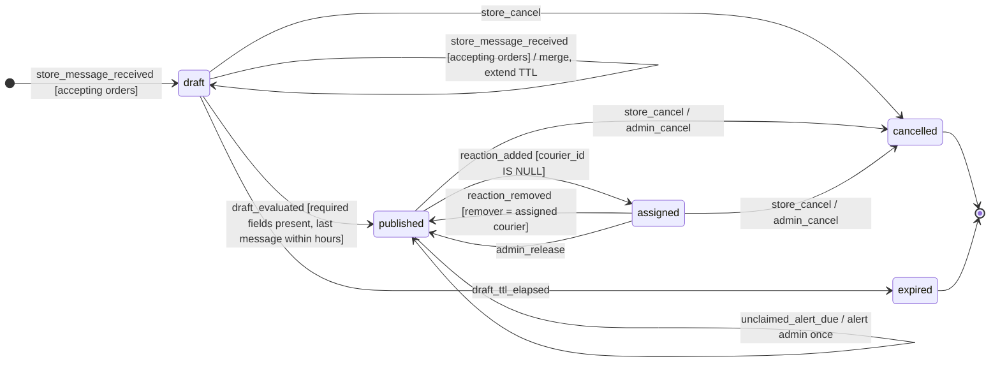
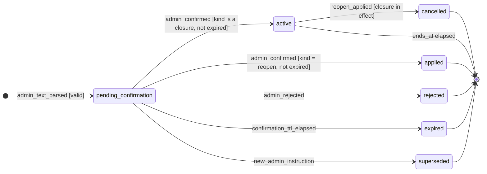

# 03 — Máquinas de estados

Casi toda la lógica del sistema son dos máquinas de estados: la del **pedido** y la de los **cambios de
horario** del administrador. Cada transición se implementa como un `UPDATE` condicional (la condición
`WHERE` es la guarda) dentro de una transacción que además registra la auditoría y encola los mensajes en
`outbound_messages`. Si el `UPDATE` no devuelve filas, la transición no ocurrió y no se envía nada.

## 1. Pedido

### Estados

| Estado | Descripción | ¿Terminal? |
|--------|-------------|------------|
| `draft` | Borrador en construcción; faltan datos o se está esperando el intervalo de agrupación. | No |
| `published` | Completo y publicado en el grupo (una sola publicación); esperando que un motero lo tome. Cuenta como **pendiente** para el reporte diario. | No |
| `assigned` | Tomado por un motero (`courier_id` no nulo). Se da por **resuelto**: no hay seguimiento de entrega. Solo puede liberarse o cancelarse. | No (resuelto) |
| `cancelled` | Cancelado por el local o el administrador. | Sí |
| `expired` | Borrador vencido por inactividad del local. | Sí |

"Sin tomar" no es un estado: es un pedido `published` con `unclaimed_alert_sent_at` no nulo, que
indica que ya se alertó al administrador (RN-18).

Invariante: `courier_id IS NOT NULL` si y solo si `status = 'assigned'`
(se implementa como `CHECK`, ver [modelo de datos](05-modelo-datos.md)).

### Diagrama



Eventos que **no** producen transición (se registran como ignorados, sin mensajes salvo los indicados):

- `store_message_received` fuera del horario efectivo → respuesta de cierre (con límite de frecuencia); no se crea ni modifica el borrador.
- `reaction_added` de otro motero cuando el pedido está `assigned` → `courier_order_already_taken` (una vez por motero y pedido).
- `reaction_added` del mismo motero asignado (cambio de emoji) → nada.
- `reaction_removed` de alguien que no es el asignado, o con el pedido en un estado distinto de `assigned` → nada.
- Cualquier reacción sobre un pedido `cancelled` → nada.

### Tabla de transiciones

| # | Desde | Evento | Guarda (condición) | Hacia | Acciones | Mensajes enviados |
|---|-------|--------|--------------------|-------|----------|-------------------|
| T01 | — | `store_message_received` | `is_accepting_orders(now)`; no es comando; el local no tiene borrador abierto | `draft` | Alta automática del local si no existe; crear pedido; extraer con LLM; `draft_expires_at = now() + DRAFT_TTL`; programar evaluación | — |
| T02 | `draft` | `store_message_received` | `is_accepting_orders(now)`; no es comando | `draft` | Extraer, combinar campos, renovar `draft_expires_at`, reprogramar evaluación | — |
| T03 | `draft` | `draft_evaluated` | Falta algún campo obligatorio | `draft` | `missing_prompts_count += 1` | `store_order_missing_fields` (+ `store_order_format_example` si corresponde) |
| T04 | `draft` | `draft_evaluated` | Campos obligatorios presentes y `last_store_message_at` dentro del horario efectivo | `published` | Asignar `code`, `published_at`, `unclaimed_alert_at = now() + UNCLAIMED_ALERT`; publicar y guardar `group_message_id` | `group_order_post`, `store_order_published` |
| T05 | `draft` | `draft_ttl_elapsed` | `draft_expires_at < now()` | `expired` | — | `store_draft_expired` |
| T06 | `draft` | `store_cancel` | Pedido del local | `cancelled` | `cancelled_at`, `cancelled_by = 'store'` | `store_draft_cancelled` |
| T07 | `published` | `reaction_added` | Motero no bloqueado y `courier_id IS NULL` | `assigned` | Alta automática del motero si no existe; `courier_id`, `last_courier_id`, `assigned_at` | `courier_order_assigned`, `store_order_assigned`, `group_order_assigned` |
| T08 | `assigned` | `reaction_added` | Motero distinto del asignado | (sin cambio) | Registrar `claim_rejected` | `courier_order_already_taken` si `NOTIFY_LOSER_ON_RACE` (una vez por motero y pedido) |
| T09 | `assigned` | `reaction_added` | Mismo motero asignado (cambio de emoji) | (sin cambio) | — | — |
| T10 | `assigned` | `reaction_removed` | `courier_id = remitente` | `published` | `courier_id = NULL`, `assigned_at = NULL`, reiniciar `unclaimed_alert_at`, `unclaimed_alert_sent_at = NULL` | `store_order_unassigned`, `group_order_unassigned`, `courier_order_released` |
| T11 | `assigned` | `reaction_removed` | `courier_id <> remitente` | (sin cambio) | Registrar como ignorado | — |
| T12 | `published` | `unclaimed_alert_due` | `unclaimed_alert_at < now()` y `unclaimed_alert_sent_at IS NULL` | `published` | `unclaimed_alert_sent_at = now()` | `admin_order_unclaimed` |
| T13 | `published` | `store_cancel` / `admin_cancel` | Pedido del local (o admin) | `cancelled` | `cancelled_at`, `cancelled_by` | `store_order_cancelled` o `store_order_cancelled_by_admin`, `group_order_cancelled` (+ `admin_command_ok`) |
| T14 | `assigned` | `store_cancel` / `admin_cancel` | Pedido del local (o admin) | `cancelled` | `cancelled_at`, `cancelled_by`, `courier_id = NULL` (queda en `last_courier_id` y en `order_events.courier_id`) | Ídem T13 + `courier_order_cancelled` |
| T15 | `assigned` | `admin_release` | — | `published` | Igual que T10 | `store_order_unassigned`, `group_order_unassigned`, `courier_order_released_by_admin`, `admin_command_ok` |

### Implementación de referencia de las guardas

```sql
-- T07: claim (also covers T08/T09 when no row is returned)
UPDATE orders
   SET courier_id = :courier_id, last_courier_id = :courier_id,
       status = 'assigned', assigned_at = now(), updated_at = now()
 WHERE id = :order_id
   AND courier_id IS NULL
   AND status = 'published'
RETURNING id;

-- T10: release by reaction removal
UPDATE orders
   SET courier_id = NULL, status = 'published', assigned_at = NULL,
       unclaimed_alert_at = now() + make_interval(mins => :unclaimed_alert_minutes),
       unclaimed_alert_sent_at = NULL, updated_at = now()
 WHERE id = :order_id
   AND courier_id = :courier_id
   AND status = 'assigned'
RETURNING id;

-- T12: unclaimed alert (one per publication period)
UPDATE orders
   SET unclaimed_alert_sent_at = now(), updated_at = now()
 WHERE id = :order_id
   AND status = 'published'
   AND unclaimed_alert_sent_at IS NULL
   AND unclaimed_alert_at < now()
RETURNING id;
```

Cuando el `UPDATE` de T07 no devuelve filas, se lee el pedido para decidir entre T08 (otro motero),
T09 (mismo motero) o "pedido no disponible" (cancelado), solo para elegir qué mensaje enviar; nunca
para decidir la asignación.

## 2. Cambio de horario (`schedule_overrides`)

### Estados

| Estado | Descripción |
|--------|-------------|
| `pending_confirmation` | Interpretado y validado; esperando "sí" / "no" del administrador. |
| `active` | Cierre confirmado. Afecta al horario efectivo mientras `starts_at <= now < ends_at` (o sin fin) y no tenga `cancelled_at`. |
| `applied` | Solo para `reopen`: confirmado y ejecutado (levantó los cierres en vigor). |
| `cancelled` | Cierre levantado por un `reopen` (`cancelled_at`, `cancelled_by_override_id`). |
| `rejected` | El administrador respondió "no". |
| `expired` | No se confirmó en `SCHEDULE_CONFIRMATION_TTL_MINUTES`. |
| `superseded` | Reemplazado por una instrucción nueva antes de confirmarse. |

Un cierre `active` cuyo `ends_at` ya pasó sigue `active` en la tabla: simplemente deja de estar en vigor.



### Horario efectivo

```python
def is_accepting_orders(now: datetime) -> AcceptanceDecision:
    """Base hours minus active closures. Returns the closure that applies, if any."""
```

```sql
SELECT *
  FROM schedule_overrides
 WHERE status = 'active'
   AND kind IN ('closed_today', 'closed_until_further_notice', 'closed_window')
   AND starts_at <= now()
   AND (ends_at IS NULL OR ends_at > now())
 ORDER BY CASE kind WHEN 'closed_until_further_notice' THEN 1
                    WHEN 'closed_today' THEN 2 ELSE 3 END
 LIMIT 1;
```

Si la hora local está fuera de `BUSINESS_HOURS_START`–`BUSINESS_HOURS_END`, el motivo es `outside_base_hours`
(`store_out_of_hours`); si no, y la consulta devuelve un cierre, el motivo es ese cierre (con su `reason`).
