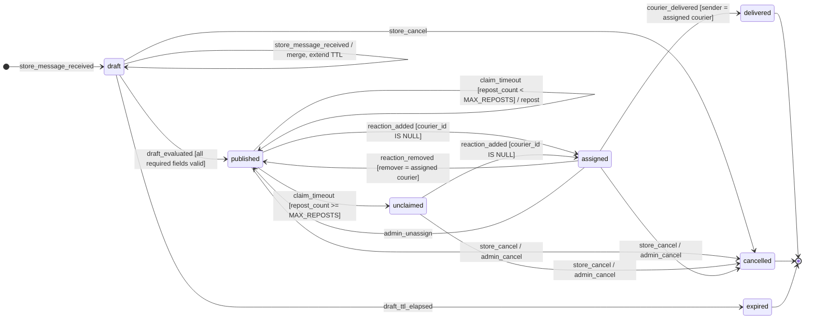

# 03 — Máquina de estados del pedido

Casi toda la lógica del sistema es esta máquina de estados. Cada transición se implementa como un
`UPDATE` condicional sobre `orders` (la condición `WHERE` es la guarda) dentro de una transacción
que además inserta en `order_events` y encola los mensajes en `outbound_messages`. Si el `UPDATE`
no devuelve filas, la transición no ocurrió y no se envía nada.

## Estados

| Estado | Descripción | ¿Terminal? |
|--------|-------------|------------|
| `draft` | Borrador en construcción; faltan datos o se está esperando el intervalo de agrupación. | No |
| `published` | Completo y publicado en el grupo; esperando que un motero lo tome. | No |
| `assigned` | Tomado por un motero (`courier_id` no nulo). | No |
| `unclaimed` | Se agotaron las republicaciones sin toma; escalado al administrador. Todavía se puede tomar. | No |
| `delivered` | El motero lo marcó como entregado. | Sí |
| `cancelled` | Cancelado por el local o el administrador. | Sí |
| `expired` | Borrador vencido por inactividad del local. | Sí |

Invariante: `courier_id IS NOT NULL` si y solo si `status IN ('assigned', 'delivered')`
(se implementa como `CHECK`, ver [modelo de datos](05-modelo-datos.md)).

## Diagrama



Eventos que **no** producen transición (se registran como ignorados, sin mensajes salvo los indicados):

- `reaction_added` de un motero distinto cuando el pedido está `assigned` → opcional `courier_order_already_taken`.
- `reaction_added` del mismo motero asignado (cambio de emoji) → nada.
- `reaction_removed` de alguien que no es el asignado, o con el pedido en un estado distinto de `assigned` → nada.
- Cualquier reacción sobre un pedido `delivered`, `cancelled` o `expired` → nada.
- `courier_delivered` de un motero que no es el asignado → `courier_order_not_found`.

## Tabla de transiciones

| # | Desde | Evento | Guarda (condición) | Hacia | Acciones | Mensajes enviados |
|---|-------|--------|--------------------|-------|----------|-------------------|
| T01 | — | `store_message_received` | Remitente es local activo; no tiene borrador abierto; no es comando | `draft` | Crear pedido, extraer con LLM, fijar `draft_expires_at = now() + DRAFT_TTL`, programar evaluación | — |
| T02 | `draft` | `store_message_received` | Ídem, con borrador abierto | `draft` | Extraer, combinar campos, renovar `draft_expires_at`, reprogramar evaluación | — |
| T03 | `draft` | `draft_evaluated` | Faltan campos o hay inválidos | `draft` | Incrementar `missing_prompts_count` | `store_order_missing_fields` (+ `store_order_format_example` si corresponde) |
| T04 | `draft` | `draft_evaluated` | Todos los obligatorios válidos | `published` | Asignar `code`, `published_at`, `claim_deadline_at = now() + CLAIM_TIMEOUT`; publicar y guardar `group_posts` | `group_order_post`, `store_order_published` |
| T05 | `draft` | `draft_ttl_elapsed` | `draft_expires_at < now()` | `expired` | — | `store_draft_expired` |
| T06 | `draft` | `store_cancel` | Pedido del local | `cancelled` | `cancelled_at = now()` | `store_draft_cancelled` |
| T07 | `published`, `unclaimed` | `reaction_added` | Motero activo y `courier_id IS NULL` | `assigned` | `courier_id`, `assigned_at` | `courier_order_assigned`, `store_order_assigned`, `group_order_assigned` |
| T08 | `assigned` | `reaction_added` | Motero distinto del asignado | (sin cambio) | Registrar `claim_rejected` | `courier_order_already_taken` si `NOTIFY_LOSER_ON_RACE` (una vez por motero y pedido) |
| T09 | `assigned` | `reaction_added` | Mismo motero asignado (cambio de emoji) | (sin cambio) | — | — |
| T10 | `assigned` | `reaction_removed` | `courier_id = remitente` | `published` | `courier_id = NULL`, `assigned_at = NULL`, renovar `claim_deadline_at` | `store_order_unassigned`, `group_order_unassigned`, `courier_order_released` |
| T11 | `assigned` | `reaction_removed` | `courier_id <> remitente` | (sin cambio) | Registrar como ignorado | — |
| T12 | `published` | `claim_timeout` | `claim_deadline_at < now()` y `repost_count < MAX_REPOSTS` | `published` | `repost_count += 1`, renovar `claim_deadline_at`, nueva fila en `group_posts` | `group_order_repost`, `store_order_reposted` |
| T13 | `published` | `claim_timeout` | `claim_deadline_at < now()` y `repost_count >= MAX_REPOSTS` | `unclaimed` | `claim_deadline_at = NULL` | `store_order_unclaimed`, `admin_order_unclaimed` |
| T14 | `published`, `unclaimed` | `store_cancel` / `admin_cancel` | Pedido del local (o admin) | `cancelled` | `cancelled_at`, `cancelled_by` | `store_order_cancelled`, `group_order_cancelled` |
| T15 | `assigned` | `store_cancel` / `admin_cancel` | Pedido del local (o admin) | `cancelled` | `cancelled_at`, `cancelled_by` (se conserva `courier_id` en `order_events`, se pone en `NULL` en `orders`) | `store_order_cancelled`, `group_order_cancelled`, `courier_order_cancelled` |
| T16 | `assigned` | `courier_delivered` | `courier_id = remitente` | `delivered` | `delivered_at` | `courier_order_delivered_ack`, `store_order_delivered`, `group_order_delivered` (opcional) |
| T17 | `assigned` | `admin_unassign` | — | `published` | Igual que T10 | `store_order_unassigned`, `group_order_unassigned`, `courier_order_released` |
| T18 | `assigned` | `delivery_reminder_due` | `assigned_at < now() - DELIVERY_REMINDER_MINUTES` y sin recordatorio previo | (sin cambio) | Marcar `delivery_reminder_sent_at` | `courier_delivery_reminder`, `admin_delivery_overdue` |

> Nota sobre T15: como el invariante exige `courier_id` nulo fuera de `assigned`/`delivered`, el
> motero que tenía el pedido cancelado queda registrado en `order_events.data` y en
> `orders.last_courier_id`.

## Implementación de referencia de las guardas

```sql
-- T07: claim (also handles T08/T09 when no row is returned)
UPDATE orders
   SET courier_id = :courier_id, last_courier_id = :courier_id,
       status = 'assigned', assigned_at = now(), claim_deadline_at = NULL, updated_at = now()
 WHERE id = :order_id
   AND courier_id IS NULL
   AND status IN ('published', 'unclaimed')
RETURNING id;

-- T10: unclaim by reaction removal
UPDATE orders
   SET courier_id = NULL, status = 'published', assigned_at = NULL,
       claim_deadline_at = now() + make_interval(mins => :claim_timeout_minutes), updated_at = now()
 WHERE id = :order_id
   AND courier_id = :courier_id
   AND status = 'assigned'
RETURNING id;

-- T16: delivered
UPDATE orders
   SET status = 'delivered', delivered_at = now(), updated_at = now()
 WHERE id = :order_id
   AND courier_id = :courier_id
   AND status = 'assigned'
RETURNING id;
```

Cuando el `UPDATE` de T07 no devuelve filas, se lee el pedido para decidir entre T08 (otro motero),
T09 (mismo motero) o "pedido no disponible" (terminal), solo para elegir qué mensaje enviar; nunca
para decidir la asignación.
