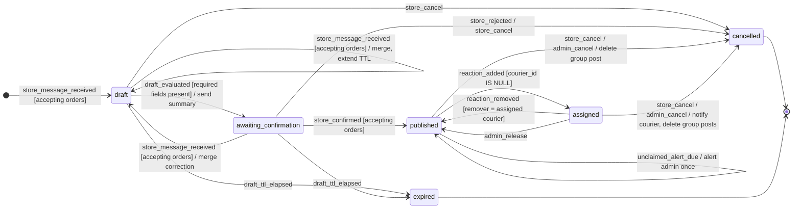
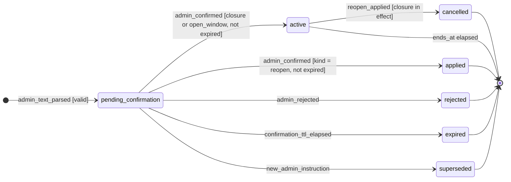

# 03 — Máquinas de estados

Casi toda la lógica del sistema son dos máquinas de estados: la del **pedido** y la de los **cambios de
horario** del administrador. Cada transición se implementa como un `UPDATE` condicional (la condición
`WHERE` es la guarda) dentro de una transacción que además registra la auditoría y encola los mensajes en
`outbound_messages`. Si el `UPDATE` no devuelve filas, la transición no ocurrió y no se envía nada.

## 1. Pedido

### Estados

| Estado | Descripción | ¿Terminal? |
|--------|-------------|------------|
| `draft` | Borrador en construcción; faltan datos o se está esperando el intervalo de agrupación. | No |
| `awaiting_confirmation` | Datos completos; se envió el resumen al local y se espera su "sí". Una corrección lo devuelve a `draft`. | No |
| `published` | Confirmado y publicado en el grupo (una sola publicación); esperando que un motero lo tome. | No |
| `assigned` | Tomado por un motero (`courier_id` no nulo). Se da por **resuelto**: no hay seguimiento de entrega. Solo puede liberarse o cancelarse. | No (resuelto) |
| `cancelled` | Cancelado por el local o el administrador. Su publicación se elimina del grupo. | Sí |
| `expired` | Borrador o pedido sin confirmar vencido por inactividad del local. | Sí |

Para el reporte diario, `draft`, `awaiting_confirmation` y `published` son **pendientes**.
"Sin tomar" no es un estado: es un pedido `published` con `unclaimed_alert_sent_at` no nulo (RN-19).

Invariante: `courier_id IS NOT NULL` si y solo si `status = 'assigned'`
(se implementa como `CHECK`, ver [modelo de datos](05-modelo-datos.md)).

### Diagrama



Eventos que **no** producen transición (se registran como ignorados, sin mensajes salvo los indicados):

- `store_message_received` o `store_confirmed` fuera del horario efectivo → respuesta de cierre (`store_order_not_sent_closed` si era una confirmación); no se crea, modifica ni publica nada.
- `reaction_added` de otro motero cuando el pedido está `assigned` → `courier_order_already_taken` (una vez por motero y pedido).
- `reaction_added` del mismo motero asignado (cambio de emoji) → nada.
- `reaction_removed` de alguien que no es el asignado, o con el pedido en un estado distinto de `assigned` → nada.
- `reaction_added` sobre un pedido `cancelled` → `courier_order_no_longer_available` si `NOTIFY_REACTION_ON_CANCELLED` (una vez por motero y pedido).

### Tabla de transiciones

| # | Desde | Evento | Guarda (condición) | Hacia | Acciones | Mensajes enviados |
|---|-------|--------|--------------------|-------|----------|-------------------|
| T01 | — | `store_message_received` | `is_accepting_orders(now)`; no es comando; el local no tiene pedido en preparación | `draft` | Alta automática del local si no existe; crear pedido con `business_date`; extraer con LLM; `draft_expires_at = now() + DRAFT_TTL`; programar evaluación | — |
| T02 | `draft` | `store_message_received` | `is_accepting_orders(now)`; no es comando | `draft` | Extraer, combinar, renovar `draft_expires_at`, reprogramar evaluación | — |
| T03 | `draft` | `draft_evaluated` | Falta algún campo obligatorio | `draft` | `missing_prompts_count += 1` | `store_order_missing_fields` (+ `store_order_format_example` si corresponde) |
| T04 | `draft` | `draft_evaluated` | Campos obligatorios presentes | `awaiting_confirmation` | `confirmation_requested_at = now()`, renovar `draft_expires_at` | `store_order_confirm_request` |
| T05 | `awaiting_confirmation` | `store_message_received` | `is_accepting_orders(now)`; no es `sí`/`no`/`cancelar` | `draft` | Extraer, combinar, renovar `draft_expires_at`, reprogramar evaluación (lleva a T03 o T04) | — |
| T06 | `awaiting_confirmation` | `store_confirmed` | `is_accepting_orders(now)` | `published` | `confirmed_at`, `code`, `published_at`, `unclaimed_alert_at = now() + UNCLAIMED_ALERT`; publicar y guardar `group_message_id` | `group_order_post`, `store_order_published` |
| T07 | `awaiting_confirmation` | `store_confirmed` | No `is_accepting_orders(now)` | (sin cambio) | — | `store_order_not_sent_closed` |
| T08 | `draft`, `awaiting_confirmation` | `store_cancel` / `store_rejected` | Pedido del local | `cancelled` | `cancelled_at`, `cancelled_by = 'store'` | `store_draft_cancelled` |
| T09 | `draft`, `awaiting_confirmation` | `draft_ttl_elapsed` | `draft_expires_at < now()` | `expired` | — | `store_draft_expired` |
| T10 | `published` | `reaction_added` | Motero no bloqueado y `courier_id IS NULL` | `assigned` | Alta automática del motero si no existe; `courier_id`, `last_courier_id`, `assigned_at` | `courier_order_assigned`, `store_order_assigned`, `group_order_assigned` |
| T11 | `assigned` | `reaction_added` | Motero distinto del asignado | (sin cambio) | Registrar `claim_rejected` | `courier_order_already_taken` si `NOTIFY_LOSER_ON_RACE` |
| T12 | `assigned` | `reaction_added` | Mismo motero asignado (cambio de emoji) | (sin cambio) | — | — |
| T13 | `assigned` | `reaction_removed` | `courier_id = remitente` | `published` | `courier_id = NULL`, `assigned_at = NULL`, reiniciar `unclaimed_alert_at`, `unclaimed_alert_sent_at = NULL`; marcar corrección si el reporte del día ya se envió | `store_order_unassigned`, `group_order_unassigned`, `courier_order_released` |
| T14 | `assigned` | `reaction_removed` | `courier_id <> remitente` | (sin cambio) | Registrar como ignorado | — |
| T15 | `published` | `unclaimed_alert_due` | `unclaimed_alert_at < now()` y `unclaimed_alert_sent_at IS NULL` | `published` | `unclaimed_alert_sent_at = now()` | `admin_order_unclaimed` |
| T16 | `published` | `store_cancel` / `admin_cancel` | Pedido del local (o admin) | `cancelled` | `cancelled_at`, `cancelled_by`; eliminar publicación; marcar corrección si el reporte del día ya se envió | `group_order_delete`; `store_order_cancelled` (local) o `admin_command_ok` + `store_order_cancelled_by_admin` (admin) |
| T17 | `assigned` | `store_cancel` / `admin_cancel` | Pedido del local (o admin) | `cancelled` | Ídem T16, más `courier_id = NULL` (queda en `last_courier_id` y en `order_events.courier_id`) y eliminar también las respuestas del bot sobre el pedido | Ídem T16 + `courier_order_cancelled` |
| T18 | `assigned` | `admin_release` | — | `published` | Igual que T13 | `store_order_unassigned`, `group_order_unassigned`, `courier_order_released_by_admin`, `admin_command_ok` |
| T19 | `cancelled` | `reaction_added` | — | (sin cambio) | Registrar `reaction_on_cancelled` | `courier_order_no_longer_available` si `NOTIFY_REACTION_ON_CANCELLED` (una vez por motero y pedido) |

Si la eliminación de `group_order_delete` falla, se intenta `group_order_cancelled_edit` y luego
`group_order_cancelled` (ver CU-09 6a).

### Implementación de referencia de las guardas

```sql
-- T06: confirm and publish (business-hours check is done in code right before, in the same transaction)
UPDATE orders
   SET status = 'published', code = :code, confirmed_at = now(), published_at = now(),
       unclaimed_alert_at = now() + make_interval(mins => :unclaimed_alert_minutes), updated_at = now()
 WHERE id = :order_id
   AND store_id = :store_id
   AND status = 'awaiting_confirmation'
RETURNING id;

-- T10: claim (also covers T11/T12/T19 when no row is returned)
UPDATE orders
   SET courier_id = :courier_id, last_courier_id = :courier_id,
       status = 'assigned', assigned_at = now(), updated_at = now()
 WHERE id = :order_id
   AND courier_id IS NULL
   AND status = 'published'
RETURNING id;

-- T13: release by reaction removal
UPDATE orders
   SET courier_id = NULL, status = 'published', assigned_at = NULL,
       unclaimed_alert_at = now() + make_interval(mins => :unclaimed_alert_minutes),
       unclaimed_alert_sent_at = NULL, updated_at = now()
 WHERE id = :order_id
   AND courier_id = :courier_id
   AND status = 'assigned'
RETURNING id;

-- T16/T17: cancel. The row is locked first to read the current status and courier,
-- so a concurrent claim either committed before (T17 path) or will find status = 'cancelled'.
SELECT status, courier_id FROM orders WHERE id = :order_id FOR UPDATE;

UPDATE orders
   SET status = 'cancelled', cancelled_at = now(), cancelled_by = :actor,
       courier_id = NULL, updated_at = now()
 WHERE id = :order_id
   AND status = :status_read
RETURNING id;
```

Cuando el `UPDATE` de T10 no devuelve filas, se lee el pedido para decidir entre T11 (otro motero),
T12 (mismo motero) o T19 (cancelado), solo para elegir qué mensaje enviar; nunca para decidir la asignación.

### Efecto sobre el reporte diario

En la misma transacción que T13, T16, T17 y T18 se ejecuta:

```sql
UPDATE daily_reports
   SET status = 'correction_pending', updated_at = now()
 WHERE report_date = :order_business_date
   AND status = 'sent';
```

Así la corrección (CU-17) no depende de que la tarea periódica detecte el cambio por otra vía. Como `due_at` ya
pasó, la corrección sale en cuanto no quedan pendientes del día.

La confirmación de una apertura extra (`open_window`) para un día ya reportado reabre el reporte en la misma
transacción, y además corre `due_at` al nuevo cierre efectivo (RF-55):

```sql
UPDATE daily_reports
   SET status = 'correction_pending',
       due_at = :new_report_due_at,
       reopened_by_override_id = :override_id,
       pending_reminder_sent_at = NULL,
       correction_requested_at = COALESCE(correction_requested_at, now()),
       updated_at = now()
 WHERE report_date = :override_business_date
   AND status IN ('sent', 'generating', 'correction_pending');
```

Si el reporte del día todavía no se generó (`waiting` o sin fila), no hace falta nada: `report_due_at(D)` ya
incluye la apertura.

## 2. Cambio de horario (`schedule_overrides`)

### Estados

| Estado | Descripción |
|--------|-------------|
| `pending_confirmation` | Interpretado y validado; esperando "sí" / "no" del administrador. |
| `active` | Cierre o apertura confirmados. Afecta al horario efectivo mientras `starts_at <= now < ends_at` (o sin fin) y no tenga `cancelled_at`. |
| `applied` | Solo para `reopen`: confirmado y ejecutado (levantó los cierres en vigor). |
| `cancelled` | Cierre levantado por un `reopen` (`cancelled_at`, `cancelled_by_override_id`). Las aperturas no se levantan con `reopen`; para acortarlas se carga un cierre, que tiene prioridad por ser más reciente (RN-25). |
| `rejected` | El administrador respondió "no". |
| `expired` | No se confirmó en `SCHEDULE_CONFIRMATION_TTL_MINUTES`. |
| `superseded` | Reemplazado por una instrucción nueva antes de confirmarse. |

Un cierre o apertura `active` cuyo `ends_at` ya pasó sigue `active` en la tabla: simplemente deja de estar en vigor.



### Horario efectivo

```python
def is_accepting_orders(now: datetime) -> AcceptanceDecision:
    """Base hours, then the active overrides painted on top in confirmation order (most recent
    wins, RN-25). Returns whether orders are accepted and, if not, the reason (outside hours or
    the applying closure)."""


def report_due_at(business_date: date) -> datetime:
    """Effective close of the business day: the later of BUSINESS_HOURS_END and the end of any
    active open_window for that day. Closures never move it earlier, not even one confirmed
    after the opening (they can be lifted).
    Used for the original report and, when the day is extended after its report was sent,
    for the correction that lists the orders added during the extension."""
```

```sql
-- Closure that closes now: in effect and confirmed after every opening in effect (most recent
-- wins, tiebreak on id); the widest one if there are several
SELECT c.*
  FROM schedule_overrides c
 WHERE c.status = 'active'
   AND c.kind IN ('closed_today', 'closed_until_further_notice', 'closed_window')
   AND c.starts_at <= now()
   AND (c.ends_at IS NULL OR c.ends_at > now())
   AND NOT EXISTS (
         SELECT 1
           FROM schedule_overrides o
          WHERE o.status = 'active' AND o.kind = 'open_window'
            AND o.starts_at <= now() AND o.ends_at > now()
            AND (o.confirmed_at, o.id) > (c.confirmed_at, c.id))
 ORDER BY CASE c.kind WHEN 'closed_until_further_notice' THEN 1
                      WHEN 'closed_today' THEN 2 ELSE 3 END
 LIMIT 1;

-- Extra opening in effect now
SELECT 1
  FROM schedule_overrides
 WHERE status = 'active' AND kind = 'open_window'
   AND starts_at <= now() AND ends_at > now();
```

Orden de evaluación: (1) si hay un cierre en vigor confirmado después de toda apertura en vigor → cerrado,
con ese motivo; (2) si la hora local está dentro
del horario base o hay una apertura en vigor → abierto; (3) si no → `outside_hours` (`store_out_of_hours`).

El día operativo (`business_date`) de un instante es su fecha local, salvo que la hora local sea anterior a
`BUSINESS_DAY_ROLLOVER_TIME` (05:00), en cuyo caso es el día anterior. Así, un pedido creado a las 00:30
durante una extensión "hasta la 01" pertenece al día que se extendió.
