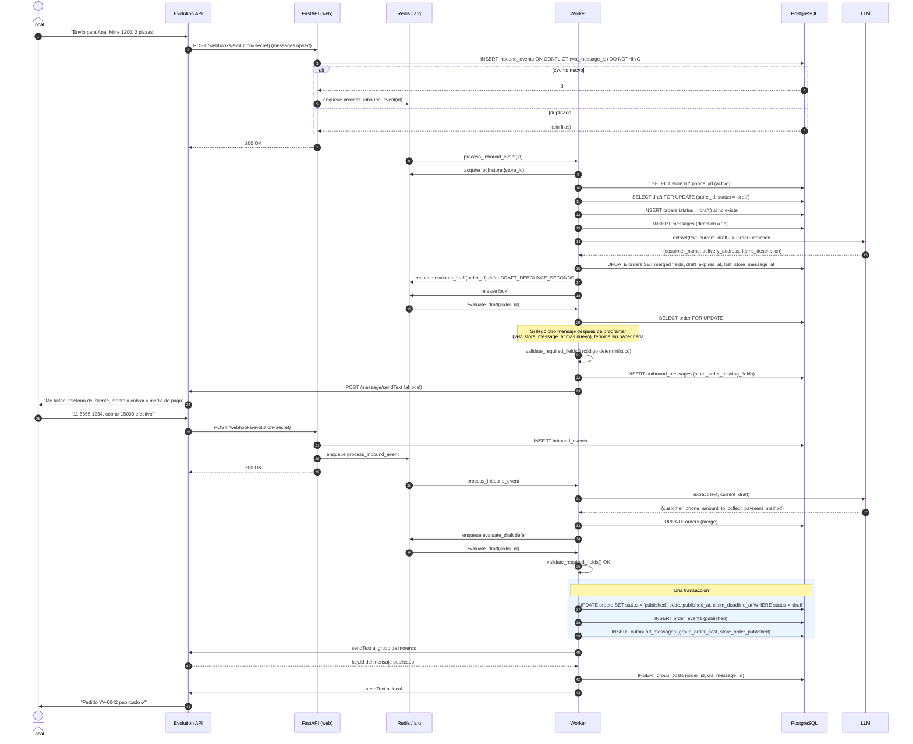
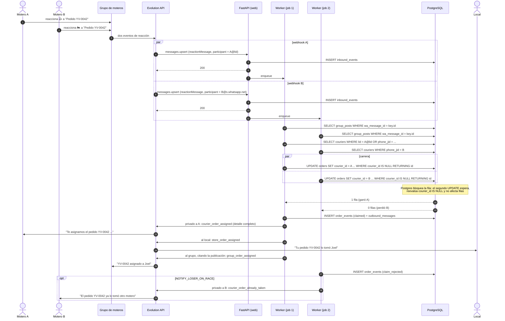
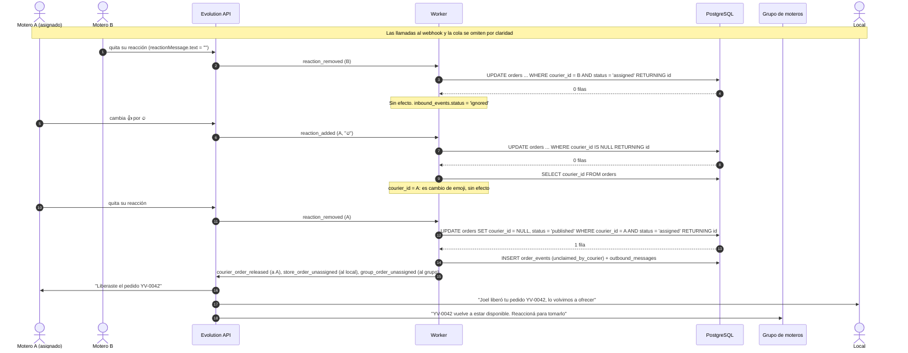
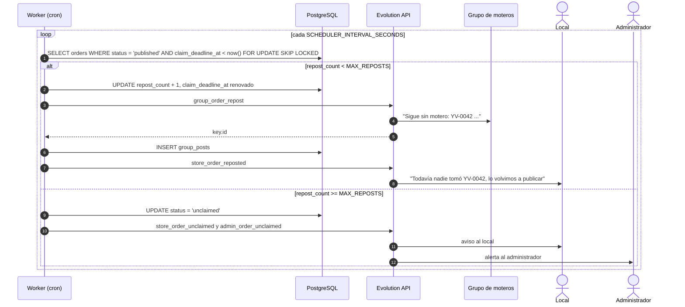

# 04 — Diagramas de secuencia

Participantes comunes:

- **WA**: WhatsApp (los teléfonos del local, los moteros y el grupo).
- **EVO**: Evolution API (instancia conectada al número del bot).
- **API**: servicio FastAPI (`web`), solo recibe webhooks y encola.
- **Q**: cola arq sobre Redis.
- **W**: worker arq (lógica de negocio y envíos).
- **DB**: PostgreSQL.
- **LLM**: proveedor de LLM para extracción estructurada.

## 1. Recepción, deduplicación y validación de un pedido

Caso: el local manda el pedido en dos mensajes; el primero queda incompleto.

Puntos clave:

- El webhook nunca llama al LLM ni a Evolution: solo persiste y encola (RNF-01).
- La extracción del LLM recibe el borrador actual como contexto, pero la combinación y la validación las hace el código.
- El intervalo de agrupación (`DRAFT_DEBOUNCE_SECONDS`) evita responder "faltan datos" a cada mensaje de una ráfaga.
- `group_posts` se inserta cuando Evolution devuelve el `key.id`; sin ese id no se pueden asociar las reacciones, por eso la publicación en el grupo se envía antes que la confirmación al local.

## 2. Toma con carrera entre dos moteros

## 3. Liberación, quitar reacción de un no asignado y cambio de emoji

## 4. Republicación por falta de toma

## 5. Envío de mensajes salientes (bandeja de salida)

Todos los envíos siguen el mismo patrón, que no se repite en los diagramas anteriores:

1. En la misma transacción que el cambio de estado se inserta en `outbound_messages` con una
   `idempotency_key` determinística (por ejemplo `order:42:claimed:courier:7`). Si ya existe, no se inserta.
2. Después del `COMMIT`, se encola `send_outbound(id)`.
3. `send_outbound` toma la fila con `FOR UPDATE SKIP LOCKED`, respeta el límite de envío
   (`OUTBOUND_MIN_INTERVAL_MS`, lock global en Redis), llama a Evolution y guarda `wa_message_id` y `status = 'sent'`.
4. Ante error, reintenta con backoff hasta `OUTBOUND_MAX_ATTEMPTS`; luego `status = 'failed'` y alerta al administrador.
5. Una tarea de barrido reencola filas `pending` antiguas (por si se perdió el trabajo en Redis).
