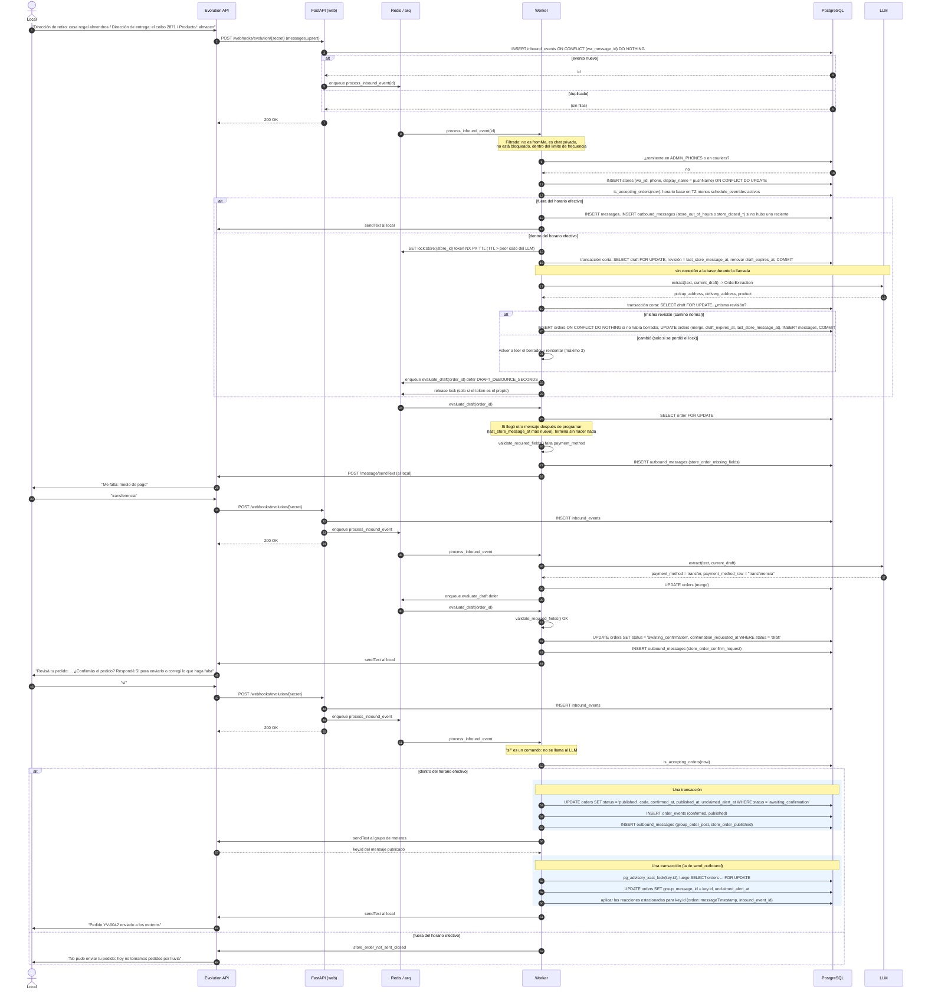
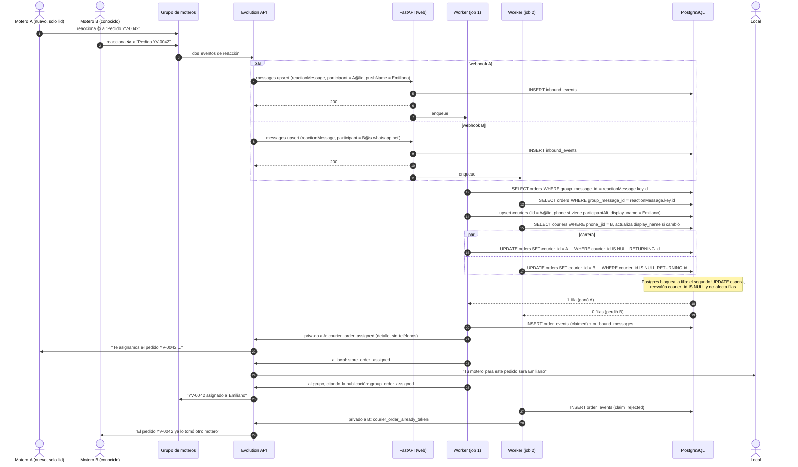
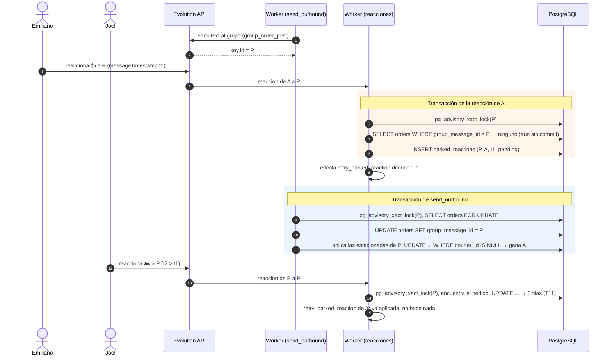
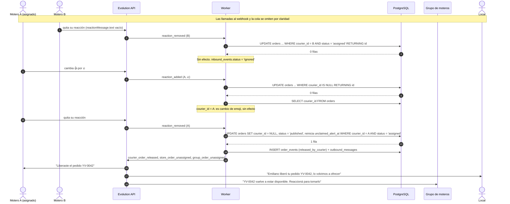
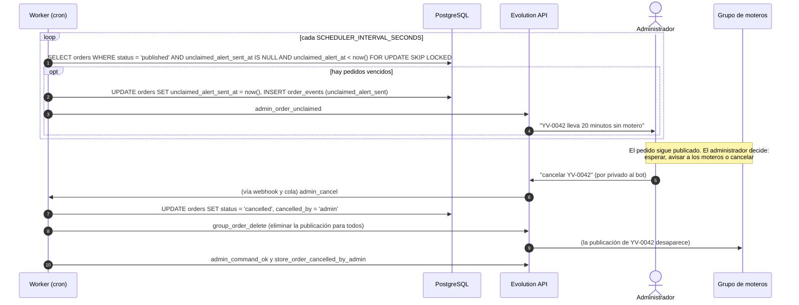
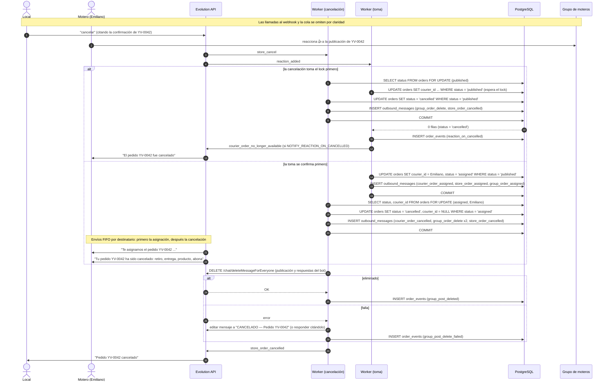
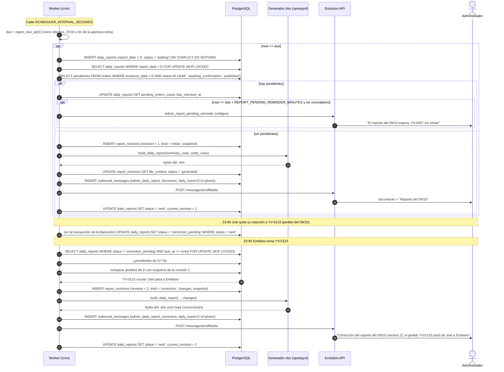
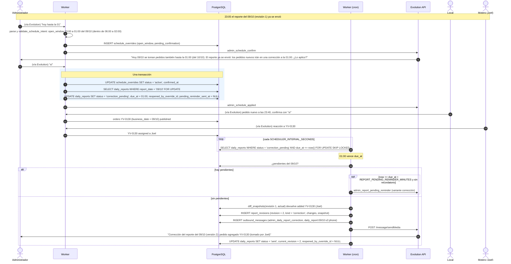

# 04 — Diagramas de secuencia

Participantes comunes:

- **EVO**: Evolution API (instancia conectada al número del bot).
- **API**: servicio FastAPI (`web`); solo recibe webhooks y encola.
- **Q**: cola arq sobre Redis.
- **W**: worker arq (lógica de negocio, envíos y tareas programadas).
- **AD**: administrador (número en `ADMIN_PHONES`).
- **DB**: PostgreSQL.
- **LLM**: proveedor de LLM para extracción estructurada.

## 1. Recepción, alta automática del local, validación y confirmación del pedido

Caso: un local nuevo manda el ejemplo canónico sin la línea de pago, lo completa en un segundo mensaje y confirma el resumen.



Puntos clave:

- El webhook nunca llama al LLM ni a Evolution: solo persiste y encola (RNF-01).
- La extracción del LLM recibe el borrador actual como contexto, pero la combinación y la validación las hace el código.
- Nada se publica sin el "sí" del local sobre el resumen vigente; si en lugar de "sí" el local manda una corrección,
  el pedido vuelve a `draft`, se combina y se reenvía el resumen (T05).
- El intervalo de agrupación (`DRAFT_DEBOUNCE_SECONDS`) evita responder "faltan datos" a cada mensaje de una ráfaga.
- `group_message_id` se guarda cuando Evolution devuelve el `key.id`; sin ese id no se pueden asociar las
  reacciones, por eso la publicación en el grupo se envía antes que la confirmación al local.
- Una reacción que llega entre la respuesta de Evolution y el commit de ese id no se descarta: se
  estaciona (`parked_reactions`) y se aplica primero en esa misma transacción (sección 2b).

## 2. Toma con carrera entre dos moteros y alta automática



## 2b. Reacción antes de que se guarde `group_message_id`

Caso: Emiliano reacciona apenas ve la publicación; su evento se procesa antes de que `send_outbound`
haga commit del `key.id`. Joel reacciona después, cuando el id ya está guardado.



- El lock de asesoramiento (por transacción, sobre el id del mensaje) cierra la ventana entre "ningún
  pedido tiene este id" y "la reacción quedó estacionada": o la reacción ve el id ya confirmado, o queda
  estacionada antes de que el gancho busque las estacionadas.
- Si el id nunca aparece (la reacción era a otro mensaje), los reintentos (1 s, 2 s, 2 s) la descartan
  y lo registran en el log. Un mensaje del bot que no es publicación y ya tiene id se ignora en el acto.

## 3. Liberación, quitar reacción de un no asignado y cambio de emoji



## 4. Alerta por pedido sin tomar



## 5. Cancelación con carrera contra una toma

Caso: el local cancela YV-0042 en el mismo instante en que Emiliano reacciona. Se muestran los dos órdenes posibles.



## 6. Reporte diario (con espera de pendientes y corrección)



## 7. Cambio de horario por el administrador (con confirmación)

```mermaid
sequenceDiagram
    autonumber
    actor AD as Administrador
    participant EVO as Evolution API
    participant W as Worker
    participant LLM as LLM
    participant DB as PostgreSQL
    actor S as Local

    Note over AD,S: Las llamadas al webhook y la cola se omiten por claridad

    AD->>EVO: "hoy no tomamos pedidos por lluvia"
    EVO->>W: mensaje privado de un número de ADMIN_PHONES
    W->>W: ¿es comando (cancelar, liberar, estado, horario, ayuda) o respuesta sí/no? No
    Note over W: SET lock:admin:{teléfono} NX PX TTL (TTL > peor caso del LLM)
    W->>DB: transacción corta: solicitud pendiente del administrador (revisión), COMMIT
    Note over W,LLM: sin conexión a la base durante la llamada
    W->>LLM: parse_schedule(text, now en TZ, día operativo, horario base) -> ScheduleOverrideIntent
    LLM-->>W: kind = closed_today, reason = "lluvia"
    rect rgb(235, 245, 255)
        Note over W,DB: Una transacción corta
        W->>DB: SELECT solicitud pendiente FOR UPDATE: ¿misma revisión? (si no, reintentar)
        W->>W: validate_schedule_intent() con los cambios activos; ends_at = fin del día operativo (05:00)
        W->>DB: UPDATE schedule_overrides SET status = 'superseded' WHERE created_by = AD AND status = 'pending_confirmation'
        W->>DB: INSERT schedule_overrides (status = 'pending_confirmation', confirmation_expires_at = now + 5 min)
        W->>DB: INSERT outbound_messages (admin_schedule_confirm)
    end
    Note over W: release lock (solo con el token propio)
    W->>EVO: sendText al administrador
    EVO->>AD: "Entendí esto: hoy 09/10 no se toman pedidos (motivo: lluvia). ¿Lo aplico? Respondé sí o no"

    alt responde "sí" a tiempo
        AD->>EVO: "sí"
        EVO->>W: mensaje privado
        W->>DB: UPDATE schedule_overrides SET status = 'active', confirmed_at WHERE status = 'pending_confirmation' AND confirmation_expires_at > now()
        DB-->>W: 1 fila
        W->>EVO: admin_schedule_applied
        EVO->>AD: "Listo. Hoy no se toman más pedidos (motivo: lluvia)"
    else responde "no"
        AD->>EVO: "no"
        W->>DB: UPDATE status = 'rejected'
        W->>EVO: admin_schedule_rejected
    else no responde
        W->>DB: (cron) UPDATE status = 'expired' WHERE confirmation_expires_at < now()
    end

    S->>EVO: "Dirección de retiro: ..."
    EVO->>W: mensaje de local
    W->>DB: is_accepting_orders(now) devuelve cierre closed_today, reason lluvia
    W->>EVO: store_closed_today (si no se le respondió hace poco)
    EVO->>S: "Hoy no tomamos pedidos por lluvia."

    Note over AD,S: Las aperturas siguen el mismo flujo. "hoy hasta las 00" genera kind = open_window<br/>(23:00 a 24:00) y corre la hora del reporte del día a las 24:00<br/>(si el reporte ya se envió, lo reabre: ver sección 8)
    AD->>EVO: "ya tomamos pedidos de nuevo"
    W->>LLM: parse_schedule(...)
    LLM-->>W: kind = reopen
    W->>DB: INSERT schedule_overrides (kind = reopen, pending_confirmation)
    W->>EVO: admin_schedule_confirm ("Vuelvo a tomar pedidos ahora. Se levanta: cierre de hoy por lluvia")
    AD->>EVO: "sí"
    rect rgb(235, 245, 255)
        W->>DB: UPDATE reopen SET status = 'applied', confirmed_at
        W->>DB: UPDATE schedule_overrides SET status = 'cancelled', cancelled_at, cancelled_by_override_id WHERE status = 'active' AND en vigor ahora
    end
    W->>EVO: admin_schedule_applied
```

## 8. Apertura extra después de enviado el reporte (corrección con pedidos agregados)



Si a la 01:00 no hubo pedidos nuevos ni otros cambios, `diff_snapshots` devuelve una lista vacía: no se crea
revisión y el reporte vuelve a `sent` sin enviar nada (PA-01).

## 9. Envío de mensajes salientes (bandeja de salida)

Todos los envíos siguen el mismo patrón, que no se repite en los diagramas anteriores:

1. En la misma transacción que el cambio de estado se inserta en `outbound_messages` con una
   `idempotency_key` determinística (por ejemplo `order:42:claimed:courier:7`). Si ya existe, no se inserta.
2. Después del `COMMIT`, se encola `send_outbound(id)`.
3. `send_outbound` toma la fila con `FOR UPDATE SKIP LOCKED`, respeta el límite de envío
   (`OUTBOUND_MIN_INTERVAL_MS`, lock global en Redis) y el orden por destinatario (no envía una fila si hay
   otra anterior pendiente para el mismo `recipient_jid`), llama a Evolution según `message_type`
   (`text` → `sendText`, `document` → `sendMedia`, `delete` → `deleteMessageForEveryone`, `edit` → `updateMessage`)
   y guarda `wa_message_id` y `status = 'sent'`.
4. Ante un error transitorio (red o timeout, `5xx`, `408`, `429`) reintenta con backoff hasta
   `OUTBOUND_MAX_ATTEMPTS`; un error permanente (cualquier otro `4xx`) no se reintenta. En ambos casos termina
   en `status = 'failed'` y alerta al administrador (`admin_outbound_failed`, salvo que la fila fallida sea
   esa alerta). Detalle en [arquitectura](06-arquitectura.md), "Política de reintentos de la bandeja de salida".
5. Una tarea de barrido reencola filas `pending` con más de `OUTBOUND_RECOVERY_SECONDS` (por si se perdió el trabajo en Redis).
