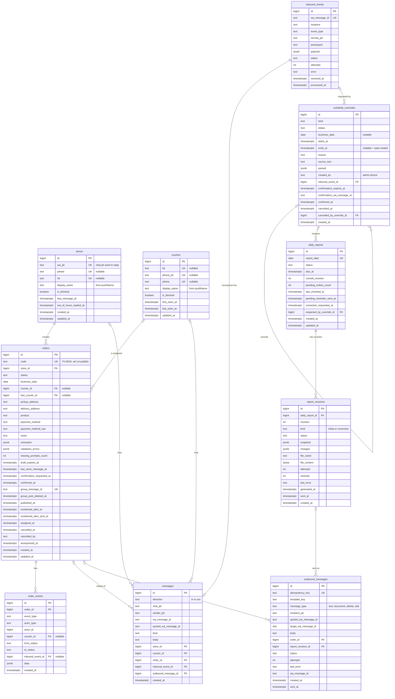

# 05 — Modelo de datos

PostgreSQL 16 es la fuente de verdad: locales, moteros, pedidos, borradores (pedidos en estado
`draft`), cambios de horario, historial de conversación, auditoría, bandeja de salida y reportes diarios. Redis no guarda
nada que no pueda reconstruirse (cola, locks y contadores de límite de frecuencia).

Decisiones:

- **El borrador es un pedido en estado `draft`** (o `awaiting_confirmation` mientras espera el "sí" del
  local), no una tabla aparte. Un índice único parcial garantiza un solo pedido en preparación por local (RN-09).
- **Cada pedido tiene un día operativo (`business_date`)**, fijado al crear el borrador. Es la clave del
  reporte diario y no depende de la fecha calendario (las extensiones pueden pasar la medianoche).
- **Una sola publicación por pedido** (no hay republicación): el id del mensaje del grupo se guarda en
  `orders.group_message_id`, con restricción única. No hace falta una tabla `group_posts`.
- **Locales y moteros se dan de alta solos.** Su identidad es el identificador de WhatsApp que llega en
  el evento (JID de número o `@lid`); el número de teléfono es un dato complementario que puede faltar.
- **Idempotencia por restricciones únicas**: `inbound_events.wa_message_id`,
  `outbound_messages.idempotency_key`, `orders.group_message_id`, `daily_reports.report_date`,
  `report_revisions (daily_report_id, revision)`.
- **El reporte tiene versiones**: `daily_reports` es la cabecera por fecha y `report_revisions` guarda cada
  versión enviada (original y correcciones) con su archivo, la foto de los pedidos y los cambios.
- **No hay seguimiento de entrega**: el pedido termina su ciclo útil en `assigned`; no existen columnas de
  retiro ni de entrega.
- **Los cambios de horario son filas, no configuración**: el horario base viene de variables de entorno y
  los cierres y aperturas del administrador se guardan en `schedule_overrides` con su historial completo.
- **Estados como `text` con `CHECK`** (en lugar de `ENUM` de Postgres), más simple de migrar con Alembic.
- Claves primarias `bigint generated always as identity`. Fechas `timestamptz` en UTC.
- Teléfonos en E.164 sin `+` (`5491155551234`).

## Diagrama entidad-relación



## Tablas

### `stores`

Alta automática con el primer mensaje privado de un remitente que no es administrador ni motero conocido.

| Columna | Tipo | Restricciones | Notas |
|---------|------|---------------|-------|
| `id` | `bigint` | PK, identity | |
| `wa_jid` | `text` | `NOT NULL`, `UNIQUE` | JID del chat privado tal como llega (`5491155551234@s.whatsapp.net` o `xxxx@lid`); se usa para responder. |
| `phone` | `text` | `UNIQUE`, nullable | Número si se puede resolver (del JID o de campos alternativos como `remoteJidAlt`/`senderPn`). |
| `lid` | `text` | `UNIQUE`, nullable | `@lid` si se conoce. |
| `display_name` | `text` | `NOT NULL` | `pushName`; se actualiza cuando cambia. Si llega vacío: `STORE_FALLBACK_NAME` ("Local"). |
| `is_blocked` | `boolean` | `NOT NULL DEFAULT false` | Anti-abuso; se cambia a mano en v1. |
| `last_message_at` | `timestamptz` | nullable | |
| `out_of_hours_replied_at` | `timestamptz` | nullable | Para el límite de frecuencia de `store_out_of_hours`. |
| `created_at`, `updated_at` | `timestamptz` | `NOT NULL DEFAULT now()` | |

Búsqueda del remitente: `WHERE wa_jid = :jid OR lid = :lid OR phone = :phone` (con los valores disponibles).

### `couriers`

Alta automática con la primera reacción a una publicación de pedido.

| Columna | Tipo | Restricciones | Notas |
|---------|------|---------------|-------|
| `id` | `bigint` | PK, identity | |
| `lid` | `text` | `UNIQUE`, nullable | `xxxx@lid`, como suelen llegar los participantes de grupo. |
| `phone_jid` | `text` | `UNIQUE`, nullable | `549...@s.whatsapp.net`, si el evento lo trae (`participant` o `participantAlt`/`senderPn`). |
| `phone` | `text` | `UNIQUE`, nullable | E.164 sin `+`, derivado de `phone_jid`. |
| `display_name` | `text` | `NOT NULL` | `pushName`; se actualiza cuando cambia. Si nunca llegó: `COURIER_FALLBACK_NAME` ("Motero"). |
| `is_blocked` | `boolean` | `NOT NULL DEFAULT false` | |
| `first_seen_at`, `last_seen_at`, `updated_at` | `timestamptz` | `NOT NULL DEFAULT now()` | |

```sql
ALTER TABLE couriers ADD CONSTRAINT couriers_has_identity
    CHECK (lid IS NOT NULL OR phone_jid IS NOT NULL);
```

Resolución de un participante (dentro de la transacción del evento):

1. Se toman todos los identificadores del evento: `key.participant` y los campos alternativos que entregue la versión de Evolution (`participantAlt`, `senderPn`, etc.; se fijan con eventos reales).
2. `SELECT ... WHERE lid = :lid OR phone_jid = :phone_jid FOR UPDATE`.
3. Ninguna fila: `INSERT`. Una fila: completar identificadores faltantes y actualizar `display_name` y `last_seen_at`. Dos filas (la misma persona vista antes una vez por `lid` y otra por número): fusionar en la más antigua, reasignando `orders.courier_id`, `orders.last_courier_id`, `order_events.courier_id` y `messages.courier_id`.

Para enviar privados al motero se usa `phone_jid` si existe; si no, `lid` (ver riesgos en [arquitectura](06-arquitectura.md)).

### `orders`

| Columna | Tipo | Restricciones | Notas |
|---------|------|---------------|-------|
| `id` | `bigint` | PK, identity | |
| `code` | `text` | `UNIQUE`, nullable | Al publicar: `ORDER_CODE_PREFIX` + secuencia `order_code_seq` (`YV-0042`). |
| `store_id` | `bigint` | `NOT NULL`, FK → `stores.id` | |
| `status` | `text` | `NOT NULL`, `CHECK (status IN ('draft','awaiting_confirmation','published','assigned','cancelled','expired'))` | |
| `business_date` | `date` | `NOT NULL` | Día operativo en que se creó el borrador (ver [03](03-estados-pedido.md)). |
| `courier_id` | `bigint` | FK → `couriers.id`, nullable | Motero asignado actual. |
| `last_courier_id` | `bigint` | FK → `couriers.id`, nullable | Último motero que lo tuvo (cancelaciones, reporte). |
| `pickup_address` | `text` | nullable | Obligatorio para publicar. Texto libre. |
| `delivery_address` | `text` | nullable | Obligatorio para publicar. Texto libre. |
| `product` | `text` | nullable | Obligatorio para publicar. |
| `payment_method` | `text` | nullable, `CHECK (payment_method IN ('cash','transfer','prepaid','other'))` | Obligatorio para publicar. |
| `payment_method_raw` | `text` | nullable | Texto original ("transferencia"). |
| `notes` | `text` | nullable | |
| `extraction` | `jsonb` | `NOT NULL DEFAULT '{}'` | Resultado combinado de las extracciones, para depuración. |
| `validation_errors` | `jsonb` | `NOT NULL DEFAULT '[]'` | Última validación: `[{"field": "payment_method", "code": "missing"}]`. |
| `missing_prompts_count` | `int` | `NOT NULL DEFAULT 0` | |
| `draft_expires_at` | `timestamptz` | nullable | En `draft` y `awaiting_confirmation`; se renueva con cada mensaje y al enviar el resumen. |
| `last_store_message_at` | `timestamptz` | nullable | Para el intervalo de agrupación. |
| `confirmation_requested_at` | `timestamptz` | nullable | Último resumen enviado al local. Un "sí" anterior a una corrección posterior no confirma (RN-15). |
| `confirmed_at` | `timestamptz` | nullable | "Sí" del local. |
| `group_message_id` | `text` | `UNIQUE`, nullable | `key.id` de la publicación en el grupo. Se conserva tras eliminarla (para reconocer reacciones tardías). |
| `group_post_deleted_at` | `timestamptz` | nullable | Eliminación confirmada de la publicación (o marcado como CANCELADO). |
| `published_at` | `timestamptz` | nullable | |
| `unclaimed_alert_at` | `timestamptz` | nullable | Momento en que corresponde alertar si sigue sin tomar. |
| `unclaimed_alert_sent_at` | `timestamptz` | nullable | No nulo = ya se alertó en este período de publicación. |
| `assigned_at`, `cancelled_at` | `timestamptz` | nullable | |
| `cancelled_by` | `text` | nullable, `CHECK (cancelled_by IN ('store','admin'))` | |
| `anonymized_at` | `timestamptz` | nullable | Retención (RNF-10). |
| `created_at`, `updated_at` | `timestamptz` | `NOT NULL DEFAULT now()` | |

Restricciones adicionales:

```sql
-- At most one order in preparation per store (RN-09)
CREATE UNIQUE INDEX orders_one_draft_per_store
    ON orders (store_id) WHERE status IN ('draft', 'awaiting_confirmation');

-- courier_id is set only while assigned
ALTER TABLE orders ADD CONSTRAINT orders_courier_matches_status CHECK (
    (status = 'assigned') = (courier_id IS NOT NULL)
);

-- Every order that reached the group has a code
ALTER TABLE orders ADD CONSTRAINT orders_code_when_published CHECK (
    published_at IS NULL OR code IS NOT NULL
);
```

Índices:

| Índice | Uso |
|--------|-----|
| `orders_one_draft_per_store` (único parcial) | Buscar el pedido en preparación del local; garantizar uno solo. |
| `(unclaimed_alert_at) WHERE status = 'published' AND unclaimed_alert_sent_at IS NULL` | Alerta de pedidos sin tomar. |
| `(draft_expires_at) WHERE status IN ('draft','awaiting_confirmation')` | Vencimiento de borradores y confirmaciones. |
| `(courier_id) WHERE status = 'assigned'` | Resumen por motero. |
| `(store_id, created_at DESC)` | Pedidos activos del local. |
| `(business_date) WHERE status IN ('draft','awaiting_confirmation','published')` | Pedidos pendientes que retienen el reporte o su corrección. |
| `(business_date)` | Contenido del reporte diario. |

### `order_events` (auditoría)

| Columna | Tipo | Restricciones | Notas |
|---------|------|---------------|-------|
| `id` | `bigint` | PK, identity | |
| `order_id` | `bigint` | `NOT NULL`, FK → `orders.id` | |
| `event_type` | `text` | `NOT NULL` | `created`, `draft_updated`, `missing_fields_requested`, `confirmation_requested`, `confirmed`, `published`, `claimed`, `claim_rejected`, `reaction_on_cancelled`, `released_by_courier`, `released_by_admin`, `unclaimed_alert_sent`, `cancelled`, `group_post_deleted`, `group_post_delete_failed`, `expired`. |
| `actor_type` | `text` | `NOT NULL`, `CHECK (actor_type IN ('store','courier','system','admin'))` | |
| `actor_id` | `bigint` | nullable | Id de `stores` o `couriers` según `actor_type`. |
| `courier_id` | `bigint` | FK → `couriers.id`, nullable | Motero afectado por el evento (base del resumen por motero del reporte). |
| `from_status`, `to_status` | `text` | nullable | Nulos si el evento no cambia el estado. |
| `inbound_event_id` | `bigint` | FK → `inbound_events.id`, nullable | Evento que lo originó. |
| `data` | `jsonb` | `NOT NULL DEFAULT '{}'` | Emoji, campos cambiados, número del admin, etc. |
| `created_at` | `timestamptz` | `NOT NULL DEFAULT now()` | |

Índices: `(order_id, created_at)`, `(created_at, courier_id)` (reporte diario).

Mapeo al resumen del reporte (por `courier_id`, sobre los pedidos con `business_date = D`, RN-21):

| Columna del reporte | Cálculo |
|---------------------|---------|
| Tomados | Pedidos de D con `status = 'assigned'` y `courier_id` = motero |
| Liberados | Eventos `released_by_courier` y `released_by_admin` de pedidos de D con `courier_id` = motero |
| Cancelados | Eventos `cancelled` con `from_status = 'assigned'` de pedidos de D con `courier_id` = motero |

Un motero aparece en el resumen si tiene al menos un valor distinto de cero.

### `inbound_events` (eventos crudos del webhook)

| Columna | Tipo | Restricciones | Notas |
|---------|------|---------------|-------|
| `id` | `bigint` | PK, identity | |
| `wa_message_id` | `text` | `NOT NULL`, `UNIQUE` | `data.key.id` del evento. Una reacción tiene su propio `key.id`; su objetivo está en `reactionMessage.key.id`. Para eventos sin id de mensaje se usa un hash del payload. |
| `instance` | `text` | `NOT NULL` | Instancia de Evolution. |
| `event_type` | `text` | `NOT NULL` | `messages.upsert`, `connection.update`. |
| `remote_jid` | `text` | nullable | Chat (privado o grupo). |
| `participant` | `text` | nullable | Autor dentro de un grupo (`@lid` o número). |
| `payload` | `jsonb` | `NOT NULL` | Payload completo. |
| `status` | `text` | `NOT NULL DEFAULT 'received'`, `CHECK (status IN ('received','processing','processed','ignored','failed'))` | |
| `attempts` | `int` | `NOT NULL DEFAULT 0` | |
| `error` | `text` | nullable | |
| `received_at` | `timestamptz` | `NOT NULL DEFAULT now()` | |
| `processed_at` | `timestamptz` | nullable | |

Índice: `(status, received_at) WHERE status IN ('received','failed')` para el barrido de recuperación.

> **A verificar en la implementación:** si al quitar una reacción WhatsApp reutiliza el mismo `key.id`
> de la reacción original, la deduplicación por `wa_message_id` descartaría la remoción. En ese caso
> la clave única pasa a ser un hash de `key.id` + texto de la reacción + `messageTimestamp`.
> Se confirma con eventos reales al armar el entorno de desarrollo.
> La clave se calcula en un único lugar (`compute_inbound_dedup_key`, `ya_voy/whatsapp/dedup.py`), así
> el cambio, si hace falta, no toca nada más.

`payload` se guarda sin los campos del sobre que llevan secretos: `destination` (la URL del webhook,
con `WEBHOOK_SECRET`) y `apikey` se reemplazan por `***`.

### `messages` (historial de conversación)

| Columna | Tipo | Restricciones | Notas |
|---------|------|---------------|-------|
| `id` | `bigint` | PK, identity | |
| `direction` | `text` | `NOT NULL`, `CHECK (direction IN ('in','out'))` | |
| `chat_jid` | `text` | `NOT NULL` | |
| `sender_jid` | `text` | nullable | |
| `wa_message_id` | `text` | nullable | |
| `quoted_wa_message_id` | `text` | nullable | Mensaje citado (para resolver `cancelar` por cita). |
| `kind` | `text` | `NOT NULL` | `text`, `reaction`, `image`, `audio`, `document`, `other`. |
| `body` | `text` | nullable | Texto o emoji. Se anonimiza por retención. |
| `store_id`, `courier_id`, `order_id` | `bigint` | FK, nullable | |
| `inbound_event_id` | `bigint` | FK → `inbound_events.id`, nullable | Si `direction = 'in'`. |
| `outbound_message_id` | `bigint` | FK → `outbound_messages.id`, nullable | Si `direction = 'out'`. |
| `created_at` | `timestamptz` | `NOT NULL DEFAULT now()` | |

Índices: `(chat_jid, created_at)`, `(order_id)`, `(wa_message_id)`.

Restricciones adicionales (el evento de origen solo existe para los mensajes entrantes y la fila de la
bandeja de salida solo para los salientes; ninguno de los dos es obligatorio):

```sql
ALTER TABLE messages ADD CONSTRAINT messages_inbound_event_only_in
    CHECK (direction = 'in' OR inbound_event_id IS NULL);
ALTER TABLE messages ADD CONSTRAINT messages_outbound_message_only_out
    CHECK (direction = 'out' OR outbound_message_id IS NULL);
```

### `outbound_messages` (bandeja de salida)

| Columna | Tipo | Restricciones | Notas |
|---------|------|---------------|-------|
| `id` | `bigint` | PK, identity | |
| `idempotency_key` | `text` | `NOT NULL`, `UNIQUE` | Ej.: `order:42:courier_order_assigned:e130` (id del `order_event` de la transición, ver docs/06), `order:42:courier_order_already_taken:courier:7`, `order:42:delete:<wa_message_id>`, `daily_report:2026-10-09:v2:5491100000000`. |
| `template_key` | `text` | `NOT NULL` | Clave del [catálogo](07-catalogo-mensajes.md). |
| `message_type` | `text` | `NOT NULL DEFAULT 'text'`, `CHECK (message_type IN ('text','document','delete','edit'))` | `delete`: eliminar para todos un mensaje propio; `edit`: editar un mensaje propio (respaldo de la eliminación). |
| `recipient_jid` | `text` | `NOT NULL` | |
| `quoted_wa_message_id` | `text` | nullable | Para responder citando (grupo). |
| `target_wa_message_id` | `text` | nullable | Mensaje a eliminar o editar (`delete`, `edit`). |
| `body` | `text` | `NOT NULL DEFAULT ''` | Texto renderizado, el pie (caption) si es documento o el texto nuevo si es `edit`. |
| `order_id` | `bigint` | FK → `orders.id`, nullable | |
| `report_revision_id` | `bigint` | FK → `report_revisions.id`, nullable | Si `message_type = 'document'`, el archivo sale de `report_revisions.file_content`. |
| `status` | `text` | `NOT NULL DEFAULT 'pending'`, `CHECK (status IN ('pending','sending','sent','failed'))` | |
| `attempts` | `int` | `NOT NULL DEFAULT 0` | |
| `last_error` | `text` | nullable | |
| `wa_message_id` | `text` | nullable | `key.id` devuelto por Evolution. |
| `created_at` | `timestamptz` | `NOT NULL DEFAULT now()` | |
| `sent_at` | `timestamptz` | nullable | |

Índices: `(status, created_at) WHERE status IN ('pending','failed')`, `(wa_message_id)`,
`(recipient_jid, id) WHERE status IN ('pending','sending')` (orden FIFO por destinatario).

Restricciones adicionales (`delete` y `edit` actúan sobre un mensaje propio existente; un documento es
siempre el archivo de una revisión del reporte):

```sql
ALTER TABLE outbound_messages ADD CONSTRAINT outbound_messages_target_for_delete_edit
    CHECK (message_type NOT IN ('delete', 'edit') OR target_wa_message_id IS NOT NULL);
ALTER TABLE outbound_messages ADD CONSTRAINT outbound_messages_revision_for_document
    CHECK (message_type <> 'document' OR report_revision_id IS NOT NULL);
```

Las respuestas del bot en el grupo sobre un pedido (publicación, "Asignado a…", "vuelve a estar
disponible") se encuentran con `order_id` + `recipient_jid = COURIERS_GROUP_JID` + `message_type = 'text'`;
al cancelar se encola un `delete` por cada una.

### `daily_reports`

Cabecera del reporte de cada día operativo. Coordina la espera de pendientes, el recordatorio y las
correcciones (RN-22, RN-23).

| Columna | Tipo | Restricciones | Notas |
|---------|------|---------------|-------|
| `id` | `bigint` | PK, identity | |
| `report_date` | `date` | `NOT NULL`, `UNIQUE` | Día operativo (`business_date`) que cubre el reporte. |
| `status` | `text` | `NOT NULL`, `CHECK (status IN ('waiting','generating','sent','correction_pending','failed'))` | `waiting`: hay pendientes antes del primer envío. `correction_pending`: hubo cambios después de un envío o el día se extendió con una apertura extra. `failed`: se agotaron los intentos de armado o falló el envío de una copia; terminal para los crons, sale con el reenvío manual (docs/06). |
| `due_at` | `timestamptz` | `NOT NULL` | Cierre efectivo del día (`report_due_at(D)`); se recalcula mientras está `waiting` y cuando una apertura extra reabre el reporte. Ninguna versión se envía antes de `due_at`. |
| `current_revision` | `int` | `NOT NULL DEFAULT 0` | Última versión enviada (0 = ninguna). |
| `pending_orders_count` | `int` | `NOT NULL DEFAULT 0` | Última cuenta de pendientes. |
| `last_checked_at` | `timestamptz` | nullable | Última verificación de pendientes; mientras el reporte está en `generating`, inicio del intento en curso (se considera colgado a los 10 minutos). |
| `pending_reminder_sent_at` | `timestamptz` | nullable | Recordatorio de `REPORT_PENDING_REMINDER_MINUTES` enviado (una vez por cierre efectivo: antes del primer envío y en cada reapertura por apertura extra, que lo vuelve a `NULL`). |
| `correction_requested_at` | `timestamptz` | nullable | Primer cambio posterior al último envío. |
| `reopened_by_override_id` | `bigint` | FK → `schedule_overrides.id`, nullable | Apertura extra que reabrió el reporte (RF-55). Mientras no es nulo, aplica el recordatorio de pendientes. Se limpia al enviar la corrección o al volver a `sent` sin cambios. |
| `created_at`, `updated_at` | `timestamptz` | `NOT NULL DEFAULT now()` | |

### `report_revisions`

Cada versión del reporte. La revisión 1 es el original; las siguientes son correcciones.

| Columna | Tipo | Restricciones | Notas |
|---------|------|---------------|-------|
| `id` | `bigint` | PK, identity | |
| `daily_report_id` | `bigint` | `NOT NULL`, FK → `daily_reports.id` | |
| `revision` | `int` | `NOT NULL`, `UNIQUE (daily_report_id, revision)` | |
| `kind` | `text` | `NOT NULL`, `CHECK (kind IN ('initial','correction'))` | |
| `status` | `text` | `NOT NULL`, `CHECK (status IN ('generating','generated','sent','failed'))` | |
| `snapshot` | `jsonb` | `NOT NULL` | Foto de los pedidos del día: `{order_id: {code, status, courier_id, courier_name}}`. Base para calcular la próxima corrección. |
| `changes` | `jsonb` | `NOT NULL DEFAULT '[]'` | Cambios respecto de la revisión anterior: `[{"code": "YV-0123", "type": "courier_changed", "from": "Joel", "to": "Emiliano"}]`. Tipos: `added`, `courier_changed`, `cancelled`. |
| `file_name` | `text` | nullable | `reporte-ya-voy-2026-10-09.xlsx`, `reporte-ya-voy-2026-10-09-correccion-2.xlsx`. |
| `file_content` | `bytea` | nullable | El archivo (decenas de KB). Se borra por retención. |
| `attempts` | `int` | `NOT NULL DEFAULT 0` | Intentos de armado; el reenvío manual sin archivo lo vuelve a 0. |
| `resends` | `int` | `NOT NULL DEFAULT 0` | Reenvíos manuales (`make resend-report`). Si es K > 0, las claves de los documentos son `daily_report:{D}:v{N}:r{K}:{teléfono}`. |
| `last_error` | `text` | nullable | |
| `generated_at`, `sent_at` | `timestamptz` | nullable | |
| `created_at` | `timestamptz` | `NOT NULL DEFAULT now()` | |

Cálculo de cambios (`diff_snapshots(previous, current)`), por pedido publicado del día:

| Antes | Ahora | Cambio |
|-------|-------|--------|
| (no estaba en la revisión anterior) | `assigned` a A o `cancelled` | `added` ("pedido agregado YV-0130 (tomado por Joel)"); típico de una apertura extra después del reporte |
| `assigned` a A | `assigned` a B (B ≠ A) | `courier_changed` A → B ("pasó de Joel a Emiliano") |
| `assigned` a A | `cancelled` | `cancelled` ("fue cancelado (estaba asignado a Joel)") |
| `assigned` a A | `assigned` a A | Sin cambio (aunque haya habido liberación y nueva toma; RN-23) |
| `cancelled` | `cancelled` | Sin cambio |

Contenido del archivo:

| Hoja | Columnas |
|------|----------|
| `Resumen` | Motero, Teléfono (vacío si solo se conoce el `@lid`), Tomados, Liberados, Cancelados |
| `Pedidos` | Código, Creado, Asignado (hora de Buenos Aires), Local, Retiro, Entrega, Producto, Medio de pago, Motero, Estado (`assigned` → "Tomado", `cancelled` → "Cancelado"); en correcciones, además "Cambio" |
| `Correcciones` | Solo en correcciones: Código, Antes, Ahora, Detalle |

El nombre del archivo y el pie del mensaje indican la versión; la primera fila de cada hoja de una corrección
dice "CORRECCIÓN — versión N".

Pedidos pendientes que retienen el envío:

```sql
SELECT id, code, status
  FROM orders
 WHERE business_date = :report_date
   AND status IN ('draft', 'awaiting_confirmation', 'published');
```

Los borradores y pedidos sin confirmar no tienen código; no se listan en el recordatorio y vencen solos en `DRAFT_TTL_MINUTES`.

### `schedule_overrides` (cambios de horario)

Cada instrucción de horario del administrador, con su interpretación y su ciclo de confirmación
(ver la máquina de estados en [03](03-estados-pedido.md)).

| Columna | Tipo | Restricciones | Notas |
|---------|------|---------------|-------|
| `id` | `bigint` | PK, identity | |
| `kind` | `text` | `NOT NULL`, `CHECK (kind IN ('closed_today','closed_until_further_notice','closed_window','open_window','reopen'))` | `open_window` amplía el horario; los demás `closed_*` lo restringen. |
| `status` | `text` | `NOT NULL`, `CHECK (status IN ('pending_confirmation','active','applied','cancelled','rejected','expired','superseded'))` | `applied` solo para `reopen`; `cancelled` solo para cierres. |
| `business_date` | `date` | nullable | Día operativo afectado (`closed_today`, `closed_window`, `open_window`). Nulo en `closed_until_further_notice` y `reopen`. |
| `starts_at` | `timestamptz` | nullable | Inicio concreto. `closed_today` y `closed_until_further_notice`: momento de confirmación. `closed_window` y `open_window`: día + hora de inicio. |
| `ends_at` | `timestamptz` | nullable | Fin concreto. `closed_today`: fin del día operativo (`BUSINESS_DAY_ROLLOVER_TIME` del día siguiente). `closed_window` y `open_window`: día + hora de fin (puede ser después de medianoche, hasta `SCHEDULE_LATEST_CLOSE_TIME`). Nulo = hasta nuevo aviso. |
| `reason` | `text` | nullable | Motivo como frase corta usable tras "por" ("lluvia"). |
| `source_text` | `text` | `NOT NULL` | Mensaje original del administrador. |
| `parsed` | `jsonb` | `NOT NULL` | Salida del LLM (`ScheduleOverrideIntent`), para auditoría. |
| `created_by` | `text` | `NOT NULL` | Número del administrador. |
| `inbound_event_id` | `bigint` | FK → `inbound_events.id`, nullable | |
| `confirmation_expires_at` | `timestamptz` | `NOT NULL` | `created_at + SCHEDULE_CONFIRMATION_TTL_MINUTES`. |
| `confirmation_wa_message_id` | `text` | nullable | Mensaje de confirmación del bot (permite confirmar citándolo). |
| `confirmed_at` | `timestamptz` | nullable | "Sí" del administrador (`now()` de la transacción que confirma). Decide la precedencia entre cierres y aperturas superpuestos: gana el más reciente; a igual `confirmed_at`, el `id` mayor (RN-25). |
| `cancelled_at` | `timestamptz` | nullable | Levantado por un `reopen`. |
| `cancelled_by_override_id` | `bigint` | FK → `schedule_overrides.id`, nullable | El `reopen` que lo levantó. |
| `created_at` | `timestamptz` | `NOT NULL DEFAULT now()` | |

Restricciones e índices:

```sql
-- At most one pending confirmation per admin (RN-24)
CREATE UNIQUE INDEX schedule_overrides_one_pending_per_admin
    ON schedule_overrides (created_by) WHERE status = 'pending_confirmation';

-- Applied overrides must have a start; windows must have a valid start and end
ALTER TABLE schedule_overrides ADD CONSTRAINT schedule_overrides_period CHECK (
    kind = 'reopen'
    OR status IN ('pending_confirmation', 'rejected', 'expired', 'superseded')
    OR starts_at IS NOT NULL
);
ALTER TABLE schedule_overrides ADD CONSTRAINT schedule_overrides_window CHECK (
    kind NOT IN ('closed_window', 'open_window')
    OR (starts_at IS NOT NULL AND ends_at IS NOT NULL AND starts_at < ends_at)
);

-- 'applied' only for reopen; 'cancelled' only for closures; reopen is never 'active'
ALTER TABLE schedule_overrides ADD CONSTRAINT schedule_overrides_status_by_kind CHECK (
    CASE kind
        WHEN 'reopen' THEN status NOT IN ('active', 'cancelled')
        WHEN 'open_window' THEN status NOT IN ('applied', 'cancelled')
        ELSE status <> 'applied'
    END
);

-- Affected business day only for closed_today, closed_window and open_window
ALTER TABLE schedule_overrides ADD CONSTRAINT schedule_overrides_business_date_by_kind CHECK (
    (business_date IS NOT NULL) = (kind IN ('closed_today', 'closed_window', 'open_window'))
);

-- Effective-hours lookup
CREATE INDEX schedule_overrides_active ON schedule_overrides (starts_at, ends_at)
    WHERE status = 'active';
```

Para `closed_today` y `closed_until_further_notice`, `starts_at` se fija al confirmar (no al pedir), para
que el cierre empiece cuando el administrador lo aprueba. En `closed_today`, al confirmar también se recalculan
`business_date` y `ends_at` con el día operativo de la confirmación (si se pidió a las 04:58 y se confirma a las
05:02, cierra el día nuevo).

Notas sobre las restricciones:

- `schedule_overrides_window` exige también `starts_at` en las ventanas: sin él, `starts_at < ends_at` da
  `NULL` y el `CHECK` lo dejaría pasar. Las ventanas tienen inicio desde que se crean (día + hora de inicio).
- `schedule_overrides_status_by_kind` sale de la máquina de estados de [03](03-estados-pedido.md): `reopen`
  pasa de `pending_confirmation` a `applied` (nunca a `active` ni `cancelled`); `open_window` pasa a `active` y
  no se levanta con `reopen` (nunca `cancelled`); los cierres pasan a `active` y pueden quedar `cancelled`.
- `schedule_overrides_business_date_by_kind`: el día operativo afectado se conoce al interpretar la
  instrucción (también en `closed_today`), así que se exige desde `pending_confirmation`.
- Quedan en el código (no son `CHECK`): qué `kind` lleva `ends_at` (`closed_today` sí, `closed_until_further_notice`
  no), si `reopen` lleva `starts_at`/`ends_at`, y la coherencia de `confirmed_at`, `cancelled_at` y
  `cancelled_by_override_id` con el estado. Los documentos no fijan en qué momento se completan todos esos
  campos, y un `CHECK` adivinado podría bloquear el flujo de confirmación.

## Esquema de extracción (`OrderExtraction`)

El LLM devuelve este modelo Pydantic. Todos los campos son opcionales: el LLM extrae lo que encuentra
y el código decide qué falta.

```python
class PaymentMethod(StrEnum):
    CASH = "cash"
    TRANSFER = "transfer"
    PREPAID = "prepaid"
    OTHER = "other"


class OrderExtraction(BaseModel):
    pickup_address: str | None = None
    delivery_address: str | None = None
    product: str | None = None
    payment_method: PaymentMethod | None = None
    payment_method_raw: str | None = None  # original wording, e.g. "transferencia"
    notes: str | None = None
```

Entrada (ejemplo canónico) y salida esperada:

```
📍 Dirección de retiro: casa nogal almendros
📍 Dirección de entrega: el ceibo 2871
🥪 Producto/: almacen
💳Abona: transferencia
```

```json
{
  "pickup_address": "casa nogal almendros",
  "delivery_address": "el ceibo 2871",
  "product": "almacen",
  "payment_method": "transfer",
  "payment_method_raw": "transferencia",
  "notes": null
}
```

Reglas para el prompt y el código:

- El texto se copia tal cual lo escribió el local (sin corregir ni completar direcciones).
- `payment_method`: "efectivo" → `cash`; "transferencia", "transf", "mp", "mercado pago" → `transfer`;
  "pagado", "ya abonó" → `prepaid`; cualquier otro texto → `other` con `payment_method_raw`.
  El código vuelve a normalizar `payment_method_raw` con un diccionario propio y prevalece sobre el LLM.
- `validate_required_fields` devuelve una lista de `ValidationIssue(field, code)`; el único `code` en v1 es
  `missing` (campo nulo o vacío tras quitar espacios).
- Este ejemplo y sus variantes (sin emojis, en una línea, con faltantes) forman parte de los tests de extracción.

## Esquema de interpretación de horario (`ScheduleOverrideIntent`)

El LLM recibe el texto del administrador, la fecha y hora actual en `TZ` y el horario base, y devuelve:

```python
class ScheduleOverrideKind(StrEnum):
    CLOSED_TODAY = "closed_today"
    CLOSED_UNTIL_FURTHER_NOTICE = "closed_until_further_notice"
    CLOSED_WINDOW = "closed_window"
    OPEN_WINDOW = "open_window"
    REOPEN = "reopen"


class ScheduleOverrideIntent(BaseModel):
    kind: ScheduleOverrideKind | None = None  # None = not a schedule instruction
    date: date | None = None  # closed_window / open_window; defaults to today's business date
    start_time: time | None = None  # closed_window / open_window
    end_time: time | None = None  # closed_window / open_window; may be past midnight (e.g. 00:00, 01:00)
    reason: str | None = None  # short noun phrase usable after "por", e.g. "lluvia"
```

| Texto del administrador | Salida esperada |
|-------------------------|-----------------|
| "hoy no tomamos pedidos por lluvia" | `{"kind": "closed_today", "reason": "lluvia"}` |
| "hoy no tomamos pedidos hasta nuevo aviso" | `{"kind": "closed_until_further_notice", "reason": null}` |
| "de 15 a 18 no tomaremos pedidos hoy" | `{"kind": "closed_window", "date": "<hoy>", "start_time": "15:00", "end_time": "18:00"}` |
| "hoy hasta las 00" | `{"kind": "open_window", "date": "<hoy>", "start_time": "23:00", "end_time": "00:00"}` (fin del horario base a medianoche) |
| "mañana abrimos a las 8" | `{"kind": "open_window", "date": "<mañana>", "start_time": "08:00", "end_time": "09:00"}` |
| "ya tomamos pedidos de nuevo" | `{"kind": "reopen"}` |
| "¿cuántos pedidos hubo hoy?" | `{"kind": null}` |

Validación determinística (`validate_schedule_intent`), antes de pedir confirmación:

- `closed_window` y `open_window` requieren `start_time` y `end_time`; `date` nula se toma como el día operativo actual.
  Las horas anteriores a `BUSINESS_DAY_ROLLOVER_TIME` se interpretan como del día calendario siguiente
  (`00:00` → 24:00, `01:00` → 25:00), y debe quedar inicio < fin.
- `date` no puede ser pasada y, si es hoy, `end_time` debe ser posterior a la hora actual.
- `closed_window` se recorta al horario efectivo actual del día (el que resulta de aplicar la precedencia de
  RN-25); si queda vacía, es inválida.
- `open_window` debe quedar entre `SCHEDULE_EARLIEST_OPEN_TIME` (06:00) y `SCHEDULE_LATEST_CLOSE_TIME` (02:00 del
  día siguiente) y debe agregar tiempo abierto desde ahora: alguna parte de la ventana posterior a la hora actual
  tiene que estar fuera del horario efectivo actual (la parte que se superpone se ignora). Así, después de un
  cierre se puede abrir una ventana dentro del horario base ("abrimos de 19 a 23" tras "hoy no tomamos por
  lluvia"), y por ser más reciente gana sobre el cierre (RN-25). Si el reporte
  de ese día ya se envió, la apertura se permite igual: el resumen de confirmación lo advierte y, al confirmar, el
  reporte se reabre (ver [03](03-estados-pedido.md)).
- Horas ambiguas ("de 3 a 6") se interpretan dentro del horario base (15:00–18:00); el resumen de
  confirmación muestra siempre las horas en formato 24 h para que el administrador lo verifique.
- `reopen` solo se propone si hay cierres en vigor; si no, se responde sin pedir confirmación. Levanta todos los
  cierres en vigor, también los que una apertura posterior tapa en ese momento.
- El resumen de confirmación (y el de "Listo") lista lo que la instrucción nueva reemplaza: las instrucciones
  activas de signo contrario (aperturas para un cierre, cierres para una apertura) que hoy deciden alguna parte
  de su período desde ahora. Se recalcula al confirmar, porque la precedencia se decide por `confirmed_at`.

