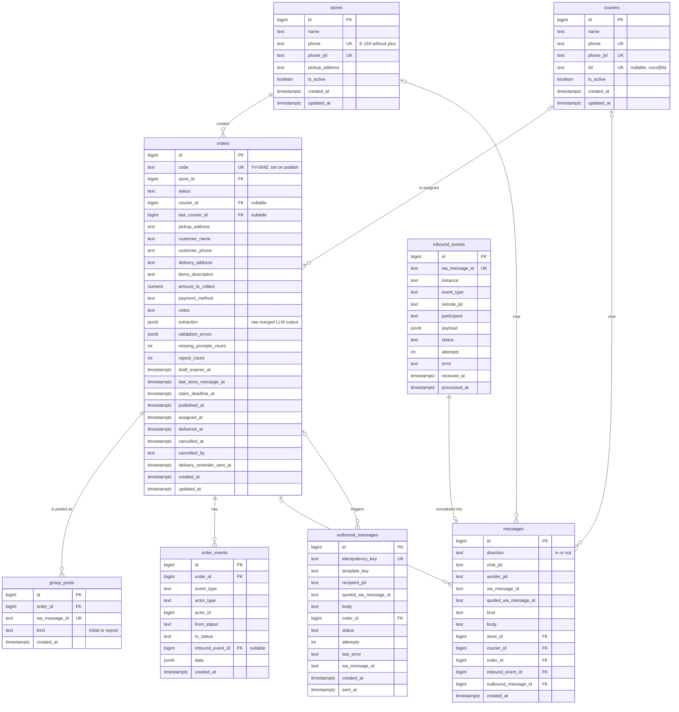

# 05 — Modelo de datos

PostgreSQL 16 es la fuente de verdad: pedidos, borradores (pedidos en estado `draft`), historial de
conversación, auditoría y bandeja de salida. Redis no guarda nada que no pueda reconstruirse.

Decisiones:

- **El borrador es un pedido en estado `draft`**, no una tabla aparte. Evita copiar datos al publicar y
  deja toda la historia del pedido en una sola fila y su `order_events`. Un índice único parcial
  garantiza un solo borrador por local (RN-09).
- **Idempotencia por restricciones únicas**: `inbound_events.wa_message_id`,
  `outbound_messages.idempotency_key`, `group_posts.wa_message_id`.
- **Estados como `text` con `CHECK`** (en lugar de `ENUM` de Postgres), más simple de migrar con Alembic.
- Claves primarias `bigint generated always as identity`. Fechas `timestamptz` en UTC.
- Teléfonos en E.164 sin `+` (`5491155551234`); JID completo aparte cuando hace falta.

## Diagrama entidad-relación



## Tablas

### `stores`

| Columna | Tipo | Restricciones | Notas |
|---------|------|---------------|-------|
| `id` | `bigint` | PK, identity | |
| `name` | `text` | `NOT NULL` | Se muestra a moteros. |
| `phone` | `text` | `NOT NULL`, `UNIQUE` | E.164 sin `+`. |
| `phone_jid` | `text` | `NOT NULL`, `UNIQUE` | `5491155551234@s.whatsapp.net`. |
| `pickup_address` | `text` | `NOT NULL` | Dirección de retiro por defecto. |
| `is_active` | `boolean` | `NOT NULL DEFAULT true` | |
| `created_at`, `updated_at` | `timestamptz` | `NOT NULL DEFAULT now()` | |

### `couriers`

| Columna | Tipo | Restricciones | Notas |
|---------|------|---------------|-------|
| `id` | `bigint` | PK, identity | |
| `name` | `text` | `NOT NULL` | Nombre visible en "Asignado a {name}". |
| `phone` | `text` | `NOT NULL`, `UNIQUE` | Para enviar privados. |
| `phone_jid` | `text` | `NOT NULL`, `UNIQUE` | |
| `lid` | `text` | `UNIQUE`, nullable | Identificador `@lid` en grupos; se completa al resolverse por metadatos del grupo. |
| `is_active` | `boolean` | `NOT NULL DEFAULT true` | |
| `created_at`, `updated_at` | `timestamptz` | `NOT NULL DEFAULT now()` | |

Búsqueda de un participante de grupo: `WHERE lid = :participant OR phone_jid = :participant`
(Evolution puede entregar cualquiera de los dos; si entrega ambos, se usan ambos).

### `orders`

| Columna | Tipo | Restricciones | Notas |
|---------|------|---------------|-------|
| `id` | `bigint` | PK, identity | |
| `code` | `text` | `UNIQUE`, nullable | Se asigna al publicar: `ORDER_CODE_PREFIX` + secuencia `order_code_seq` (`YV-0042`). |
| `store_id` | `bigint` | `NOT NULL`, FK → `stores.id` | |
| `status` | `text` | `NOT NULL`, `CHECK (status IN ('draft','published','assigned','unclaimed','delivered','cancelled','expired'))` | |
| `courier_id` | `bigint` | FK → `couriers.id`, nullable | Motero asignado actual. |
| `last_courier_id` | `bigint` | FK → `couriers.id`, nullable | Último motero que lo tuvo (para cancelaciones y auditoría rápida). |
| `pickup_address` | `text` | nullable | Si es nulo, se usa `stores.pickup_address`. |
| `customer_name` | `text` | nullable | Obligatorio para publicar (validado en código). |
| `customer_phone` | `text` | nullable | Normalizado a E.164. |
| `delivery_address` | `text` | nullable | |
| `items_description` | `text` | nullable | |
| `amount_to_collect` | `numeric(12,2)` | nullable, `CHECK (amount_to_collect >= 0)` | |
| `payment_method` | `text` | nullable, `CHECK (payment_method IN ('cash','transfer','prepaid'))` | |
| `notes` | `text` | nullable | |
| `extraction` | `jsonb` | `NOT NULL DEFAULT '{}'` | Resultado combinado de las extracciones, para depuración. |
| `validation_errors` | `jsonb` | `NOT NULL DEFAULT '[]'` | Última validación: `[{"field": "...", "code": "missing"}]`. |
| `missing_prompts_count` | `int` | `NOT NULL DEFAULT 0` | |
| `repost_count` | `int` | `NOT NULL DEFAULT 0` | |
| `draft_expires_at` | `timestamptz` | nullable | Solo en `draft`. |
| `last_store_message_at` | `timestamptz` | nullable | Para el intervalo de agrupación. |
| `claim_deadline_at` | `timestamptz` | nullable | Solo en `published`. |
| `published_at`, `assigned_at`, `delivered_at`, `cancelled_at` | `timestamptz` | nullable | |
| `cancelled_by` | `text` | nullable, `CHECK (cancelled_by IN ('store','admin'))` | |
| `delivery_reminder_sent_at` | `timestamptz` | nullable | |
| `created_at`, `updated_at` | `timestamptz` | `NOT NULL DEFAULT now()` | |

Restricciones adicionales:

```sql
-- At most one open draft per store (RN-09)
CREATE UNIQUE INDEX orders_one_draft_per_store
    ON orders (store_id) WHERE status = 'draft';

-- courier_id is set only while assigned or delivered
ALTER TABLE orders ADD CONSTRAINT orders_courier_matches_status CHECK (
    (status IN ('assigned', 'delivered')) = (courier_id IS NOT NULL)
);

-- Published orders must have a code
ALTER TABLE orders ADD CONSTRAINT orders_code_when_published CHECK (
    status IN ('draft', 'expired') OR code IS NOT NULL
    OR (status = 'cancelled' AND published_at IS NULL)
);
```

Índices:

| Índice | Uso |
|--------|-----|
| `orders_one_draft_per_store` (único parcial) | Buscar el borrador del local; garantizar uno solo. |
| `(status, claim_deadline_at) WHERE status = 'published'` | Planificador de republicación. |
| `(status, draft_expires_at) WHERE status = 'draft'` | Planificador de vencimiento de borradores. |
| `(courier_id) WHERE status = 'assigned'` | Comando `entregado` sin código; recordatorios. |
| `(store_id, created_at DESC)` | Pedidos activos del local; consultas de administración. |

### `group_posts`

Cada mensaje del bot en el grupo que representa un pedido (publicación inicial y republicaciones).
Las reacciones se resuelven contra esta tabla.

| Columna | Tipo | Restricciones | Notas |
|---------|------|---------------|-------|
| `id` | `bigint` | PK, identity | |
| `order_id` | `bigint` | `NOT NULL`, FK → `orders.id` | |
| `wa_message_id` | `text` | `NOT NULL`, `UNIQUE` | `key.id` devuelto por Evolution al enviar. |
| `kind` | `text` | `NOT NULL`, `CHECK (kind IN ('initial','repost'))` | |
| `created_at` | `timestamptz` | `NOT NULL DEFAULT now()` | |

Índice: `(order_id)`.

### `order_events` (auditoría)

| Columna | Tipo | Restricciones | Notas |
|---------|------|---------------|-------|
| `id` | `bigint` | PK, identity | |
| `order_id` | `bigint` | `NOT NULL`, FK → `orders.id` | |
| `event_type` | `text` | `NOT NULL` | `created`, `draft_updated`, `missing_fields_requested`, `published`, `reposted`, `claimed`, `claim_rejected`, `unclaimed_by_courier`, `unassigned_by_admin`, `marked_unclaimed`, `cancelled`, `delivered`, `expired`, `delivery_reminder_sent`. |
| `actor_type` | `text` | `NOT NULL`, `CHECK (actor_type IN ('store','courier','system','admin'))` | |
| `actor_id` | `bigint` | nullable | Id de `stores` o `couriers` según `actor_type`. |
| `from_status`, `to_status` | `text` | nullable | Nulos si el evento no cambia el estado. |
| `inbound_event_id` | `bigint` | FK → `inbound_events.id`, nullable | Evento que lo originó. |
| `data` | `jsonb` | `NOT NULL DEFAULT '{}'` | Emoji, campos cambiados, motero previo, etc. |
| `created_at` | `timestamptz` | `NOT NULL DEFAULT now()` | |

Índice: `(order_id, created_at)`.

### `inbound_events` (eventos crudos del webhook)

| Columna | Tipo | Restricciones | Notas |
|---------|------|---------------|-------|
| `id` | `bigint` | PK, identity | |
| `wa_message_id` | `text` | `NOT NULL`, `UNIQUE` | `data.key.id` del evento. Una reacción tiene su propio `key.id`; su objetivo está en `reactionMessage.key.id`. Para eventos sin id de mensaje se usa un hash del payload. |
| `instance` | `text` | `NOT NULL` | Instancia de Evolution. |
| `event_type` | `text` | `NOT NULL` | `messages.upsert`, `connection.update`, etc. |
| `remote_jid` | `text` | nullable | Chat (privado o grupo). |
| `participant` | `text` | nullable | Autor dentro de un grupo (`@lid` o número). |
| `payload` | `jsonb` | `NOT NULL` | Payload completo. |
| `status` | `text` | `NOT NULL DEFAULT 'received'`, `CHECK (status IN ('received','processing','processed','ignored','failed'))` | |
| `attempts` | `int` | `NOT NULL DEFAULT 0` | |
| `error` | `text` | nullable | |
| `received_at` | `timestamptz` | `NOT NULL DEFAULT now()` | |
| `processed_at` | `timestamptz` | nullable | |

Índice: `(status, received_at) WHERE status IN ('received','failed')` para el barrido de recuperación.

> **A verificar en la implementación:** si al quitar una reacción WhatsApp reutiliza el mismo `key.id`
> de la reacción original, la deduplicación por `wa_message_id` descartaría la remoción. En ese caso
> la clave única pasa a ser `(wa_message_id, reaction_text)` o un hash de `key.id` + `messageTimestamp`.
> Se confirma con eventos reales al armar el entorno de desarrollo.

### `messages` (historial de conversación)

Vista normalizada de lo que se dijo en cada chat, en ambas direcciones. Sirve para soporte,
depuración y para dar contexto a la extracción.

| Columna | Tipo | Restricciones | Notas |
|---------|------|---------------|-------|
| `id` | `bigint` | PK, identity | |
| `direction` | `text` | `NOT NULL`, `CHECK (direction IN ('in','out'))` | |
| `chat_jid` | `text` | `NOT NULL` | |
| `sender_jid` | `text` | nullable | |
| `wa_message_id` | `text` | nullable | |
| `quoted_wa_message_id` | `text` | nullable | Mensaje citado (para resolver `cancelar` / `entregado` por cita). |
| `kind` | `text` | `NOT NULL` | `text`, `reaction`, `image`, `audio`, `other`. |
| `body` | `text` | nullable | Texto o emoji. |
| `store_id`, `courier_id`, `order_id` | `bigint` | FK, nullable | |
| `inbound_event_id` | `bigint` | FK → `inbound_events.id`, nullable | Si `direction = 'in'`. |
| `outbound_message_id` | `bigint` | FK → `outbound_messages.id`, nullable | Si `direction = 'out'`. |
| `created_at` | `timestamptz` | `NOT NULL DEFAULT now()` | |

Índices: `(chat_jid, created_at)`, `(order_id)`, `(wa_message_id)`.

### `outbound_messages` (bandeja de salida)

| Columna | Tipo | Restricciones | Notas |
|---------|------|---------------|-------|
| `id` | `bigint` | PK, identity | |
| `idempotency_key` | `text` | `NOT NULL`, `UNIQUE` | Ej.: `order:42:claimed:courier:7`, `order:42:repost:2:group`. |
| `template_key` | `text` | `NOT NULL` | Clave del [catálogo](07-catalogo-mensajes.md). |
| `recipient_jid` | `text` | `NOT NULL` | |
| `quoted_wa_message_id` | `text` | nullable | Para responder citando (grupo). |
| `body` | `text` | `NOT NULL` | Texto ya renderizado. |
| `order_id` | `bigint` | FK → `orders.id`, nullable | |
| `status` | `text` | `NOT NULL DEFAULT 'pending'`, `CHECK (status IN ('pending','sending','sent','failed'))` | |
| `attempts` | `int` | `NOT NULL DEFAULT 0` | |
| `last_error` | `text` | nullable | |
| `wa_message_id` | `text` | nullable | `key.id` devuelto por Evolution. |
| `created_at` | `timestamptz` | `NOT NULL DEFAULT now()` | |
| `sent_at` | `timestamptz` | nullable | |

Índices: `(status, created_at) WHERE status IN ('pending','failed')`, `(wa_message_id)` (para resolver citas del local o del motero a mensajes del bot).

## Esquema de extracción (`OrderExtraction`)

El LLM devuelve este modelo Pydantic. Todos los campos son opcionales: el LLM extrae lo que encuentra
y el código decide qué falta.

```python
class PaymentMethod(StrEnum):
    CASH = "cash"
    TRANSFER = "transfer"
    PREPAID = "prepaid"


class OrderExtraction(BaseModel):
    customer_name: str | None = None
    customer_phone: str | None = None
    delivery_address: str | None = None
    pickup_address: str | None = None  # only if different from the store's address
    items_description: str | None = None
    amount_to_collect: Decimal | None = None
    payment_method: PaymentMethod | None = None
    notes: str | None = None
```

La validación (`validate_required_fields`) devuelve una lista de `ValidationIssue(field, code)` con
`code` en `missing` | `invalid_phone` | `invalid_amount` | `payment_mismatch`, que se traduce a texto con el catálogo.
