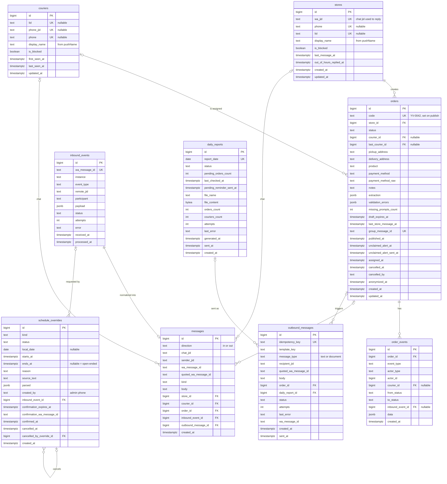

# 05 — Modelo de datos

PostgreSQL 16 es la fuente de verdad: locales, moteros, pedidos, borradores (pedidos en estado
`draft`), cambios de horario, historial de conversación, auditoría, bandeja de salida y reportes diarios. Redis no guarda
nada que no pueda reconstruirse (cola, locks y contadores de límite de frecuencia).

Decisiones:

- **El borrador es un pedido en estado `draft`**, no una tabla aparte. Un índice único parcial garantiza
  un solo borrador por local (RN-09).
- **Una sola publicación por pedido** (no hay republicación): el id del mensaje del grupo se guarda en
  `orders.group_message_id`, con restricción única. No hace falta una tabla `group_posts`.
- **Locales y moteros se dan de alta solos.** Su identidad es el identificador de WhatsApp que llega en
  el evento (JID de número o `@lid`); el número de teléfono es un dato complementario que puede faltar.
- **Idempotencia por restricciones únicas**: `inbound_events.wa_message_id`,
  `outbound_messages.idempotency_key`, `orders.group_message_id`, `daily_reports.report_date`.
- **No hay seguimiento de entrega**: el pedido termina su ciclo útil en `assigned`; no existen columnas de
  retiro ni de entrega.
- **Los cambios de horario son filas, no configuración**: el horario base viene de variables de entorno y
  los cierres del administrador se guardan en `schedule_overrides` con su historial completo.
- **Estados como `text` con `CHECK`** (en lugar de `ENUM` de Postgres), más simple de migrar con Alembic.
- Claves primarias `bigint generated always as identity`. Fechas `timestamptz` en UTC.
- Teléfonos en E.164 sin `+` (`5491155551234`).

## Diagrama entidad-relación



## Tablas

### `stores`

Alta automática con el primer mensaje privado de un remitente que no es administrador ni motero conocido.

| Columna | Tipo | Restricciones | Notas |
|---------|------|---------------|-------|
| `id` | `bigint` | PK, identity | |
| `wa_jid` | `text` | `NOT NULL`, `UNIQUE` | JID del chat privado tal como llega (`5491155551234@s.whatsapp.net` o `xxxx@lid`); se usa para responder. |
| `phone` | `text` | `UNIQUE`, nullable | Número si se puede resolver (del JID o de campos alternativos como `remoteJidAlt`/`senderPn`). |
| `lid` | `text` | `UNIQUE`, nullable | `@lid` si se conoce. |
| `display_name` | `text` | `NOT NULL` | `pushName`; se actualiza cuando cambia. Si llega vacío: `STORE_FALLBACK_NAME` ("Local"). |
| `is_blocked` | `boolean` | `NOT NULL DEFAULT false` | Anti-abuso; se cambia a mano en v1. |
| `last_message_at` | `timestamptz` | nullable | |
| `out_of_hours_replied_at` | `timestamptz` | nullable | Para el límite de frecuencia de `store_out_of_hours`. |
| `created_at`, `updated_at` | `timestamptz` | `NOT NULL DEFAULT now()` | |

Búsqueda del remitente: `WHERE wa_jid = :jid OR lid = :lid OR phone = :phone` (con los valores disponibles).

### `couriers`

Alta automática con la primera reacción a una publicación de pedido.

| Columna | Tipo | Restricciones | Notas |
|---------|------|---------------|-------|
| `id` | `bigint` | PK, identity | |
| `lid` | `text` | `UNIQUE`, nullable | `xxxx@lid`, como suelen llegar los participantes de grupo. |
| `phone_jid` | `text` | `UNIQUE`, nullable | `549...@s.whatsapp.net`, si el evento lo trae (`participant` o `participantAlt`/`senderPn`). |
| `phone` | `text` | `UNIQUE`, nullable | E.164 sin `+`, derivado de `phone_jid`. |
| `display_name` | `text` | `NOT NULL` | `pushName`; se actualiza cuando cambia. Si nunca llegó: `COURIER_FALLBACK_NAME` ("Motero"). |
| `is_blocked` | `boolean` | `NOT NULL DEFAULT false` | |
| `first_seen_at`, `last_seen_at`, `updated_at` | `timestamptz` | `NOT NULL DEFAULT now()` | |

```sql
ALTER TABLE couriers ADD CONSTRAINT couriers_has_identity
    CHECK (lid IS NOT NULL OR phone_jid IS NOT NULL);
```

Resolución de un participante (dentro de la transacción del evento):

1. Se toman todos los identificadores del evento: `key.participant` y los campos alternativos que entregue la versión de Evolution (`participantAlt`, `senderPn`, etc.; se fijan con eventos reales).
2. `SELECT ... WHERE lid = :lid OR phone_jid = :phone_jid FOR UPDATE`.
3. Ninguna fila: `INSERT`. Una fila: completar identificadores faltantes y actualizar `display_name` y `last_seen_at`. Dos filas (la misma persona vista antes una vez por `lid` y otra por número): fusionar en la más antigua, reasignando `orders.courier_id`, `orders.last_courier_id`, `order_events.courier_id` y `messages.courier_id`.

Para enviar privados al motero se usa `phone_jid` si existe; si no, `lid` (ver riesgos en [arquitectura](06-arquitectura.md)).

### `orders`

| Columna | Tipo | Restricciones | Notas |
|---------|------|---------------|-------|
| `id` | `bigint` | PK, identity | |
| `code` | `text` | `UNIQUE`, nullable | Al publicar: `ORDER_CODE_PREFIX` + secuencia `order_code_seq` (`YV-0042`). |
| `store_id` | `bigint` | `NOT NULL`, FK → `stores.id` | |
| `status` | `text` | `NOT NULL`, `CHECK (status IN ('draft','published','assigned','cancelled','expired'))` | |
| `courier_id` | `bigint` | FK → `couriers.id`, nullable | Motero asignado actual. |
| `last_courier_id` | `bigint` | FK → `couriers.id`, nullable | Último motero que lo tuvo (cancelaciones, reporte). |
| `pickup_address` | `text` | nullable | Obligatorio para publicar. Texto libre. |
| `delivery_address` | `text` | nullable | Obligatorio para publicar. Texto libre. |
| `product` | `text` | nullable | Obligatorio para publicar. |
| `payment_method` | `text` | nullable, `CHECK (payment_method IN ('cash','transfer','prepaid','other'))` | Obligatorio para publicar. |
| `payment_method_raw` | `text` | nullable | Texto original ("transferencia"). |
| `notes` | `text` | nullable | |
| `extraction` | `jsonb` | `NOT NULL DEFAULT '{}'` | Resultado combinado de las extracciones, para depuración. |
| `validation_errors` | `jsonb` | `NOT NULL DEFAULT '[]'` | Última validación: `[{"field": "payment_method", "code": "missing"}]`. |
| `missing_prompts_count` | `int` | `NOT NULL DEFAULT 0` | |
| `draft_expires_at` | `timestamptz` | nullable | Solo en `draft`. |
| `last_store_message_at` | `timestamptz` | nullable | Para el intervalo de agrupación. |
| `group_message_id` | `text` | `UNIQUE`, nullable | `key.id` de la publicación en el grupo. |
| `published_at` | `timestamptz` | nullable | |
| `unclaimed_alert_at` | `timestamptz` | nullable | Momento en que corresponde alertar si sigue sin tomar. |
| `unclaimed_alert_sent_at` | `timestamptz` | nullable | No nulo = ya se alertó en este período de publicación. |
| `assigned_at`, `cancelled_at` | `timestamptz` | nullable | |
| `cancelled_by` | `text` | nullable, `CHECK (cancelled_by IN ('store','admin'))` | |
| `anonymized_at` | `timestamptz` | nullable | Retención (RNF-10). |
| `created_at`, `updated_at` | `timestamptz` | `NOT NULL DEFAULT now()` | |

Restricciones adicionales:

```sql
-- At most one open draft per store (RN-09)
CREATE UNIQUE INDEX orders_one_draft_per_store
    ON orders (store_id) WHERE status = 'draft';

-- courier_id is set only while assigned
ALTER TABLE orders ADD CONSTRAINT orders_courier_matches_status CHECK (
    (status = 'assigned') = (courier_id IS NOT NULL)
);

-- Every order that reached the group has a code
ALTER TABLE orders ADD CONSTRAINT orders_code_when_published CHECK (
    published_at IS NULL OR code IS NOT NULL
);
```

Índices:

| Índice | Uso |
|--------|-----|
| `orders_one_draft_per_store` (único parcial) | Buscar el borrador del local; garantizar uno solo. |
| `(unclaimed_alert_at) WHERE status = 'published' AND unclaimed_alert_sent_at IS NULL` | Alerta de pedidos sin tomar. |
| `(draft_expires_at) WHERE status = 'draft'` | Vencimiento de borradores. |
| `(courier_id) WHERE status = 'assigned'` | Resumen por motero. |
| `(store_id, created_at DESC)` | Pedidos activos del local. |
| `(created_at) WHERE status IN ('draft','published')` | Pedidos pendientes que retienen el reporte diario. |
| `(created_at)` | Detalle del reporte diario (pedidos creados en la fecha). |

### `order_events` (auditoría)

| Columna | Tipo | Restricciones | Notas |
|---------|------|---------------|-------|
| `id` | `bigint` | PK, identity | |
| `order_id` | `bigint` | `NOT NULL`, FK → `orders.id` | |
| `event_type` | `text` | `NOT NULL` | `created`, `draft_updated`, `missing_fields_requested`, `published`, `claimed`, `claim_rejected`, `released_by_courier`, `released_by_admin`, `unclaimed_alert_sent`, `cancelled`, `expired`. |
| `actor_type` | `text` | `NOT NULL`, `CHECK (actor_type IN ('store','courier','system','admin'))` | |
| `actor_id` | `bigint` | nullable | Id de `stores` o `couriers` según `actor_type`. |
| `courier_id` | `bigint` | FK → `couriers.id`, nullable | Motero afectado por el evento (base del resumen por motero del reporte). |
| `from_status`, `to_status` | `text` | nullable | Nulos si el evento no cambia el estado. |
| `inbound_event_id` | `bigint` | FK → `inbound_events.id`, nullable | Evento que lo originó. |
| `data` | `jsonb` | `NOT NULL DEFAULT '{}'` | Emoji, campos cambiados, número del admin, etc. |
| `created_at` | `timestamptz` | `NOT NULL DEFAULT now()` | |

Índices: `(order_id, created_at)`, `(created_at, courier_id)` (reporte diario).

Mapeo al resumen del reporte (por `courier_id`, sobre los pedidos creados en la fecha D, RN-19):

| Columna del reporte | Cálculo |
|---------------------|---------|
| Tomados | Pedidos de D con `status = 'assigned'` y `courier_id` = motero |
| Liberados | Eventos `released_by_courier` y `released_by_admin` de pedidos de D con `courier_id` = motero |
| Cancelados | Eventos `cancelled` con `from_status = 'assigned'` de pedidos de D con `courier_id` = motero |

Un motero aparece en el resumen si tiene al menos un valor distinto de cero.

### `inbound_events` (eventos crudos del webhook)

| Columna | Tipo | Restricciones | Notas |
|---------|------|---------------|-------|
| `id` | `bigint` | PK, identity | |
| `wa_message_id` | `text` | `NOT NULL`, `UNIQUE` | `data.key.id` del evento. Una reacción tiene su propio `key.id`; su objetivo está en `reactionMessage.key.id`. Para eventos sin id de mensaje se usa un hash del payload. |
| `instance` | `text` | `NOT NULL` | Instancia de Evolution. |
| `event_type` | `text` | `NOT NULL` | `messages.upsert`, `connection.update`. |
| `remote_jid` | `text` | nullable | Chat (privado o grupo). |
| `participant` | `text` | nullable | Autor dentro de un grupo (`@lid` o número). |
| `payload` | `jsonb` | `NOT NULL` | Payload completo. |
| `status` | `text` | `NOT NULL DEFAULT 'received'`, `CHECK (status IN ('received','processing','processed','ignored','failed'))` | |
| `attempts` | `int` | `NOT NULL DEFAULT 0` | |
| `error` | `text` | nullable | |
| `received_at` | `timestamptz` | `NOT NULL DEFAULT now()` | |
| `processed_at` | `timestamptz` | nullable | |

Índice: `(status, received_at) WHERE status IN ('received','failed')` para el barrido de recuperación.

> **A verificar en la implementación:** si al quitar una reacción WhatsApp reutiliza el mismo `key.id`
> de la reacción original, la deduplicación por `wa_message_id` descartaría la remoción. En ese caso
> la clave única pasa a ser un hash de `key.id` + texto de la reacción + `messageTimestamp`.
> Se confirma con eventos reales al armar el entorno de desarrollo.

### `messages` (historial de conversación)

| Columna | Tipo | Restricciones | Notas |
|---------|------|---------------|-------|
| `id` | `bigint` | PK, identity | |
| `direction` | `text` | `NOT NULL`, `CHECK (direction IN ('in','out'))` | |
| `chat_jid` | `text` | `NOT NULL` | |
| `sender_jid` | `text` | nullable | |
| `wa_message_id` | `text` | nullable | |
| `quoted_wa_message_id` | `text` | nullable | Mensaje citado (para resolver `cancelar` por cita). |
| `kind` | `text` | `NOT NULL` | `text`, `reaction`, `image`, `audio`, `document`, `other`. |
| `body` | `text` | nullable | Texto o emoji. Se anonimiza por retención. |
| `store_id`, `courier_id`, `order_id` | `bigint` | FK, nullable | |
| `inbound_event_id` | `bigint` | FK → `inbound_events.id`, nullable | Si `direction = 'in'`. |
| `outbound_message_id` | `bigint` | FK → `outbound_messages.id`, nullable | Si `direction = 'out'`. |
| `created_at` | `timestamptz` | `NOT NULL DEFAULT now()` | |

Índices: `(chat_jid, created_at)`, `(order_id)`, `(wa_message_id)`.

### `outbound_messages` (bandeja de salida)

| Columna | Tipo | Restricciones | Notas |
|---------|------|---------------|-------|
| `id` | `bigint` | PK, identity | |
| `idempotency_key` | `text` | `NOT NULL`, `UNIQUE` | Ej.: `order:42:claimed:courier:7`, `daily_report:2026-10-09:5491100000000`. |
| `template_key` | `text` | `NOT NULL` | Clave del [catálogo](07-catalogo-mensajes.md). |
| `message_type` | `text` | `NOT NULL DEFAULT 'text'`, `CHECK (message_type IN ('text','document'))` | |
| `recipient_jid` | `text` | `NOT NULL` | |
| `quoted_wa_message_id` | `text` | nullable | Para responder citando (grupo). |
| `body` | `text` | `NOT NULL` | Texto renderizado, o el pie (caption) si es documento. |
| `order_id` | `bigint` | FK → `orders.id`, nullable | |
| `daily_report_id` | `bigint` | FK → `daily_reports.id`, nullable | Si `message_type = 'document'`, el archivo sale de `daily_reports.file_content`. |
| `status` | `text` | `NOT NULL DEFAULT 'pending'`, `CHECK (status IN ('pending','sending','sent','failed'))` | |
| `attempts` | `int` | `NOT NULL DEFAULT 0` | |
| `last_error` | `text` | nullable | |
| `wa_message_id` | `text` | nullable | `key.id` devuelto por Evolution. |
| `created_at` | `timestamptz` | `NOT NULL DEFAULT now()` | |
| `sent_at` | `timestamptz` | nullable | |

Índices: `(status, created_at) WHERE status IN ('pending','failed')`, `(wa_message_id)`.

### `daily_reports`

Un registro por fecha; garantiza que el reporte se genere y envíe una sola vez, y solo cuando no quedan
pedidos pendientes de esa fecha (RN-20).

| Columna | Tipo | Restricciones | Notas |
|---------|------|---------------|-------|
| `id` | `bigint` | PK, identity | |
| `report_date` | `date` | `NOT NULL`, `UNIQUE` | Fecha local (`TZ`) cuyos pedidos cubre el reporte (por `created_at`). |
| `status` | `text` | `NOT NULL`, `CHECK (status IN ('waiting','generating','generated','sent','failed'))` | `waiting`: hay pedidos pendientes de la fecha. |
| `pending_orders_count` | `int` | `NOT NULL DEFAULT 0` | Última cuenta de pendientes. |
| `last_checked_at` | `timestamptz` | nullable | Última verificación de pendientes. |
| `pending_reminder_sent_at` | `timestamptz` | nullable | Recordatorio de `REPORT_PENDING_REMINDER_TIME` enviado (una vez). |
| `file_name` | `text` | nullable | `reporte-ya-voy-2026-10-09.xlsx`. |
| `file_content` | `bytea` | nullable | El archivo (decenas de KB). Se borra por retención. |
| `orders_count`, `couriers_count` | `int` | nullable | |
| `attempts` | `int` | `NOT NULL DEFAULT 0` | |
| `last_error` | `text` | nullable | |
| `generated_at`, `sent_at` | `timestamptz` | nullable | |
| `created_at` | `timestamptz` | `NOT NULL DEFAULT now()` | |

Contenido del archivo:

| Hoja | Columnas |
|------|----------|
| `Resumen` | Motero, Teléfono (vacío si solo se conoce el `@lid`), Tomados, Liberados, Cancelados |
| `Pedidos` | Código, Creado, Asignado (hora de Buenos Aires), Local, Retiro, Entrega, Producto, Medio de pago, Motero, Estado (`assigned` → "Tomado", `cancelled` → "Cancelado") |

Pedidos pendientes que retienen el envío:

```sql
SELECT id, code, status
  FROM orders
 WHERE (created_at AT TIME ZONE :tz)::date = :report_date
   AND status IN ('draft', 'published');
```

Los borradores no tienen código; no se listan en el recordatorio y vencen solos en `DRAFT_TTL_MINUTES`.

### `schedule_overrides` (cambios de horario)

Cada instrucción de horario del administrador, con su interpretación y su ciclo de confirmación
(ver la máquina de estados en [03](03-estados-pedido.md)).

| Columna | Tipo | Restricciones | Notas |
|---------|------|---------------|-------|
| `id` | `bigint` | PK, identity | |
| `kind` | `text` | `NOT NULL`, `CHECK (kind IN ('closed_today','closed_until_further_notice','closed_window','reopen'))` | |
| `status` | `text` | `NOT NULL`, `CHECK (status IN ('pending_confirmation','active','applied','cancelled','rejected','expired','superseded'))` | `applied` solo para `reopen`; `active`/`cancelled` solo para cierres. |
| `local_date` | `date` | nullable | Fecha local afectada (`closed_today`, `closed_window`). Nula en `closed_until_further_notice` y `reopen`. |
| `starts_at` | `timestamptz` | nullable | Inicio concreto del cierre. `closed_today` y `closed_until_further_notice`: momento de confirmación. `closed_window`: fecha + hora de inicio. |
| `ends_at` | `timestamptz` | nullable | Fin concreto. `closed_today`: 24:00 local. `closed_window`: fecha + hora de fin. Nulo = hasta nuevo aviso. |
| `reason` | `text` | nullable | Motivo como frase corta usable tras "por" ("lluvia"). |
| `source_text` | `text` | `NOT NULL` | Mensaje original del administrador. |
| `parsed` | `jsonb` | `NOT NULL` | Salida del LLM (`ScheduleOverrideIntent`), para auditoría. |
| `created_by` | `text` | `NOT NULL` | Número del administrador. |
| `inbound_event_id` | `bigint` | FK → `inbound_events.id`, nullable | |
| `confirmation_expires_at` | `timestamptz` | `NOT NULL` | `created_at + SCHEDULE_CONFIRMATION_TTL_MINUTES`. |
| `confirmation_wa_message_id` | `text` | nullable | Mensaje de confirmación del bot (permite confirmar citándolo). |
| `confirmed_at` | `timestamptz` | nullable | |
| `cancelled_at` | `timestamptz` | nullable | Levantado por un `reopen`. |
| `cancelled_by_override_id` | `bigint` | FK → `schedule_overrides.id`, nullable | El `reopen` que lo levantó. |
| `created_at` | `timestamptz` | `NOT NULL DEFAULT now()` | |

Restricciones e índices:

```sql
-- At most one pending confirmation per admin (RN-21)
CREATE UNIQUE INDEX schedule_overrides_one_pending_per_admin
    ON schedule_overrides (created_by) WHERE status = 'pending_confirmation';

-- Closures must have a start; windows must have a valid end
ALTER TABLE schedule_overrides ADD CONSTRAINT schedule_overrides_period CHECK (
    kind = 'reopen'
    OR status IN ('pending_confirmation', 'rejected', 'expired', 'superseded')
    OR starts_at IS NOT NULL
);
ALTER TABLE schedule_overrides ADD CONSTRAINT schedule_overrides_window CHECK (
    kind <> 'closed_window' OR (ends_at IS NOT NULL AND starts_at < ends_at)
);

-- Effective-hours lookup
CREATE INDEX schedule_overrides_active ON schedule_overrides (starts_at, ends_at)
    WHERE status = 'active';
```

Para `closed_today` y `closed_until_further_notice`, `starts_at` se fija al confirmar (no al pedir), para
que el cierre empiece cuando el administrador lo aprueba.

## Esquema de extracción (`OrderExtraction`)

El LLM devuelve este modelo Pydantic. Todos los campos son opcionales: el LLM extrae lo que encuentra
y el código decide qué falta.

```python
class PaymentMethod(StrEnum):
    CASH = "cash"
    TRANSFER = "transfer"
    PREPAID = "prepaid"
    OTHER = "other"


class OrderExtraction(BaseModel):
    pickup_address: str | None = None
    delivery_address: str | None = None
    product: str | None = None
    payment_method: PaymentMethod | None = None
    payment_method_raw: str | None = None  # original wording, e.g. "transferencia"
    notes: str | None = None
```

Entrada (ejemplo canónico) y salida esperada:

```
📍 Dirección de retiro: casa nogal almendros
📍 Dirección de entrega: el ceibo 2871
🥪 Producto/: almacen
💳Abona: transferencia
```

```json
{
  "pickup_address": "casa nogal almendros",
  "delivery_address": "el ceibo 2871",
  "product": "almacen",
  "payment_method": "transfer",
  "payment_method_raw": "transferencia",
  "notes": null
}
```

Reglas para el prompt y el código:

- El texto se copia tal cual lo escribió el local (sin corregir ni completar direcciones).
- `payment_method`: "efectivo" → `cash`; "transferencia", "transf", "mp", "mercado pago" → `transfer`;
  "pagado", "ya abonó" → `prepaid`; cualquier otro texto → `other` con `payment_method_raw`.
  El código vuelve a normalizar `payment_method_raw` con un diccionario propio y prevalece sobre el LLM.
- `validate_required_fields` devuelve una lista de `ValidationIssue(field, code)`; el único `code` en v1 es
  `missing` (campo nulo o vacío tras quitar espacios).
- Este ejemplo y sus variantes (sin emojis, en una línea, con faltantes) forman parte de los tests de extracción.

## Esquema de interpretación de horario (`ScheduleOverrideIntent`)

El LLM recibe el texto del administrador, la fecha y hora actual en `TZ` y el horario base, y devuelve:

```python
class ScheduleOverrideKind(StrEnum):
    CLOSED_TODAY = "closed_today"
    CLOSED_UNTIL_FURTHER_NOTICE = "closed_until_further_notice"
    CLOSED_WINDOW = "closed_window"
    REOPEN = "reopen"


class ScheduleOverrideIntent(BaseModel):
    kind: ScheduleOverrideKind | None = None  # None = not a schedule instruction
    date: date | None = None  # closed_window only; defaults to today
    start_time: time | None = None  # closed_window only
    end_time: time | None = None  # closed_window only
    reason: str | None = None  # short noun phrase usable after "por", e.g. "lluvia"
```

| Texto del administrador | Salida esperada |
|-------------------------|-----------------|
| "hoy no tomamos pedidos por lluvia" | `{"kind": "closed_today", "reason": "lluvia"}` |
| "hoy no tomamos pedidos hasta nuevo aviso" | `{"kind": "closed_until_further_notice", "reason": null}` |
| "de 15 a 18 no tomaremos pedidos hoy" | `{"kind": "closed_window", "date": "<hoy>", "start_time": "15:00", "end_time": "18:00"}` |
| "ya tomamos pedidos de nuevo" | `{"kind": "reopen"}` |
| "¿cuántos pedidos hubo hoy?" | `{"kind": null}` |

Validación determinística (`validate_schedule_intent`), antes de pedir confirmación:

- `closed_window` requiere `start_time` y `end_time`, con `start_time < end_time`; `date` nula se toma como hoy.
- `date` no puede ser pasada y, si es hoy, `end_time` debe ser posterior a la hora actual.
- La ventana se recorta al horario base; si queda vacía (totalmente fuera de 09:00–23:00), es inválida.
- Horas ambiguas ("de 3 a 6") se interpretan dentro del horario base (15:00–18:00); el resumen de
  confirmación muestra siempre las horas en formato 24 h para que el administrador lo verifique.
- `reopen` solo se propone si hay cierres en vigor; si no, se responde sin pedir confirmación.

